# `FlutterViewController` Architecture Blueprint (Hay)

> **EGM Role:** **Blueprint ("Hay")** — High-level system map, ownership graph, cross-cutting invariants, and routing table for [`FlutterViewController`](../Headers/FlutterViewController.h) and its extracted Swift/Objective-C++ managers.
> **Target Audience:** Human engineers onboarding to the iOS embedder and stateless AI coding agents.
> **Primary Files:**
> - Public API: [`FlutterViewController.h`](../Headers/FlutterViewController.h)
> - Internal Category: [`FlutterViewController_Internal.h`](./FlutterViewController_Internal.h)
> - Implementation: [`FlutterViewController.mm`](./FlutterViewController.mm) (2,336 lines)
> - Unit Tests: [`FlutterViewControllerTest.mm`](./FlutterViewControllerTest.mm)

---

## 1. What Is `FlutterViewController`?

[`FlutterViewController`](../Headers/FlutterViewController.h#L58-L62) is a `UIViewController` subclass that bridges **UIKit's view/window/scene/responder world** to **Flutter's `FlutterEngine` and C++ `PlatformViewIOS`**.

Crucially, `FlutterViewController` **does not run Dart code or own the rendering pipeline itself**—[`FlutterEngine`](./FlutterEngine.mm) owns the C++ `flutter::Shell`, Dart VM isolate, platform channels, and plugins. Instead, `FlutterViewController` is the **UIKit host and coordinator** responsible for:
1. Providing the `CAMetalLayer`/`CAEAGLLayer`-backed [`FlutterView`](./FlutterView.mm) surface and driving its GPU surface lifecycle (`surfaceUpdated:`) across view and scene/app transitions.
2. Translating UIKit geometry (`bounds`, `safeAreaInsets`, rotation transitions, auto-resizable widget constraints, and keyboard spring animations) into `flutter::ViewportMetrics`.
3. Translating UIKit responder events (multi-touch, Apple Pencil, 120Hz ProMotion touch-rate smoothing, trackpad/mouse gestures, and hardware keyboard `UIPress` events) into engine pointer/key packets.
4. Bridging iOS system chrome (`UIWindowScene` orientation locks, status bar, home indicator), user settings (`flutter/settings`), VoiceOver/Semantics (`AccessibilityBridge`), and UIKit state restoration.

### Ongoing Objective-C++ to Swift Modularization (`InternalFlutterSwift`)
Historically, `FlutterViewController.mm` was a monolithic 2,650+ line Objective-C++ file. The iOS embedder is actively extracting self-contained subsystems out of `FlutterViewController.mm` into Swift classes in [`shell/platform/darwin/ios/framework/Source/`](./) (bridged via `InternalFlutterSwift.h` and `InternalFlutterSwiftCommon.h`):
- **[`SplashScreenManager.swift`](./SplashScreenManager.swift) (`FlutterSplashScreenManager`):** Storyboard/XIB launch screen loading, installation, and `0.2s` fade-out removal.
- **[`KeyboardInsetManager.swift`](./KeyboardInsetManager.swift) (`FlutterKeyboardInsetManager`):** Keyboard notification filtering, iPad Slide Over/Stage Manager adjustments, `CASpringAnimation` parameter extraction, and VSync-driven bottom inset interpolation via `FlutterKeyboardInsetManagerDelegate`.
- **[`AccessibilityFeatures.swift`](./AccessibilityFeatures.swift) (`FlutterAccessibilityFeatures`):** UIKit accessibility notification registry and `flutter::AccessibilityFeatureFlag` bitmask computation.
- **[`VSyncClient.swift`](./VSyncClient.swift) (`FlutterVSyncClient`) & [`DisplayLinkManager.swift`](./DisplayLinkManager.swift) (`FlutterDisplayLinkManager`):** Swift `CADisplayLink` VSync scheduling and ProMotion refresh rate queries.
- **[`LaunchEngine.swift`](./LaunchEngine.swift) (`FlutterLaunchEngine`) & [`UIPressProxy.swift`](./UIPressProxy.swift) (`FlutterUIPressProxy`):** Lazy launch engine container for `FlutterAppDelegate` and testable `UIPress`/`UIEvent` Swift wrapper.

---

## 2. Ownership & Memory Graph

> [!IMPORTANT]
> **Why `FlutterEngine` and `PlatformViewIOS` hold `weak` references to `FlutterViewController`:**
> In a standard app, `UIWindow.rootViewController` strongly retains `FlutterViewController`, which strongly retains `_engine` (`FlutterEngine`) and `_flutterView` (`FlutterView`). If `FlutterEngine` or `PlatformViewIOS` strongly retained `FlutterViewController`, dismissing a presented `FlutterViewController` would leak the entire view controller, view hierarchy, and C++ `Shell`.

```mermaid
classDiagram
    direction LR
    class UIWindow {
        +UIViewController rootViewController
    }
    class FlutterViewController {
        +FlutterEngine* _engine (strong)
        +FlutterView* _flutterView (strong)
        +FlutterSplashScreenManager* _splashScreenManager (strong)
        +id~FlutterKeyboardInsetManagerProtocol~ _keyboardInsetManager (strong)
        +FlutterAccessibilityFeatures* _accessibilityFeatures (strong)
        +FlutterDisplayLinkManager* _displayLinkManager (strong)
        +FlutterVSyncClient* _touchRateCorrectionVSyncClient (strong)
        +FlutterKeyboardManager* _keyboardManager (strong)
        +UIScrollView* _scrollView (strong)
        +flutter::ViewportMetrics _viewportMetrics
    }
    class FlutterEngine {
        +FlutterViewController* _viewController (weak)
        +std::unique_ptr~Shell~ _shell
        +FlutterPlatformPlugin* _platformPlugin
        +FlutterTextInputPlugin* _textInputPlugin
        +FlutterRestorationPlugin* _restorationPlugin
    }
    class PlatformViewIOS {
        +FlutterViewController* owner_controller_ (weak)
        +std::unique_ptr~IOSSurface~ ios_surface_
        +AccessibilityBridgePtr accessibility_bridge_
    }
    class FlutterView {
        +id~FlutterViewEngineDelegate~ delegate (weak -> FlutterEngine)
        +BOOL autoResizable
    }

    UIWindow --> "1" FlutterViewController : retains
    FlutterViewController --> "1 (strong)" FlutterEngine : _engine
    FlutterViewController --> "1 (strong)" FlutterView : _flutterView
    FlutterEngine ..> "0..1 (weak)" FlutterViewController : _viewController
    FlutterEngine *-- "1" PlatformViewIOS : via _shell
    PlatformViewIOS ..> "0..1 (weak)" FlutterViewController : owner_controller_
    FlutterView ..> "1 (weak)" FlutterEngine : delegate
```

---

## 3. Global Rules of Engagement (Cross-Cutting Invariants)

Before modifying *any* method in [`FlutterViewController.mm`](./FlutterViewController.mm), keep these 6 file-wide invariants in mind:

1. **Never access `self.view` or `UIScreen.mainScreen` in notifications, getters, or helper methods:**
   Accessing `self.view` before a `UIViewController` is added to a window forces UIKit to synchronously run `loadView` and `viewDidLoad`, causing premature engine launch and plugin setup ([`testDoesntLoadViewInInit`](./FlutterViewControllerTest.mm)). Always use `self.viewIfLoaded`, `self.flutterScreenIfViewLoaded`, and `self.flutterWindowSceneIfViewLoaded` ([`UIViewController+FlutterScreenAndSceneIfLoaded.mm`](./UIViewController+FlutterScreenAndSceneIfLoaded.mm)).
2. **Use `FlutterSharedApplication` instead of `[UIApplication sharedApplication]` or `#if APPLICATION_EXTENSION_API_ONLY`:**
   So that a single compiled `Flutter.framework` binary can run safely in both standard iOS apps and iOS App Extensions, never call `[UIApplication sharedApplication]` directly or introduce `#if APPLICATION_EXTENSION_API_ONLY` macros. Always query [`FlutterSharedApplication.application`](./FlutterSharedApplication.h) / `FlutterSharedApplication.isAvailable` at runtime (`stateIsActive`, `stateIsBackground`, `textScaleFactor`, `performOrientationUpdate:`).
3. **Filter `UIScene` notifications with `shouldHandleSceneNotification:`:**
   In multi-scene environments (iPadOS Split View, Stage Manager, Mac Catalyst, App Extensions), `NSNotificationCenter` broadcasts `UIScene` notifications across all scenes in the process. Every scene notification handler must gate on [`[self shouldHandleSceneNotification:notification]`](file:///usr/local/google/home/louisehsu/.gemini/jetski/brain/f61f8251-c20d-4de6-ae1a-3274b193d650/scratch/flutter_monorepo/engine/src/flutter/shell/platform/darwin/ios/framework/Source/FlutterViewController.mm#L687-L696).
4. **Always guard engine mutations with `self.engine.viewController == self`:**
   A `FlutterEngine` can be detached from ViewController A and attached to ViewController B while ViewController A is still animating offscreen or listening to `NSNotificationCenter`.
5. **Teardown via `FlutterViewControllerWillDealloc`:**
   Because `FlutterEngine` and `PlatformViewIOS` hold `weak` references to `FlutterViewController`, ARC zeroes their weak pointers before `dealloc` body runs. `-[FlutterViewController dealloc]` posts `FlutterViewControllerWillDealloc` so `FlutterEngine` and `PlatformViewIOS` can clean up (and if `allowHeadlessExecution == NO`, destroy the C++ `Shell`).
6. **Never trigger GPU surface creation when the app/scene is backgrounded (`!self.stateIsActive`):**
   UIKit can call `viewDidLayoutSubviews` in the background; creating a Metal/GL surface while inactive crashes the app (`gpusReturnNotPermittedKillClient`).

---

## 4. Subsystem "Peanuts" Routing Table

[`FlutterViewController.mm`](./FlutterViewController.mm) (2,336 lines) is a hub where 8 vertical subsystems meet. Read the specific Peanut for the area you are working on:

| 🥜 Subsystem Peanut | When to Read This | Slice of `FlutterViewController.mm` | Companion Swift / ObjC++ Files Covered |
| :--- | :--- | :--- | :--- |
| **1. [`1_lifecycle_and_surface.md`](./FlutterViewController/1_lifecycle_and_surface.md)** | Debugging engine attach/detach, `takeLaunchEngine`, implicit engine callbacks, `UIScene` multi-window lifecycle, `surfaceUpdated:`, or `dealloc`. | `#L185-L486`, `#L665-L871`, `#L939-L1073`, `#L1389-L1413` | [`LaunchEngine.swift`](./LaunchEngine.swift), [`FlutterSharedApplication.mm`](./FlutterSharedApplication.mm), [`FlutterSceneLifeCycle.mm`](./FlutterSceneLifeCycle.mm), [`FlutterEngine.mm`](./FlutterEngine.mm), [`platform_view_ios.mm`](../../platform_view_ios.mm) |
| **2. [`2_splash_and_first_frame.md`](./FlutterViewController/2_splash_and_first_frame.md)** | Debugging launch screen fade-out, `FlutterSplashScreenManager`, `displayingFlutterUI` KVO, or iOS 14+ debug home-screen launch warning. | `#L173-L178`, `#L340`, `#L500-L552`, `#L576-L663` | [`SplashScreenManager.swift`](./SplashScreenManager.swift), [`SplashScreenManagerTests.swift`](./SplashScreenManagerTests.swift), [`ptrace_check.h`](../../../../../../runtime/ptrace_check.h) |
| **3. [`3_viewport_and_keyboard_inset.md`](./FlutterViewController/3_viewport_and_keyboard_inset.md)** | Debugging safe areas, rotation distortion, `autoResizable` constraints (`FlutterAutoResizeLayoutConstraint`), or keyboard inset animations (`FlutterKeyboardInsetManager`). | `#L873-L906`, `#L1378-L1560`, `#L2307-L2336` | [`KeyboardInsetManager.swift`](./KeyboardInsetManager.swift), [`FlutterView.mm`](./FlutterView.mm), [`VSyncClient.swift`](./VSyncClient.swift), [`spring_animation.mm`](../../../../../../third_party/spring_animation/spring_animation.mm) |
| **4. [`4_pointer_and_gesture_input.md`](./FlutterViewController/4_pointer_and_gesture_input.md)** | Debugging touch events, status-bar tap-to-scroll (`onStatusBarTap`), Apple Pencil tilt/azimuth, 120Hz ProMotion touch-rate smoothing, or trackpad/mouse gestures. | `#L55-L62`, `#L554-L574`, `#L760-L794`, `#L908-L937`, `#L1075-L1376`, `#L2072-L2279` | [`VSyncClient.swift`](./VSyncClient.swift), [`DisplayLinkManager.swift`](./DisplayLinkManager.swift), [`vsync_waiter_ios.mm`](./vsync_waiter_ios.mm) |
| **5. [`5_hardware_keyboard_and_text.md`](./FlutterViewController/5_hardware_keyboard_and_text.md)** | Debugging physical keyboard `UIPress` handling (`FlutterUIPressProxy`), key event propagation, Apple Pencil Scribble, or modal presentation keyboard dismissal. | `#L796-L820`, `#L839-L871`, `#L1562-L1664`, `#L2053-L2070`, `#L2303-L2305` | [`UIPressProxy.swift`](./UIPressProxy.swift), [`FlutterKeyboardManager.mm`](./FlutterKeyboardManager.mm), [`FlutterEmbedderKeyResponder.mm`](./FlutterEmbedderKeyResponder.mm), [`FlutterChannelKeyResponder.mm`](./FlutterChannelKeyResponder.mm), [`FlutterTextInputPlugin.mm`](./FlutterTextInputPlugin.mm) |
| **6. [`6_system_chrome_and_settings.md`](./FlutterViewController/6_system_chrome_and_settings.md)** | Debugging `SystemChrome` orientation locks, status bar style/visibility, home indicator hiding, dark/high-contrast mode, or Dynamic Type `textScaleFactor`. | `#L378-L432`, `#L1666-L1774`, `#L1805-L1960` | [`FlutterPlatformPlugin.mm`](./FlutterPlatformPlugin.mm), [`FlutterSharedApplication.mm`](./FlutterSharedApplication.mm), [`FlutterHourFormat.h`](../../../common/framework/Headers/FlutterHourFormat.h) |
| **7. [`7_accessibility_and_semantics.md`](./FlutterViewController/7_accessibility_and_semantics.md)** | Debugging VoiceOver, Switch Control, Speak Screen, Simulator Accessibility Inspector, `FlutterAccessibilityFeatures`, or 2-finger Z escape. | `#L367`, `#L411-L416`, `#L1775-L1803`, `#L2035-L2037` | [`AccessibilityFeatures.swift`](./AccessibilityFeatures.swift), [`accessibility_bridge.mm`](./accessibility_bridge.mm), [`SemanticsObject.mm`](./SemanticsObject.mm) |
| **8. [`8_navigation_and_restoration.md`](./FlutterViewController/8_navigation_and_restoration.md)** | Debugging initial routes, `pushRoute`/`popRoute`, engine-level deep linking (`sendDeepLinkToFramework:`), or UIKit State Restoration. | `#L46`, `#L301`, `#L488-L499`, `#L831`, `#L2281-L2302` | [`FlutterRestorationPlugin.mm`](./FlutterRestorationPlugin.mm), [`FlutterEngine.mm`](./FlutterEngine.mm), [`FlutterAppDelegate.mm`](./FlutterAppDelegate.mm) |
