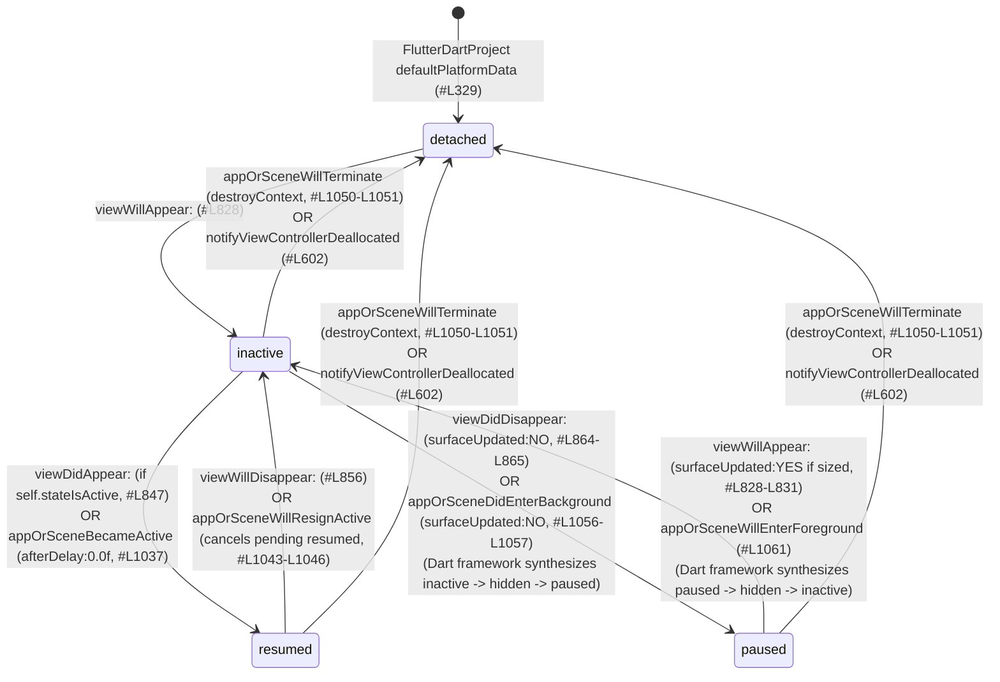

# 🥜 [Peanut #1] Engine Attachment, App Lifecycle & Surface Management

> [!NOTE]
> **Parent Blueprint:** [🌾 `FlutterViewController.md`](../FlutterViewController.md)
> **Scope of this Peanut:** How [`FlutterViewController`](../FlutterViewController.mm) initializes or attaches to a [`FlutterEngine`](../FlutterEngine.mm) (including [`LaunchEngine`](../LaunchEngine.swift) adoption and `UIScene` storyboard launch fallbacks), why [`FlutterView`](../FlutterView.mm) is allocated before `loadView`, how ARC weak-reference teardown works via `FlutterViewControllerWillDealloc`, when Metal GPU rendering surfaces are created and destroyed across `UIViewController` transitions (`surfaceUpdated:`), and how runtime App-Extension detection ([`FlutterSharedApplication`](../FlutterSharedApplication.mm)) and multi-window `UIScene` notification filtering drive the `AppLifecycleState` state machine.
> **Files Covered:**
> - [`FlutterViewController.mm`](../FlutterViewController.mm) (`#L46`, `#L76-L98`, `#L185-L354`, `#L390-L486`, `#L502-L552`, `#L665-L758`, `#L817-L871`, `#L908-L1073`, `#L1389-L1413`)
> - [`FlutterViewController.h`](../../Headers/FlutterViewController.h) (`#L60-L120`, `#L198-L279`) & [`FlutterViewController_Internal.h`](../FlutterViewController_Internal.h) (`#L24-L87`)
> - [`LaunchEngine.swift`](../LaunchEngine.swift) (`#L1-L92`) & [`FlutterAppDelegate.mm`](../FlutterAppDelegate.mm) (`#L29-L44`, `#L245-L267`)
> - [`FlutterSharedApplication.h`](../FlutterSharedApplication.h) (`#L1-L41`) & [`FlutterSharedApplication.mm`](../FlutterSharedApplication.mm) (`#L1-L70`)
> - [`FlutterSceneLifeCycle.mm`](../FlutterSceneLifeCycle.mm) (`#L113-L285`) & [`FlutterPluginAppLifeCycleDelegate.mm`](../FlutterPluginAppLifeCycleDelegate.mm) (`#L121-L144`)
> - [`FlutterEngine.mm`](../FlutterEngine.mm) (`#L174-L379`, `#L408-L413`, `#L559-L647`, `#L1025-L1034`, `#L1515-L1564`)
> - [`platform_view_ios.h`](../../../platform_view_ios.h) (`#L40-L170`) & [`platform_view_ios.mm`](../../../platform_view_ios.mm) (`#L56-L137`, `#L235-L250`)
> - [`FlutterView.mm`](../FlutterView.mm) (`#L123-L196`, `#L317-L347`) & [`rendering_api_selection.mm`](../../../rendering_api_selection.mm) (`#L34-L50`)
> - [`FlutterViewControllerTest.mm`](../FlutterViewControllerTest.mm) (`#L825-L1200`, `#L1700-L1780`, `#L2450-L2750`, `#L3198-L3302`), [`LaunchEngineTests.swift`](../LaunchEngineTests.swift) (`#L1-L47`), & [`FlutterEngineTest.mm`](../FlutterEngineTest.mm) (`#L502-L765`, `#L850-L926`)

---

## 1. Initialization Paths, `LaunchEngine` Adoption & `UIScene` Implicit Engine Fallbacks

### 1.1 The Three Initialization Families (`_engineNeedsLaunch` & `LaunchEngine`)

`FlutterViewController` supports two primary ownership models (introduced in the iOS Embedding Refactor, Commit `2bfb893cf3`, PR `#6447`), controlled by the boolean ivar [`_engineNeedsLaunch`](../FlutterViewController.mm#L84), plus a transitional [`LaunchEngine`](../LaunchEngine.swift#L35-L91) handoff mechanism for Storyboard apps migrating to `UIScene`:

| Initialization Path | Entrypoints in [`FlutterViewController.mm`](../FlutterViewController.mm) | `engine.allowHeadlessExecution` | `_engineNeedsLaunch` | When `Shell` is Created & Launched | When `[engine setViewController:self]` & `attachView` Run |
| :--- | :--- | :---: | :---: | :--- | :--- |
| **Path A: Pre-Warmed / External Engine** | `initWithEngine:nibName:bundle:` ([`#L187-L218`](../FlutterViewController.mm#L187-L218)) | `YES` (default on `FlutterEngine`) | **`NO`** | Caller already created & launched `FlutterEngine` before `init`. | `[engine setViewController:self]` runs in **`initWithEngine:`** ([`#L214`](../FlutterViewController.mm#L214)). Because `self.isViewLoaded == NO`, `PlatformViewIOS::attachView()` is deferred until **`viewDidLoad`** ([`#L755-L757`](../FlutterViewController.mm#L755-L757)). |
| **Path B1: Implicit Engine (Programmatic)** | `init`, `initWithNibName:bundle:`, `initWithProject:nibName:bundle:`, `initWithProject:initialRoute:nibName:bundle:` $\rightarrow$ `sharedSetupWithProject:initialRoute:` ([`#L220-L249`](../FlutterViewController.mm#L220-L249), [`#L264-L342`](../FlutterViewController.mm#L264-L342)) | `self.engineAllowHeadlessExecution` (default **`NO`**) | **`YES`** (unless `nibName != nil` adopts `LaunchEngine`) | `[_engine createShell:nil libraryURI:nil initialRoute:initialRoute]` runs in `sharedSetupWithProject:` ([`#L306`](../FlutterViewController.mm#L306)), **but** Dart isolate launch (`launchEngine:`) is deferred to **`viewDidLoad`** ([`#L750-L754`](../FlutterViewController.mm#L750-L754)). | Both `[self.engine launchEngine:...]` and `[self.engine setViewController:self]` run in **`viewDidLoad`** ([`#L750-L754`](../FlutterViewController.mm#L750-L754)). Since `self.isViewLoaded == YES` inside `viewDidLoad`, `SetOwnerViewController` immediately calls `this->attachView()`. |
| **Path B2: Implicit Engine (Storyboard / XIB)** | `initWithCoder:` ([`#L251-L254`](../FlutterViewController.mm#L251-L254)) $\rightarrow$ `awakeFromNib` ([`#L256-L262`](../FlutterViewController.mm#L256-L262)) $\rightarrow$ `sharedSetupWithProject:nil initialRoute:nil` | `self.engineAllowHeadlessExecution` (configurable in XIB; or `YES` if `LaunchEngine` adopted) | **`YES`** (or **`NO`** if `LaunchEngine` adopted) | If `appDelegate.takeLaunchEngine` returns a pre-running `LaunchEngine` ([`#L273-L277`](../FlutterViewController.mm#L273-L277)), it is already launched and `[engine setViewController:self]` runs in `sharedSetupWithProject:` ([`#L336-L338`](../FlutterViewController.mm#L336-L338)); otherwise `createShell:` runs in **`awakeFromNib`** and `launchEngine:` runs in **`viewDidLoad`**. | If `LaunchEngine` was adopted (`_engineNeedsLaunch == NO`), `setViewController:self` runs in `awakeFromNib` (`#L337`) and `attachView` runs in `viewDidLoad` (`#L757`). Otherwise same as Path B1 (`viewDidLoad`). |

```mermaid
flowchart TD
    subgraph PathA["Path A: Pre-Warmed / External Engine"]
        A1["initWithEngine:nibName:bundle:<br/>(#L187-L218)"] --> A2["FML_CHECK(engine)<br/>_engine = engine<br/>_engineNeedsLaunch = NO"]
        A2 --> A3["If engine.viewController != nil:<br/>FlutterLogger logError:<br/>'Attaching to an engine that is already<br/>attached to a view controller...' (#L194-L203)"]
        A3 --> A4["Allocate _flutterView (#L206)<br/>loadDefaultSplashScreenView (#L210)<br/>performCommonViewControllerInitialization (#L213)"]
        A4 --> A5["[engine setViewController:self] (#L214)<br/>(Attaches immediately in init!)"]
    end

    subgraph PathB["Path B: Implicit Engine (Programmatic vs. Storyboard/Nib)"]
        B1["initWithProject:initialRoute:nibName:bundle:<br/>(#L220-L249, #L264-L266)"] --> B3["sharedSetupWithProject:initialRoute:<br/>(#L268-L342)"]
        B2["initWithCoder: (#L251-L254)<br/>(No-op until awakeFromNib #L256-L262)"] -->|"self.awokenFromNib = YES"| B3
        B3 --> B4{"appDelegate responds to<br/>takeLaunchEngine? (#L272)"}
        B4 -->|"Yes & self.nibName != nil"| B5["Adopt [appDelegate takeLaunchEngine]<br/>_engineNeedsLaunch = NO (#L273-L277)<br/>[engine setViewController:self] (#L336-L338)"]
        B4 -->|"Yes & self.nibName == nil"| B6["Discard [appDelegate takeLaunchEngine]<br/>(Transitions LaunchEngine to .taken)<br/>(#L278-L283)"]
        B4 -->|"No"| B7["Allocate FlutterEngine('io.flutter')<br/>_engineNeedsLaunch = YES (#L285-L296)"]
        B6 --> B7
        B7 --> B8["Allocate _flutterView (#L303)<br/>[_engine createShell:nil libraryURI:nil initialRoute:] (#L306)<br/>[_engine performImplicitEngineCallback] (#L312)"]
        B8 --> B9{"awokenFromNib && performedCallback<br/>&& hasSceneDelegate? (#L326-L329)"}
        B9 -->|"Yes"| B10["Replay sceneFallbackWillFinishLaunchingApplication:<br/>& sceneFallbackDidFinishLaunchingApplication:<br/>(#L330-L332)"]
        B9 -->|"No"| B11["Wait for viewDidLoad (#L742-L758)<br/>to launch/attach engine"]
        B5 --> B11
        B10 --> B11
    end
```



### 1.2 Key Design Decisions in Initialization, `LaunchEngine` & `UIScene` Fallbacks

1. **Why `initWithCoder:` defers `sharedSetupWithProject:` to `awakeFromNib` (Commit `9345347587`, PR `#19458` & Commit `0123541c39`, PR `#23495`):**
   When UIKit unarchives a `FlutterViewController` from a Storyboard or XIB, user-defined runtime attributes (such as `engineAllowHeadlessExecution` or UIKit's `restorationIdentifier`) are applied *after* `initWithCoder:` returns but *before* `awakeFromNib` is called. Deferring `sharedSetupWithProject:nil initialRoute:nil` to `awakeFromNib` ([`#L256-L262`](../FlutterViewController.mm#L256-L262)) ensures `self.engineAllowHeadlessExecution` ([`#L293`](../FlutterViewController.mm#L293)) and `self.restorationIdentifier != nil` ([`#L294`](../FlutterViewController.mm#L294)) have their final XIB-configured values when `FlutterEngine` is allocated. Also, `awakeFromNib` records `self.awokenFromNib = YES` ([`#L258`](../FlutterViewController.mm#L258)) so `sharedSetupWithProject:` knows whether the controller came from a Storyboard/XIB.

2. **Why `LaunchEngine` Exists and Why Programmatic `FlutterViewController`s Discard It ([`LaunchEngine.swift#L35-L91`](../LaunchEngine.swift#L35-L91), [`FlutterAppDelegate.mm#L245-L267`](../FlutterAppDelegate.mm#L245-L267), [`FlutterViewController.mm#L270-L284`](../FlutterViewController.mm#L270-L284)):**
   - In legacy Storyboard apps that have not yet migrated to [`FlutterImplicitEngineDelegate`](../../Headers/FlutterEngine.h#L511), `AppDelegate.application(_:didFinishLaunchingWithOptions:)` calls `[GeneratedPluginRegistrant registerWithRegistry:self]`, invoking [`-[FlutterAppDelegate registrarForPlugin:]`](file:///usr/local/google/home/louisehsu/.gemini/jetski/brain/f61f8251-c20d-4de6-ae1a-3274b193d650/scratch/flutter_monorepo/engine/src/flutter/shell/platform/darwin/ios/framework/Source/FlutterAppDelegate.mm#L245-L263).
   - When an app adopts `UIScene`, `application:didFinishLaunchingWithOptions:` runs *before* the `UIWindowScene` connects and instantiates the root `FlutterViewController` from the Storyboard. Thus `window.rootViewController` is still `nil` when `registrarForPlugin:` is called!
   - To prevent plugin registration from failing or crashing, `FlutterAppDelegate` owns a `@MainActor @objc(FlutterLaunchEngine) final class LaunchEngine` ([`LaunchEngine.swift#L35-L36`](../LaunchEngine.swift#L35-L36)) with a 3-state machine (`.uninitialized` $\rightarrow$ `.created(FlutterEngine)` $\rightarrow$ `.taken`, [`#L39-L48`](../LaunchEngine.swift#L39-L48)). Calling `self.launchEngine.acquireEngine()` ([`#L56-L75`](../LaunchEngine.swift#L56-L75)) lazily creates and runs a `FlutterEngine` (`name: "io.flutter"`, `allowHeadlessExecution: true`, `restorationEnabled: true`).
   - When `FlutterViewController` later runs `sharedSetupWithProject:initialRoute:` ([`#L270-L284`](../FlutterViewController.mm#L270-L284)):
     - **If `self.nibName != nil` ([`#L273-L277`](../FlutterViewController.mm#L273-L277))**: It adopts `engine = [appDelegate takeLaunchEngine]`, sets `engineNeedsLaunch = NO`, and immediately attaches via `[_engine setViewController:self]` ([`#L336-L338`](../FlutterViewController.mm#L336-L338)). This is safe because nib-created view controllers cannot pass a custom `initialRoute` in `init`.
     - **If `self.nibName == nil` ([`#L278-L283`](../FlutterViewController.mm#L278-L283))**: It calls `(void)[appDelegate takeLaunchEngine]` and **intentionally discards** the returned engine! Registering plugins on `FlutterAppDelegate` without a XIB/Storyboard is invalid API usage; calling `takeLaunchEngine` transitions `LaunchEngine.state` to `.taken` ([`LaunchEngine.swift#L84-L90`](../LaunchEngine.swift#L84-L90)), releasing the unused launch engine from memory so it does not leak (verified in [`testGrabLaunchEngine` and `testDoesntGrabLaunchEngine`](../FlutterViewControllerTest.mm#L3280-L3302)).

3. **Implicit Engine Callback (`FlutterImplicitEngineDelegate`) & Storyboard `UIScene` Launch Fallback ([`#L308-L333`](../FlutterViewController.mm#L308-L333), [`FlutterEngine.mm#L1025-L1034`](../FlutterEngine.mm#L1025-L1034), [`FlutterPluginAppLifeCycleDelegate.mm#L121-L144`](../FlutterPluginAppLifeCycleDelegate.mm#L121-L144)):**
   - When `sharedSetupWithProject:initialRoute:` creates a fresh implicit engine (`engineNeedsLaunch == YES`), it calls `[_engine createShell:nil libraryURI:nil initialRoute:initialRoute]` ([`#L306`](../FlutterViewController.mm#L306)) and then invokes `BOOL performedCallback = [_engine performImplicitEngineCallback]` ([`#L312`](../FlutterViewController.mm#L312)) (plus deprecated `appDelegate.pluginRegistrant` if present, [`#L315-L321`](../FlutterViewController.mm#L315-L321)).
   - If `FlutterSharedApplication.application.delegate` conforms to `FlutterImplicitEngineDelegate`, `performImplicitEngineCallback` calls `[provider didInitializeImplicitFlutterEngine:[[FlutterImplicitEngineBridgeImpl alloc] initWithEngine:self]]` ([`FlutterEngine.mm#L1025-L1034`](../FlutterEngine.mm#L1025-L1034)), allowing the host app to register plugins before the Dart isolate launches in `viewDidLoad`.
   - **The Storyboard + `UIScene` Launch Ordering Gap ([`#L326-L333`](../FlutterViewController.mm#L326-L333)):** In a Storyboard app using `UIScene`, `application:willFinishLaunchingWithOptions:` and `application:didFinishLaunchingWithOptions:` fire on `FlutterAppDelegate` *before* the scene connects and unarchives `FlutterViewController` from the Storyboard (`awakeFromNib`). Consequently, plugins registered inside `didInitializeImplicitFlutterEngine:` during `awakeFromNib` missed the `UIApplication` launch events! When `self.awokenFromNib && performedCallback && FlutterSharedApplication.hasSceneDelegate && [appDelegate isKindOfClass:[FlutterAppDelegate class]]`, `FlutterViewController` calls [`sceneFallbackWillFinishLaunchingApplication:`](../FlutterPluginAppLifeCycleDelegate.mm#L121-L131) and [`sceneFallbackDidFinishLaunchingApplication:`](../FlutterPluginAppLifeCycleDelegate.mm#L133-L144), replaying `willFinishLaunchingWithOptions:@{}` and `didFinishLaunchingWithOptions:@{}` once to registered plugins (tested in [`FlutterViewControllerTest.mm#L3198-L3278`](../FlutterViewControllerTest.mm#L3198-L3278)).

4. **Why `initWithEngine:` logs an error if `engine.viewController != nil` (Commit `8a8b298405`, PR `#17186`):**
   A `FlutterEngine` can only be attached to **one** `FlutterViewController` at a time ([`#L194-L203`](../FlutterViewController.mm#L194-L203)). If an app attaches an already-attached engine to a second `FlutterViewController` without first setting `engine.viewController = nil`, `initWithEngine:` logs an error via `[FlutterLogger logError:]` explaining how to detach before re-attaching.

5. **Why `viewDidLoad` uses an `if (self.engine && self.engineNeedsLaunch) ... else if (self.engine.viewController == self)` branch (Commit `fe051e08ac` PR `#16672` & Commit `7fda9c9695` PR `#34642`):**
   - **The Premature `loadView` Bug (`fe051e08ac`, PR `#16672`):** Originally, `PlatformViewIOS::SetOwnerViewController` unconditionally accessed `owner_controller_.view` to create `ios_surface_`. When called from `initWithEngine:` ([`#L214`](../FlutterViewController.mm#L214)), accessing `.view` forced UIKit to synchronously run `loadView` and `viewDidLoad` *inside the initializer* before the subclass or caller finished initializing ([`testDoesntLoadViewInInit`](../FlutterViewControllerTest.mm#L1736-L1745)). PR `#16672` guarded `this->attachView()` inside `PlatformViewIOS::SetOwnerViewController` on `if (owner_controller_ && owner_controller_.isViewLoaded)` ([`platform_view_ios.mm#L84-L86`](../../../platform_view_ios.mm#L84-L86)).
   - **Avoiding Double Attachment (`7fda9c9695`, PR `#34642`):** In `viewDidLoad` ([`FlutterViewController.mm#L749-L758`](../FlutterViewController.mm#L749-L758)):
     - If `self.engineNeedsLaunch == YES`, `viewDidLoad` launches the engine and calls `[self.engine setViewController:self]`. Because `self.isViewLoaded` is already `YES` inside `viewDidLoad`, `SetOwnerViewController` calls `this->attachView(previousFlutterView)` directly.
     - If `self.engineNeedsLaunch == NO` (Path A or adopted `LaunchEngine`), `[engine setViewController:self]` already ran during `init` / `awakeFromNib` when `isViewLoaded` was `NO`, so `viewDidLoad` enters the `else if (self.engine.viewController == self)` branch and calls `[self.engine attachView]` once (validated by [`testViewDidLoadDoesntInvokeEngineAttachViewWhenEngineNeedsLaunch`](../FlutterViewControllerTest.mm#L1123-L1136) and [`testViewDidLoadDoesInvokeEngineWhenIsTheViewController`](../FlutterViewControllerTest.mm#L1110-L1121)).

---

### 1.3 Why `_flutterView` Is Allocated in `init` Instead of `loadView`

Unlike standard `UIViewController` subclasses that allocate their root view lazily inside `-loadView`, `FlutterViewController` allocates `_flutterView` eagerly inside `initWithEngine:` ([`#L206-L208`](../FlutterViewController.mm#L206-L208)) and `sharedSetupWithProject:initialRoute:` ([`#L303-L305`](../FlutterViewController.mm#L303-L305)), storing it in a strong property (`@property(nonatomic, strong) FlutterView* flutterView;`, [`#L77`](../FlutterViewController.mm#L77)) and later assigning `self.view = GetViewOrPlaceholder(self.flutterView, self.engine);` inside `-loadView` ([`#L532-L552`](../FlutterViewController.mm#L532-L552)).

1. **Historical Origin (Commit `58e84c8bf0`, PR `#4932` / `#4998`):**
   When multi-shell support was first introduced, `FlutterViewController` created its `Shell` and `PlatformViewIOS` during `init` and needed `FlutterView`'s backing `CALayer` before `loadView` ran, without touching `self.view` (which would force `loadView` early).
2. **Pre-`loadView` `viewOpaque` Mutation (`#L344-L354`, Commit `427915e2fb` PR `#6570` & `6c2477bd29` PR `#6653`):**
   Because `_flutterView` already exists after `init`, callers can set `flutterViewController.viewOpaque = NO` *before* presenting the view controller without triggering `self.view` / `loadView`:
   ```objc
   - (void)setViewOpaque:(BOOL)value {
     _viewOpaque = value;
     if (self.flutterView.layer.opaque != value) {
       self.flutterView.layer.opaque = value;
       [self.flutterView.layer setNeedsLayout];
     }
   }
   ```
   > [!WARNING]
   > **Performance Landmine (`df562b8e2b` PR `#30664` $\rightarrow$ Reverted in `05d1b5a66b` PR `#31710`):**
   > `_viewOpaque` defaults to `YES` ([`#L193`](../FlutterViewController.mm#L193), [`#L301`](../FlutterViewController.mm#L301)). PR `#30664` attempted to change the default to `NO` so transparent Flutter modals would work out of the box, but it was reverted 6 days later (`#31710`): a non-opaque `CAMetalLayer` forces the iOS WindowServer compositor to alpha-blend the entire full-screen layer every frame, significantly increasing GPU memory bandwidth and power consumption.
3. **Metal-Only Layer Class (`FlutterMetalLayer`) & App-Extension Wide Gamut Guard ([`FlutterView.mm#L123-L196`](../FlutterView.mm#L123-L196), [`rendering_api_selection.mm#L34-L50`](../../../rendering_api_selection.mm#L34-L50)):**
   - Software and legacy OpenGL rendering have been removed on iOS (`GetRenderingAPIForProcess` always returns `IOSRenderingAPI::kMetal`). `+[FlutterView layerClass]` ([`FlutterView.mm#L194-L196`](../FlutterView.mm#L194-L196)) returns [`FlutterMetalLayer`](../FlutterMetalLayer.h) (when `[FlutterMetalLayer enabled]` is true) or `CAMetalLayer`.
   - Passing `enableWideGamut:project.isWideGamutEnabled` (`b93428ef34`, PR `#39111`) allows `-[FlutterView layoutSubviews]` ([`FlutterView.mm#L168-L191`](../FlutterView.mm#L168-L191)) to configure `kCGColorSpaceExtendedSRGB` and `MTLPixelFormatBGRA10_XR` when Display P3 wide gamut is supported—**except inside App Extensions**, where [`-[FlutterView isWideGamutSupported]`](file:///usr/local/google/home/louisehsu/.gemini/jetski/brain/f61f8251-c20d-4de6-ae1a-3274b193d650/scratch/flutter_monorepo/engine/src/flutter/shell/platform/darwin/ios/framework/Source/FlutterView.mm#L123-L136) explicitly returns `NO` (`if (FlutterSharedApplication.isAppExtension) return NO;`, Issue `#165086`) to stay within strict extension memory limits.
4. **iOS 14+ Debug Home-Screen Launch Placeholder (`GetViewOrPlaceholder`, [`#L502-L530`](../FlutterViewController.mm#L502-L530), Commit `f0fb74b8fb` PR `#20980`):**
   On iOS 14+, debug-mode Flutter apps require a debugger (`ptrace`) to allocate JIT executable memory. If a user taps a debug app icon on the iOS home screen, `EnableTracingIfNecessary` inside `-[FlutterEngine createShell:libraryURI:initialRoute:]` ([`FlutterEngine.mm#L259-L266`](../FlutterEngine.mm#L259-L266)) returns `NO`. When UIKit calls `-loadView` ([`#L536`](../FlutterViewController.mm#L536)), `GetViewOrPlaceholder(self.flutterView, self.engine)` checks `if (flutter::GetTracingResult() == flutter::TracingResult::kDisabled && !engine)` and returns a fallback `UIView` containing a full-screen `UILabel` explaining that debug apps must be launched from Xcode or Flutter tooling.

---

## 2. Teardown & The `FlutterViewControllerWillDealloc` Protocol

### 2.1 Why ARC Weak Zeroing Requires `FlutterViewControllerWillDealloc`

To prevent retain cycles between `FlutterViewController` and `FlutterEngine` (fixed in Commit `9004af1341`, PR `#6879`), ownership is strictly one-way:
- `FlutterViewController` holds a **strong** reference to `_engine` ([`FlutterViewController.mm#L79`](../FlutterViewController.mm#L79)).
- `FlutterEngine` holds a **weak** reference to `_viewController` ([`FlutterEngine.mm#L211`](../FlutterEngine.mm#L211)).
- `PlatformViewIOS` holds a **`__weak`** reference to `owner_controller_` ([`platform_view_ios.h#L148`](../../../platform_view_ios.h#L148)).

Under Objective-C ARC (migrated across Commits `6ae2021dd2` PR `#55962`, `3162aaad00` PR `#55669`, and `8c74f3f85e` PR `#55672`), **weak references to an object begin returning `nil` the instant the object's retain count hits zero—before `-dealloc` executes its body.** Furthermore, in add-to-app scenarios where a `FlutterEngine` outlives its `FlutterViewController`, `PlatformViewIOS` and `FlutterEngine` must tear down semantics and view state when the attached `FlutterViewController` is deallocated.

**The Solution (Commit `5075172fe7`, PR `#12232`):**
When `-[FlutterViewController dealloc]` ([`FlutterViewController.mm#L946-L963`](../FlutterViewController.mm#L946-L963)) runs, it calls `[self deregisterNotifications]` ([`#L939-L944`](../FlutterViewController.mm#L939-L944)), which synchronously broadcasts `FlutterViewControllerWillDealloc` with `object:self` on `[NSNotificationCenter defaultCenter]`:

```mermaid
sequenceDiagram
    participant ARC as Objective-C Runtime
    participant FVC as FlutterViewController
    participant NC as NSNotificationCenter
    participant FE as FlutterEngine
    participant PVIOS as PlatformViewIOS

    ARC->>FVC: Retain count == 0 -> -dealloc (#L946)
    FVC->>FVC: [self removeInternalPlugins] (#L949 -> #L817-L819)
    FVC->>NC: postNotificationName:FlutterViewControllerWillDealloc object:self (#L940)
    NC->>FE: flutterViewControllerWillDeallocObserver block (FlutterEngine.mm#L574-L579)
    FE->>FE: -notifyViewControllerDeallocated (#L601-L611)
    FE->>FE: [lifecycleChannel sendMessage:@"AppLifecycleState.detached"] (#L602)
    FE->>FE: textInputPlugin.viewController = nil (#L603)
    alt allowHeadlessExecution == NO (Implicit Engine)
        FE->>FE: [self destroyContext] (#L605 -> #L613-L626)<br/>Resets 14 channels, _shell.reset(), _threadHost.reset()
    else allowHeadlessExecution == YES (Pre-warmed Engine)
        FE->>PVIOS: platformView->SetOwnerViewController({}) (#L607)
        PVIOS->>PVIOS: NotifyDestroyed(), ios_surface_.reset(), accessibility_bridge_->SetViewController(nil, previousFlutterView)
    end
    FE->>FE: [textInputPlugin resetViewResponder]; _viewController = nil (#L609-L610)
    NC->>PVIOS: dealloc_view_controller_observer_ block (platform_view_ios.mm#L73-L81)
    PVIOS->>PVIOS: accessibility_bridge_->SetViewController(nil, deallocatingView); owner_controller_ = nil
    FVC->>NC: removeObserver:self (#L943)
    FVC->>FVC: [keyboardInsetManager invalidate] & invalidateTouchRateCorrectionVSyncClient (#L952-L953)
    FVC->>FVC: Clear _scrollView.delegate & 5 gesture recognizer delegates (#L957-L962)
```

### 2.2 Detailed Teardown Invariants in `FlutterEngine` & `PlatformViewIOS`

1. **Why `FlutterEngine` checks `else if (self.platformView)` in `notifyViewControllerDeallocated` (Commit `6641c74a91`, PR `#41037`):**
   In [`FlutterEngine.mm#L604-L608`](../FlutterEngine.mm#L604-L608):
   ```objc
   if (!self.allowHeadlessExecution) {
     [self destroyContext];
   } else if (self.platformView) {
     self.platformView->SetOwnerViewController({});
   }
   ```
   If an app with `allowHeadlessExecution == YES` explicitly called `[engine destroyContext]` (or `applicationWillTerminate:` called it) *before* `FlutterViewController` was deallocated, `_shell` is already `nullptr`. Checking `else if (self.platformView)` prevents a null-pointer dereference when `FlutterViewController` later deallocates in the background.
2. **Why `destroyContext` manually nils out all 14 channels (`resetChannels`, [`FlutterEngine.mm#L613-L647`](../FlutterEngine.mm#L613-L647)):**
   Each `FlutterMethodChannel` / `FlutterBasicMessageChannel` holds a reference to `self.binaryMessenger` (`FlutterBinaryMessengerRelay`), and method call handlers capture weak/strong state. Calling `[self resetChannels]` before `_shell.reset()` and `_threadHost.reset()` ensures no channel traffic or C++ `Shell` callbacks can fire after the `Shell` and its `ThreadHost` threads are torn down.
3. **Why `PlatformViewIOS::SetOwnerViewController` Captures `FlutterView* deallocatingView` at Observer Registration Time ([`platform_view_ios.mm#L68-L82`](../../../platform_view_ios.mm#L68-L82)):**
   When `FlutterViewController` begins deallocating, `owner_controller_` (a `__weak` pointer) is already `nil` when the `FlutterViewControllerWillDealloc` notification block runs! By capturing `FlutterView* deallocatingView = [owner_controller_ flutterView];` (`#L71`) *when registering the observer* inside `SetOwnerViewController`, `PlatformViewIOS` can still pass `deallocatingView` into `accessibility_bridge_->SetViewController(nil, deallocatingView)` (`#L77`) so the `AccessibilityBridge` stays alive on headless engines and cleanly detaches from the deallocating view.

---

## 3. View Hierarchy Lifecycle & GPU Surface Management (`surfaceUpdated:`)

### 3.1 Two-Phase Surface Architecture: `IOSSurface` vs. `NotifyCreated()`

On iOS, attaching a `FlutterView` to the engine and creating its active GPU rendering surface are deliberately split into two phases:

| Phase | Method | Thread | What It Does | Why It Is Separated |
| :--- | :--- | :---: | :--- | :--- |
| **Phase 1: Layer & Accessibility Binding** | `PlatformViewIOS::attachView(FlutterView* previousView)` ([`platform_view_ios.mm#L98-L114`](../../../platform_view_ios.mm#L98-L114)) | Platform (Main) | Extracts `flutter_view.layer` (`FlutterMetalLayer` / `CAMetalLayer`), constructs `ios_surface_ = IOSSurface::Create(ios_context_, ca_layer)`, ensures `AccessibilityBridge` exists, calls `accessibility_bridge_->SetViewController(owner_controller_, previousView)`, and posts `FlutterSemanticsUpdateNotification` if semantics updates arrived while headless. | Runs once per `FlutterViewController` in `viewDidLoad` (or in `SetOwnerViewController` if the view was already loaded). **Does not allocate GPU framebuffers yet** ([`platform_view_ios.mm#L87-L90`](../../../platform_view_ios.mm#L87-L90)), because `self.view.bounds` may still be `CGRectZero` (`_viewportMetrics.physical_width == 0`), which would create an incomplete `0x0` framebuffer. |
| **Phase 2: Raster Surface Activation / Teardown** | `-[FlutterViewController surfaceUpdated:(BOOL)appeared]` ([`FlutterViewController.mm#L720-L738`](../FlutterViewController.mm#L720-L738)) | Platform $\leftrightarrow$ Raster (Sync) | **If `appeared == YES`:**<br/>1. `[self installFirstFrameCallback]`<br/>2. Sets `platformViewsController.flutterView = self.flutterView` & `.flutterViewController = self`<br/>3. Calls `[self.engine notifyViewCreated]` $\rightarrow$ `PlatformView::NotifyCreated()`, which synchronously hops to the Raster thread and calls `PlatformViewIOS::CreateRenderingSurface()` (`ios_surface_->CreateGPUSurface(...)`).<br/><br/>**If `appeared == NO`:**<br/>1. `self.displayingFlutterUI = NO`<br/>2. Calls `[self.engine notifyViewDestroyed]` $\rightarrow$ `PlatformView::NotifyDestroyed()` (synchronously tears down the Raster thread `Surface`)<br/>3. Clears `platformViewsController.flutterView = nil` & `.flutterViewController = nil`. | Allows the Metal GPU `Surface` (`GPUSurfaceMetalImpeller`) to be torn down whenever the view disappears (`viewDidDisappear:`) or the app/scene enters the background (`appOrSceneDidEnterBackground`), and recreated when returning (`viewWillAppear:` / `appOrSceneBecameActive`), without detaching `FlutterViewController` from `FlutterEngine`. |

> [!IMPORTANT]
> **Thread-Safety Invariant on `ios_surface_` (Commit `362e3fe586`, PR `#12775`):**
> In [`platform_view_ios.h#L149-L152`](../../../platform_view_ios.h#L149-L152), `ios_surface_` is protected by `std::mutex ios_surface_mutex_`. `PlatformViewIOS::SetOwnerViewController` acquires `ios_surface_mutex_` on the **Platform thread** ([`#L60`](../../../platform_view_ios.mm#L60)) while `PlatformViewIOS::CreateRenderingSurface()` acquires `ios_surface_mutex_` on the **Raster thread** ([`#L129`](../../../platform_view_ios.mm#L129)).

---

### 3.2 `UIViewController` Appearance Lifecycle & Surface Timing

```mermaid
flowchart TD
    A["-loadView (#L532-L552)<br/>self.view = GetViewOrPlaceholder(self.flutterView, self.engine)<br/>Install splashScreenView & status-bar UIScrollView"] --> B["-viewDidLoad (#L742-L794)"]
    B --> B1{"_engineNeedsLaunch?"}
    B1 -- "YES (initWithProject:)" --> B2["[engine launchEngine:...]<br/>[engine setViewController:self]<br/>(Calls PlatformViewIOS::attachView)"]
    B1 -- "NO (initWithEngine: / LaunchEngine)" --> B3{"engine.viewController == self?"}
    B3 -- "YES" --> B4["[engine attachView]<br/>(Calls PlatformViewIOS::attachView)"]
    B2 --> B5["[self addInternalPlugins]<br/>[self setUpKeyboardSpringAnimationIfNeeded]<br/>[self createTouchRateCorrectionVSyncClientIfNeeded]<br/>Install iOS 13.4+ mouse/trackpad gesture recognizers"]
    B4 --> B5
    B3 -- "NO" --> B5

    B5 --> C["-viewWillAppear: (#L821-L837)<br/>Guarded by: self.engine.viewController == self"]
    C --> C1["[self onUserSettingsChanged:nil]<br/>(Sends brightness/contrast/textScaleFactor)"]
    C1 --> C2{"_viewportMetrics.physical_width > 0<br/>&& self.stateIsActive?"}
    C2 -- "NO (1st appearance)" --> C3["Skip surfaceUpdated:YES<br/>(Defer to viewDidLayoutSubviews)"]
    C2 -- "YES (Subsequent appearance)" --> C4["[self surfaceUpdated:YES] (#L831)"]
    C3 --> C5["Send AppLifecycleState.inactive<br/>[restorationPlugin markRestorationComplete]"]
    C4 --> C5

    C5 --> D["-viewDidLayoutSubviews (#L1389-L1413)<br/>Update _viewportMetrics & send to engine"]
    D --> D1{"firstViewBoundsUpdate &&<br/>self.stateIsActive && self.engine?"}
    D1 -- "YES (1st layout)" --> D2["[self surfaceUpdated:YES] (#L1411)<br/>(No longer blocks main thread with waitForFirstFrameSync:!)"]
    D1 -- "NO" --> E

    D2 --> E["-viewDidAppear: (#L839-L850)<br/>Guarded by: self.engine.viewController == self"]
    E --> E1["[self onUserSettingsChanged:nil]<br/>[self onAccessibilityStatusChanged:nil]<br/>If self.stateIsActive -> Send AppLifecycleState.resumed (#L845-L847)"]

    E1 --> F["-viewWillDisappear: (#L852-L858)<br/>Guarded by: self.engine.viewController == self<br/>Send AppLifecycleState.inactive"]
    F --> G["-viewDidDisappear: (#L860-L871)<br/>Guarded by: self.engine.viewController == self<br/>1. [keyboardInsetManager hideKeyboardImmediately]<br/>2. [self surfaceUpdated:NO]<br/>3. Send AppLifecycleState.paused<br/>4. [self flushOngoingTouches]<br/>5. [self.engine notifyLowMemory]"]
```



#### Critical Engineering Invariants Across Appearance Callbacks

1. **Why First-Time Surface Creation Happens in `viewDidLayoutSubviews`, While Subsequent Appearances Happen in `viewWillAppear:` (Commit `cafbd9b0b5`, PR `#3934`):**
   - Originally, `surfaceUpdated:YES` was called in `viewDidAppear:` and `surfaceUpdated:NO` in `viewWillDisappear:`. That meant during a `UINavigationController` push/pop swipe transition, the Flutter view had no rendering surface until the transition animation completely finished!
   - PR `#3934` (`cafbd9b0b5`) extended Flutter's drawing window to `viewWillAppear:` $\leftrightarrow$ `viewDidDisappear:`:
      - On **initial presentation**, `viewWillAppear:` runs before AutoLayout sizes `self.view.bounds`, so `_viewportMetrics.physical_width` is `0`. Creating the surface before the viewport is sized causes a blank/unattached framebuffer (`platform_view_ios.mm#L87-L90`). Therefore, `viewWillAppear:` checks `if (_viewportMetrics.physical_width && self.stateIsActive)` ([`#L830`](../FlutterViewController.mm#L830)) and lets `viewDidLayoutSubviews` ([`#L1410-L1412`](../FlutterViewController.mm#L1410-L1412)) perform the very first `[self surfaceUpdated:YES]` right after sending the first non-zero `_viewportMetrics`.
      - On **subsequent appearances** (e.g., popping a native `UIViewController` off the navigation stack to reveal `FlutterViewController` again), `_viewportMetrics.physical_width` is already populated, so `viewWillAppear:` immediately calls `[self surfaceUpdated:YES]` ([`#L831`](../FlutterViewController.mm#L831)) before the pop animation begins.
      - **Removal of `waitForFirstFrameSync:` in `viewDidLayoutSubviews` ([`#L1410-L1412`](../FlutterViewController.mm#L1410-L1412)):** Previously, `viewDidLayoutSubviews` followed `[self surfaceUpdated:YES]` with a synchronous `100ms`/`200ms` main-thread wait (`[self.engine waitForFirstFrameSync:...]`). That synchronous block has been completely removed from `FlutterViewController.mm` and `FlutterEngine.mm`.
2. **Why Every Appearance Callback Gates on `if (self.engine.viewController == self)` (Commit `0e8f89cd71` PR `#18816` & Commit `f181517303` PR `#28658`):**
   - **The Shared-Engine Freeze Bug (`0e8f89cd71`, PR `#18816`):** Suppose `viewControllerA` and `viewControllerB` share a single `FlutterEngine`. When navigating from `viewControllerA` to `viewControllerB`, `viewControllerB` attaches itself (`engine.viewController = viewControllerB`) and UIKit runs `viewControllerB`'s `viewWillAppear:` **before** running `viewControllerA`'s `viewDidDisappear:`. Before PR `#18816`, `viewControllerA`'s `viewDidDisappear:` unconditionally called `[self surfaceUpdated:NO]` and sent `"AppLifecycleState.paused"`, which destroyed the GPU surface that `viewControllerB` had just created and froze `viewControllerB`'s UI!
   - **The Redundant `surfaceUpdated:YES` Bug (`f181517303`, PR `#28658`):** Extended the `if (self.engine.viewController == self)` check to `viewWillAppear:`, `viewDidAppear:`, and `viewWillDisappear:` so a detached `FlutterViewController` never triggers `surfaceUpdated:YES`, `onUserSettingsChanged:`, or `AppLifecycleState` transitions on an engine it no longer controls.
3. **Why `viewDidDisappear:` Calls `[self flushOngoingTouches]` ([`#L866`](../FlutterViewController.mm#L866), [`#L908-L937`](../FlutterViewController.mm#L908-L937), Commit `8b74cba20b` PR `#8400`):**
   If a user is holding a finger on the screen while `FlutterViewController` is dismissed or covered by another view controller, UIKit may not deliver `touchesCancelled:withEvent:` before the view controller disappears. `flushOngoingTouches` iterates over every active touch device ID recorded in `self.ongoingTouches`, synthesizes a `flutter::PointerData::Change::kCancel` packet for each one, clears `self.ongoingTouches`, and dispatches the packet to the engine so Dart gesture arenas cleanly cancel instead of sticking in a permanent drag/down state.
4. **Why `viewDidDisappear:` and `setViewController:nil` Call `[self.engine notifyLowMemory]` ([`#L867`](../FlutterViewController.mm#L867), [`FlutterEngine.mm#L582`](../FlutterEngine.mm#L582), Commit `eab9b7f2a4` PR `#19289`):**
   In add-to-app applications, pushing a memory-intensive native `UIViewController` on top of `FlutterViewController` (or detaching `FlutterViewController` from `FlutterEngine`) often caused iOS Jetsam to terminate the app before emitting `UIApplicationDidReceiveMemoryWarningNotification`. Calling `[self.engine notifyLowMemory]` in `viewDidDisappear:` and when `engine.viewController` is set to `nil` proactively invokes `_shell->NotifyLowMemoryWarning()` and sends `{"type": "memoryPressure"}` over `flutter/system`.

---

## 4. Runtime App-Extension Detection (`FlutterSharedApplication`), Multi-Window `UIScene` Filtering & `AppLifecycleState`

### 4.1 Why `FlutterSharedApplication` Replaced `#if APPLICATION_EXTENSION_API_ONLY`

iOS App Extensions (such as Share Extensions, Action Extensions, or Widgets) forbid calling `[UIApplication sharedApplication]` (`NS_EXTENSION_UNAVAILABLE_IOS`). Previously (Commit `d5f6b007c7`, PR `#43449`), `FlutterViewController` and `FlutterEngine` used compile-time `#if APPLICATION_EXTENSION_API_ONLY` guards, which required separate framework builds for extensions vs. host apps.

On current `master`, compile-time guards have been replaced with **runtime** detection in [`FlutterSharedApplication`](../FlutterSharedApplication.mm#L14-L70):
- [`+[FlutterSharedApplication isAppExtension]`](file:///usr/local/google/home/louisehsu/.gemini/jetski/brain/f61f8251-c20d-4de6-ae1a-3274b193d650/scratch/flutter_monorepo/engine/src/flutter/shell/platform/darwin/ios/framework/Source/FlutterSharedApplication.mm#L16-L21) checks `[NSBundle.mainBundle objectForInfoDictionaryKey:@"NSExtension"] != nil`.
- [`+[FlutterSharedApplication isAvailable]`](file:///usr/local/google/home/louisehsu/.gemini/jetski/brain/f61f8251-c20d-4de6-ae1a-3274b193d650/scratch/flutter_monorepo/engine/src/flutter/shell/platform/darwin/ios/framework/Source/FlutterSharedApplication.mm#L23-L25) returns `!self.isAppExtension`.
- [`+[FlutterSharedApplication application]`](file:///usr/local/google/home/louisehsu/.gemini/jetski/brain/f61f8251-c20d-4de6-ae1a-3274b193d650/scratch/flutter_monorepo/engine/src/flutter/shell/platform/darwin/ios/framework/Source/FlutterSharedApplication.mm#L27-L32) returns `nil` inside an App Extension without touching `UIApplication`, or calls `FlutterSharedApplication.sharedApplication` (the only method marked `NS_EXTENSION_UNAVAILABLE_IOS`, [`#L34-L37`](../FlutterSharedApplication.mm#L34-L37)) in a standard app.

In [`-[FlutterViewController setUpNotificationCenterObservers]`](file:///usr/local/google/home/louisehsu/.gemini/jetski/brain/f61f8251-c20d-4de6-ae1a-3274b193d650/scratch/flutter_monorepo/engine/src/flutter/shell/platform/darwin/ios/framework/Source/FlutterViewController.mm#L390-L486) and [`-[FlutterEngine setUpLifecycleNotifications:]`](file:///usr/local/google/home/louisehsu/.gemini/jetski/brain/f61f8251-c20d-4de6-ae1a-3274b193d650/scratch/flutter_monorepo/engine/src/flutter/shell/platform/darwin/ios/framework/Source/FlutterEngine.mm#L334-L359), both classes branch at runtime on `FlutterSharedApplication.isAvailable`:

| Lifecycle Event | Host App (`FlutterSharedApplication.isAvailable == YES`, [`#L461-L486`](../FlutterViewController.mm#L461-L486)) | App Extension (`FlutterSharedApplication.isAvailable == NO`, [`#L434-L459`](../FlutterViewController.mm#L434-L459)) | Shared `FlutterViewController` Handler ([`#L1032-L1064`](../FlutterViewController.mm#L1032-L1064)) | Companion `FlutterEngine` Action ([`FlutterEngine.mm#L1517-L1564`](../FlutterEngine.mm#L1517-L1564)) |
| :--- | :--- | :--- | :--- | :--- |
| **Will Enter Foreground** | `UIApplicationWillEnterForegroundNotification` | `UISceneWillEnterForegroundNotification` | `appOrSceneWillEnterForeground` ([`#L1060`](../FlutterViewController.mm#L1060)) | `flutterWillEnterForeground:` $\rightarrow$ `[self setIsGpuDisabled:NO]` (`_shell->SetGpuAvailability(kAvailable)`) |
| **Did Become Active** | `UIApplicationDidBecomeActiveNotification` | `UISceneDidActivateNotification` | `appOrSceneBecameActive` ([`#L1032`](../FlutterViewController.mm#L1032)) | — |
| **Will Resign Active** | `UIApplicationWillResignActiveNotification` | `UISceneWillDeactivateNotification` | `appOrSceneWillResignActive` ([`#L1042`](../FlutterViewController.mm#L1042)) | — |
| **Did Enter Background** | `UIApplicationDidEnterBackgroundNotification` | `UISceneDidEnterBackgroundNotification` | `appOrSceneDidEnterBackground` ([`#L1054`](../FlutterViewController.mm#L1054)) | `flutterDidEnterBackground:` $\rightarrow$ `[self setIsGpuDisabled:YES]` (`_shell->SetGpuAvailability(kUnavailable)`) + `[self notifyLowMemory]`. |
| **Will Terminate / Disconnect** | `UIApplicationWillTerminateNotification` | `UISceneDidDisconnectNotification` | `appOrSceneWillTerminate` ([`#L1049`](../FlutterViewController.mm#L1049)) | — |

Similarly:
- [`-[FlutterViewController stateIsActive]`](file:///usr/local/google/home/louisehsu/.gemini/jetski/brain/f61f8251-c20d-4de6-ae1a-3274b193d650/scratch/flutter_monorepo/engine/src/flutter/shell/platform/darwin/ios/framework/Source/FlutterViewController.mm#L669-L677) and [`stateIsBackground`](../FlutterViewController.mm#L679-L685) check `FlutterSharedApplication.application`: if non-nil, they query `flutterApplication.applicationState` ([`isApplicationStateMatching:withApplication:`](../FlutterViewController.mm#L698-L706)); if nil (in an App Extension), they query `self.flutterWindowSceneIfViewLoaded.activationState` ([`isSceneStateMatching:`](../FlutterViewController.mm#L708-L716)).
- [`-[FlutterEngine updateGpuAvailabilityFromLifecycleState]`](file:///usr/local/google/home/louisehsu/.gemini/jetski/brain/f61f8251-c20d-4de6-ae1a-3274b193d650/scratch/flutter_monorepo/engine/src/flutter/shell/platform/darwin/ios/framework/Source/FlutterEngine.mm#L317-L332) (Issue `#190835`) reads `application.applicationState == UIApplicationStateBackground` when `FlutterSharedApplication.application` is available, or `scene.activationState == UISceneActivationStateBackground` when in an App Extension with an attached `UIWindowScene`. Crucially, if `scene == nil` in an App Extension (e.g. when `engine.viewController` is detached), it leaves `isGpuDisabled` **unmodified** so a backgrounded extension engine never accidentally re-enables the GPU and crashes.

---

### 4.2 Multi-Window & Auxiliary Keyboard `UIScene` Filtering (`shouldHandleSceneNotification:`)

Because `UIScene*` observers are registered with `object:nil` at `init` time (before `self.view` is attached to a `UIWindowScene`), `NSNotificationCenter` delivers scene notifications for **all** scenes in the process—including secondary windows and, on iOS 27 Beta (Issue `#187844`), out-of-process/auxiliary system keyboard scenes that post `UISceneDidEnterBackgroundNotification` independently of the host window scene.

To prevent an unrelated scene's background transition from tearing down the active `FlutterViewController`'s surface (`surfaceUpdated:NO`) or disabling the engine's GPU (`isGpuDisabled = YES`), [`-[FlutterViewController shouldHandleSceneNotification:]`](file:///usr/local/google/home/louisehsu/.gemini/jetski/brain/f61f8251-c20d-4de6-ae1a-3274b193d650/scratch/flutter_monorepo/engine/src/flutter/shell/platform/darwin/ios/framework/Source/FlutterViewController.mm#L687-L696) filters every `scene*:` callback ([`#L993-L1030`](../FlutterViewController.mm#L993-L1030)) and `FlutterEngine` scene notification ([`FlutterEngine.mm#L361-L364`](../FlutterEngine.mm#L361-L364), [`#L1517-L1529`](../FlutterEngine.mm#L1517-L1529)):

```objc
- (BOOL)shouldHandleSceneNotification:(NSNotification*)notification {
  if (notification.object == nil) {
    return YES;
  }
  UIWindowScene* scene = self.flutterWindowSceneIfViewLoaded;
  if (scene == nil) {
    return YES;
  }
  return notification.object == scene;
}
```
Furthermore, when a `FlutterView` moves between windows (`-[FlutterView willMoveToWindow:]`, [`FlutterView.mm#L317-L347`](../FlutterView.mm#L317-L347)), it automatically registers or unregisters its `FlutterEngine` with the window scene's [`FlutterPluginSceneLifeCycleDelegate`](../FlutterSceneLifeCycle.mm#L113-L285) (`addFlutterManagedEngine:` / `removeFlutterManagedEngine:`).

---

### 4.3 The Complete `AppLifecycleState` State Machine & Subtle Invariants

The iOS embedder initializes `PlatformData.lifecycle_state` to `"AppLifecycleState.detached"` ([`FlutterDartProject.mm#L329`](../FlutterDartProject.mm#L329)) and sends string messages over `flutter/lifecycle` (`"AppLifecycleState.inactive"`, `"AppLifecycleState.resumed"`, `"AppLifecycleState.paused"`, `"AppLifecycleState.detached"`). (Dart's `WidgetsBinding` synthesizes intermediate `AppLifecycleState.hidden` transitions between `inactive` and `paused`.)



1. **Why `surfaceUpdated:NO` (and `setIsGpuDisabled:YES`) Wait Until `DidEnterBackground` Instead of `WillResignActive` (Commit `1a6eda5c34`, PR `#25196`):**
   iOS puts an app into `UIApplicationStateInactive` whenever Notification Center, Control Center, a system permission alert, or the multitasking switcher is shown over the app. `appOrSceneWillResignActive` ([`#L1042-L1047`](../FlutterViewController.mm#L1042-L1047)) *only* transitions to `"AppLifecycleState.inactive"` while keeping the rendering surface alive and the GPU enabled; `surfaceUpdated:NO` and `setIsGpuDisabled:YES` wait until `appOrSceneDidEnterBackground` ([`#L1054-L1058`](../FlutterViewController.mm#L1054-L1058)).
2. **Why `appOrSceneBecameActive` Defers `AppLifecycleState.resumed` with `afterDelay:0.0f` (Commit `c2ec683c4e`, PR `#44947`, Issue `#130055`):**
   When locking an iPhone, iOS occasionally emits a transient `DidBecomeActive` followed in the same runloop turn by `WillResignActive` and `DidEnterBackground`. In [`appOrSceneBecameActive`](../FlutterViewController.mm#L1032-L1040), `[self surfaceUpdated:YES]` runs synchronously, while `[self performSelector:@selector(goToApplicationLifecycle:) withObject:@"AppLifecycleState.resumed" afterDelay:0.0f]` defers `"AppLifecycleState.resumed"` to the next runloop turn so `appOrSceneWillResignActive` ([`#L1042-L1047`](../FlutterViewController.mm#L1042-L1047)) can cancel it via `cancelPreviousPerformRequestsWithTarget:`.
3. **Why `goToApplicationLifecycle:` Checks `if (self.viewIfLoaded.window)` ([`#L1066-L1072`](../FlutterViewController.mm#L1066-L1072)):**
   Avoids forcing `loadView` when notifications arrive before presentation, and prevents offscreen `FlutterViewController` instances from sending conflicting `AppLifecycleState` messages.
4. **Why `appOrSceneWillTerminate` Explicitly Calls `[self.engine destroyContext]` ([`#L1049-L1052`](../FlutterViewController.mm#L1049-L1052), Commit `09ce0bd7f2` PR `#29295`):**
   UIKit does not guarantee root view controller deallocation before `exit()`; explicitly calling `[self.engine destroyContext]` stops background Raster/UI/IO threads before C++ static destructors run.

---

## 5. Test Coverage Matrix

When modifying any code in this subsystem, run `ios_debug_sim_unittests` and check these tests across [`FlutterViewControllerTest.mm`](../FlutterViewControllerTest.mm), [`LaunchEngineTests.swift`](../LaunchEngineTests.swift), and [`FlutterEngineTest.mm`](../FlutterEngineTest.mm):

| Test File & Method | Lines | Invariant Verified |
| :--- | :--- | :--- |
| `FlutterViewControllerTest.mm` `testViewDidDisappearDoesntPauseEngineWhenNotTheViewController` | [`#L850-L864`](../FlutterViewControllerTest.mm#L850-L864) | Detached `FlutterViewController` does not call `surfaceUpdated:NO` or send `AppLifecycleState.paused` in `viewDidDisappear:` (`#18816`). |
| `FlutterViewControllerTest.mm` `testAppWillTerminateViewDidDestroyTheEngine` | [`#L866-L878`](../FlutterViewControllerTest.mm#L866-L878) | `applicationWillTerminate:` sends `AppLifecycleState.detached` and calls `[engine destroyContext]` (`#29295`). |
| `FlutterViewControllerTest.mm` `testViewDidLoadDoesInvokeEngineWhenIsTheViewController` & `...WhenEngineNeedsLaunch` | [`#L1110-L1136`](../FlutterViewControllerTest.mm#L1110-L1136) | Verifies single `attachView` execution across `initWithEngine:` vs `_engineNeedsLaunch == YES` (`#34642`). |
| `FlutterViewControllerTest.mm` `testWillDeallocNotification` & `testDoesntLoadViewInInit` | [`#L1700-L1745`](../FlutterViewControllerTest.mm#L1700-L1745) | Deallocating `FlutterViewController` posts `FlutterViewControllerWillDealloc` (`#12232`), and `initWithEngine:` does not prematurely trigger `loadView` (`#16672`). |
| `FlutterViewControllerTest.mm` `testLifeCycleNotification*` & `testLifeCycleNotificationCancelledInvalidResumed` | [`#L2480-L2696`](../FlutterViewControllerTest.mm#L2480-L2696) | Verifies runtime `FlutterSharedApplication` (`UIScene*` vs `UIApplication*`) routing, `surfaceUpdated:` calls, and same-runloop cancellation of `AppLifecycleState.resumed` (`#44947`). |
| `FlutterViewControllerTest.mm` `testLifeCycleNotificationSceneDidEnterBackgroundIgnoresOtherScenes` | [`#L2698-L2743`](../FlutterViewControllerTest.mm#L2698-L2743) | `shouldHandleSceneNotification:` ignores `UISceneDidEnterBackgroundNotification` from unrelated `UIWindowScene`s or keyboard scenes (`#187844`). |
| `FlutterViewControllerTest.mm` `testSceneFallbackForStoryboard Warmup` & `testGrabLaunchEngine` / `testDoesntGrabLaunchEngine` | [`#L3198-L3302`](../FlutterViewControllerTest.mm#L3198-L3302) | Verifies `UIScene` storyboard launch fallback replay and `LaunchEngine` adoption (`nibName != nil`) vs. disposal (`nibName == nil`). |
| `LaunchEngineTests.swift` `testAcquireEngine` & `testTakeEngine` | [`#L11-L46`](../LaunchEngineTests.swift#L11-L46) | Verifies 3-state `LaunchEngine` state machine (`.uninitialized` $\rightarrow$ `.created` $\rightarrow$ `.taken`). |
| `FlutterEngineTest.mm` `testGpuStateSetBeforeRunIsAppliedToShell` & `testGpuStateIsPreservedWhenLifecycleStateIsUnknown` | [`#L619-L765`](../FlutterEngineTest.mm#L619-L765) | Verifies `updateGpuAvailabilityFromLifecycleState` across host apps and App Extensions (`#190835`). |
