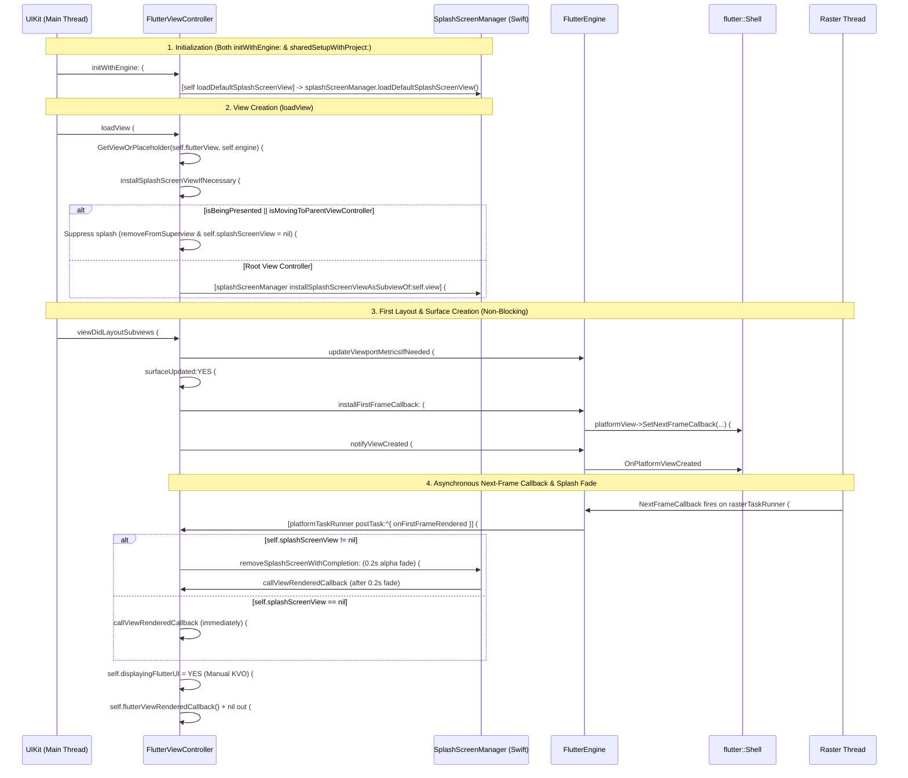
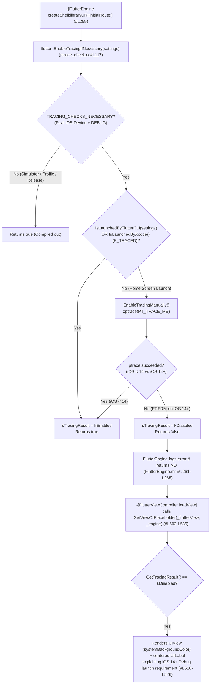

# 🥜 [Peanut #2] Splash Screen, First-Frame Waiting & Launch Diagnostics

> [!NOTE]
> **Parent Blueprint:** [🌾 `FlutterViewController.md`](../FlutterViewController.md)
> **Scope of this Peanut:** How [`FlutterViewController`](../FlutterViewController.mm) and [`FlutterEngine`](../FlutterEngine.mm) bridge iOS app launch into the first rendered Flutter frame—covering why synchronous main-thread first-frame waiting (`waitForFirstFrameSync:`) was removed, how the two remaining asynchronous first-frame pipelines work (`installFirstFrameCallback:` vs. the non-blocking main-queue race in `waitForFirstFrame:callback:`), the Swift extraction of [`SplashScreenManager`](../SplashScreenManager.swift) (exception-free Storyboard/XIB loading, modal/child suppression, and `0.2s` fade-out), manual KVO for `displayingFlutterUI`, one-shot `flutterViewRenderedCallback`, and the iOS 14+ untethered debug launch placeholder (`GetViewOrPlaceholder` & `ptrace_check`).
> **Files Covered:**
> - [`FlutterViewController.mm`](../FlutterViewController.mm) (`#L80`, `#L166`, `#L173-L218`, `#L297-L340`, `#L502-L552`, `#L578-L663`, `#L720-L738`, `#L1389-L1413`)
> - [`SplashScreenManager.swift`](../SplashScreenManager.swift) (`#L1-L125`) & [`SplashScreenManagerTests.swift`](../SplashScreenManagerTests.swift) (`#L1-L105`)
> - [`FlutterEngine.mm`](../FlutterEngine.mm) (`#L259-L266`, `#L442-L461`, `#L1599-L1632`, `#L1696-L1723`) & [`FlutterEngine_Internal.h`](../FlutterEngine_Internal.h) (`#L41-L144`)
> - [`ptrace_check.h`](../../../../../../../runtime/ptrace_check.h) (`#L1-L73`) & [`ptrace_check.cc`](../../../../../../../runtime/ptrace_check.cc) (`#L1-L149`)
> - [`FlutterViewControllerTest.mm`](../FlutterViewControllerTest.mm) (`#L1138-L1145`, `#L2472-L2476`), [`FlutterEngineTest.mm`](../FlutterEngineTest.mm) (`#L373-L384`, `#L1041-L1096`), [`FlutterAppDelegateTest.mm`](../FlutterAppDelegateTest.mm) (`#L26-L70`), and [`ScenariosTests/FlutterViewControllerTest.m`](../../../../../../../testing/ios_scenario_app/ios/Scenarios/ScenariosTests/FlutterViewControllerTest.m) (`#L35-L111`)

---

## 1. Mental Model: The Two First-Frame Pipelines (and the Removal of `waitForFirstFrameSync:`)

### 1.1 Historical Evolution: From Three Pipelines to Two Non-Blocking Pipelines

Historically, `FlutterViewController` and `FlutterEngine` coordinated around the first frame using **three** mechanisms—two of which blocked a thread on `Shell::WaitForFirstFrame` (`waiting_for_first_frame_condition_`):
1. **Removed — Synchronous Layout Wait (`waitForFirstFrameSync:`):** Previously, [`viewDidLayoutSubviews`](../FlutterViewController.mm#L1389-L1413) blocked the main (platform) thread for up to `200ms` in Debug / `100ms` in Profile & Release (Commits `9776043ea5` PR `#9506`, `0dc86cda19` PR `#19592`, `9b51e30a4d` PR `#57151`) after calling `[self surfaceUpdated:YES]`. On current `master`, **`waitForFirstFrameSync:` has been completely removed** from `FlutterViewController.mm` and `FlutterEngine.mm`: `viewDidLayoutSubviews` simply calls `[self surfaceUpdated:YES]` ([`#L1411`](../FlutterViewController.mm#L1411)) without stalling UIKit's main thread.
2. **Rewritten — Asynchronous Deep-Link Wait (`-[FlutterEngine waitForFirstFrame:callback:]`):** Previously, `waitForFirstFrame:callback:` spawned a `QOS_CLASS_BACKGROUND` GCD block that blocked on `_shell->WaitForFirstFrame(waitTime)`, which required a `dispatch_group_t` + main-queue strong retention dance to prevent `FlutterEngine` from being deallocated on a background thread when the last reference dropped during the wait (Commit `06240d4493`, PR `#55966`, Issue `#156177`). On current `master`, `waitForFirstFrame:callback:` ([`FlutterEngine.mm#L1599-L1632`](../FlutterEngine.mm#L1599-L1632)) has been rewritten as a **pure, non-blocking main-queue race** between `_shell->AddFirstFrameCallback` and `dispatch_after`.

### 1.2 Side-by-Side Comparison of the Two Active First-Frame Pipelines

| Dimension | Pipeline A: Next-Frame Raster Callback (`installFirstFrameCallback`) | Pipeline B: Main-Queue First-Frame Race (`waitForFirstFrame:callback:`) |
| :--- | :--- | :--- |
| **Entry Point** | [`-[FlutterViewController installFirstFrameCallback]`](file:///usr/local/google/home/louisehsu/.gemini/jetski/brain/f61f8251-c20d-4de6-ae1a-3274b193d650/scratch/flutter_monorepo/engine/src/flutter/shell/platform/darwin/ios/framework/Source/FlutterViewController.mm#L631-L639) (from [`surfaceUpdated:YES`](../FlutterViewController.mm#L727-L731)) $\rightarrow$ [`-[FlutterEngine installFirstFrameCallback:]`](file:///usr/local/google/home/louisehsu/.gemini/jetski/brain/f61f8251-c20d-4de6-ae1a-3274b193d650/scratch/flutter_monorepo/engine/src/flutter/shell/platform/darwin/ios/framework/Source/FlutterEngine.mm#L442-L461) | [`-[FlutterEngine waitForFirstFrame:callback:]`](file:///usr/local/google/home/louisehsu/.gemini/jetski/brain/f61f8251-c20d-4de6-ae1a-3274b193d650/scratch/flutter_monorepo/engine/src/flutter/shell/platform/darwin/ios/framework/Source/FlutterEngine.mm#L1599-L1632) (called by [`-[FlutterEngine sendDeepLinkToFramework:completionHandler:]`](file:///usr/local/google/home/louisehsu/.gemini/jetski/brain/f61f8251-c20d-4de6-ae1a-3274b193d650/scratch/flutter_monorepo/engine/src/flutter/shell/platform/darwin/ios/framework/Source/FlutterEngine.mm#L1696-L1723)) |
| **Underlying C++ Primitive** | `PlatformView::SetNextFrameCallback` $\rightarrow$ `Rasterizer::SetNextFrameCallback` | `Shell::AddFirstFrameCallback` |
| **Thread & Blocking Behavior** | **Non-blocking:** fires on `rasterTaskRunner` after the next frame draws, then posts [`onFirstFrameRendered`](../FlutterViewController.mm#L620-L629) to `platformTaskRunner` ([`FlutterEngine.mm#L457-L459`](../FlutterEngine.mm#L457-L459)). | **Non-blocking:** both `_shell->AddFirstFrameCallback` and `dispatch_after` dispatch onto `dispatch_get_main_queue()` ([`FlutterEngine.mm#L1622-L1631`](../FlutterEngine.mm#L1622-L1631)). No background thread is ever spawned. |
| **Timeout / Duration** | No timeout; runs a **`0.2s` fade-out** if `splashScreenView != nil` before firing `callViewRenderedCallback`. | **`3.0s`** (`3000ms`) timeout for deep-link delivery. |
| **Lifecycle Scope** | Re-armed on **every** `surfaceUpdated:YES` (`viewDidLayoutSubviews`, subsequent `viewWillAppear:`, `appOrSceneBecameActive`). | Armed per deep link (`pushRouteInformation`) received via [`FlutterAppDelegate`](../FlutterAppDelegate.mm#L168-L171) or [`FlutterSceneLifeCycle`](../FlutterSceneLifeCycle.mm#L463-L466). |



---

## 2. Swift `SplashScreenManager` Architecture & Lifecycle

On current `master`, splash screen resolution, view installation, and fade-out removal have been extracted from `FlutterViewController.mm` into the Swift class [`SplashScreenManager`](../SplashScreenManager.swift#L11-L124) (`@objc(FlutterSplashScreenManager)`), lazily created by [`-[FlutterViewController splashScreenManager]`](file:///usr/local/google/home/louisehsu/.gemini/jetski/brain/f61f8251-c20d-4de6-ae1a-3274b193d650/scratch/flutter_monorepo/engine/src/flutter/shell/platform/darwin/ios/framework/Source/FlutterViewController.mm#L173-L178).

### 2.1 Exception-Free Resolution of `UILaunchStoryboardName`
**Where:** [`SplashScreenManager.swift#L56-L90`](../SplashScreenManager.swift#L56-L90), forwarded by [`FlutterViewController.mm#L649-L651`](../FlutterViewController.mm#L649-L651)

Historically, Objective-C `loadDefaultSplashScreenView` called `[UIStoryboard storyboardWithName:...]` and `[NSBundle loadNibNamed:...]` inside `@try / @catch (NSException*)` blocks to handle missing `.storyboardc` or `.nib` resources (Commit `540cd96262`, PR `#6289`). Because **Swift cannot catch Objective-C `NSException`s**, `SplashScreenManager` pre-validates bundle paths before instantiating UIKit objects:

1. **Plist Lookup (`#L57-L59`):** Reads `bundle.infoDictionary?["UILaunchStoryboardName"] as? String`. If `nil`, returns `false` (`NO`) immediately (preserving Commit `49ef4adad3`, PR `#6234`).
   - *Sharp Edge:* Only inspects `UILaunchStoryboardName`; does not synthesize views from iOS 14+'s declarative `UILaunchScreen` / `UILaunchScreens` dictionary keys.
2. **Pre-Checked Storyboard Resolution (`splashScreenFromStoryboard(name:)`, `#L73-L80`):**
   ```swift
   private func splashScreenFromStoryboard(name: String) -> UIView? {
     guard bundle.path(forResource: name, ofType: "storyboardc") != nil else {
       return nil
     }
     let storyboard = UIStoryboard(name: name, bundle: bundle)
     return storyboard.instantiateInitialViewController()?.view
   }
   ```
3. **Pre-Checked XIB/Nib Fallback (`splashScreenFromXib(name:)`, `#L83-L90`):**
   ```swift
   private func splashScreenFromXib(name: String) -> UIView? {
     guard bundle.path(forResource: name, ofType: "nib") != nil else {
       return nil
     }
     let nib = UINib(nibName: name, bundle: bundle)
     return nib.instantiate(withOwner: nil, options: nil).first as? UIView
   }
   ```
4. **Dependency-Injected `Bundle` for Unit Testing (`#L43-L51`):** `SplashScreenManager` accepts `@objc init(bundle: Bundle = .main)`, allowing [`SplashScreenManagerTests.swift`](../SplashScreenManagerTests.swift#L13-L104) to inject a `MockBundle` without swizzling `NSBundle.mainBundle`.

### 2.2 Both Initializer Families Now Call `loadDefaultSplashScreenView`
**Where:** [`initWithEngine:nibName:bundle:` (`#L210`)](../FlutterViewController.mm#L210) and [`sharedSetupWithProject:initialRoute:` (`#L340`)](../FlutterViewController.mm#L340)

Note an important change on current `master`: both `initWithEngine:nibName:bundle:` ([`#L210`](../FlutterViewController.mm#L210)) and `sharedSetupWithProject:initialRoute:` ([`#L340`](../FlutterViewController.mm#L340)) call `[self loadDefaultSplashScreenView]`. Why doesn't this flash the launch screen during in-app modal or push navigation when using a pre-warmed engine? Because of the root-view-controller check in `installSplashScreenViewIfNecessary`!

### 2.3 Modal & Child ViewController Suppression (`installSplashScreenViewIfNecessary`)
**Where:** [`FlutterViewController.mm#L578-L593`](../FlutterViewController.mm#L578-L593) (called from [`loadView` at `#L537`](../FlutterViewController.mm#L537))

```objc
- (void)installSplashScreenViewIfNecessary {
  // Show the launch screen view only if the FlutterViewController is the root view controller.
  // Look into the documentation for isBeingPresented and isMovingToParentViewController to see how
  // canonical the check is.
  if (self.splashScreenView && (self.isBeingPresented || self.isMovingToParentViewController)) {
    [self.splashScreenView removeFromSuperview];
    self.splashScreenView = nil;
    return;
  }

  [self.splashScreenManager installSplashScreenViewAsSubviewOf:self.view];
}
```
- **Design Intent (Commit `f187a5c219`, PR `#3956`):** The default splash screen exists to maintain visual continuity with iOS's system launch screen when `FlutterViewController` is the `UIWindow`'s `rootViewController` at cold start (where both `isBeingPresented` and `isMovingToParentViewController` are `NO`).
- If `FlutterViewController` is presented modally (`isBeingPresented == YES`) or pushed onto a `UINavigationController` / embedded as a child VC (`isMovingToParentViewController == YES`), `installSplashScreenViewIfNecessary` removes and nils out `self.splashScreenView`.
- Otherwise, [`installSplashScreenViewAsSubviewOf:`](../SplashScreenManager.swift#L118-L123) sets `splashScreenView.frame = parentView.bounds` and calls `parentView.addSubview(splashScreenView)`.

### 2.4 `splashScreenView` Setter & UAF / Recursion Prevention in `removeSplashScreen(completion:)`
**Where:** [`SplashScreenManager.swift#L26-L38`](../SplashScreenManager.swift#L26-L38), [`#L96-L113`](../SplashScreenManager.swift#L96-L113)

```swift
  @objc var splashScreenView: UIView? {
    get { return _splashScreenView }
    set {
      guard newValue !== _splashScreenView else {
        return
      }
      if let newView = newValue {
        _splashScreenView = newView
        newView.autoresizingMask = [.flexibleWidth, .flexibleHeight]
      } else {
        removeSplashScreen(completion: nil)
      }
    }
  }

  @objc(removeSplashScreenWithCompletion:)
  func removeSplashScreen(completion: (() -> Void)?) {
    guard let splashScreen = _splashScreenView else {
      completion?()
      return
    }

    _splashScreenView = nil
    UIView.animate(
      withDuration: Self.defaultAnimationDuration,
      animations: {
        splashScreen.alpha = 0
      },
      completion: { _ in
        splashScreen.removeFromSuperview()
        completion?()
      })
  }
```
Three critical invariants live in `SplashScreenManager`:
1. **Immediate Completion When `_splashScreenView == nil` (`#L98-L101`):** If no splash screen is present, `removeSplashScreen(completion:)` invokes `completion?()` synchronously and returns without starting a `0.2s` animation.
2. **Direct Storage Clearing (`_splashScreenView = nil`, `#L103`):** Setting `self.splashScreenView = nil` would re-invoke the `splashScreenView` setter (`#L35`) and recurse infinitely (Commit `0ecb793e1d`, PR `#9952`).
3. **Strong Local Binding `guard let splashScreen = _splashScreenView` Before Clearing `_splashScreenView` (Commit `260d979726`, PR `#34496`):**
   If `splashScreenView` was assigned before `loadView` added it to a superview, `_splashScreenView` is its sole owner. Binding `let splashScreen` strongly in Swift before setting `_splashScreenView = nil` guarantees the `UIView` stays alive across the `0.2s` fade animation (`Self.defaultAnimationDuration`, `#L15`), preventing a use-after-free crash (`#34496`, verified by [`testSplashScreenViewRemoveNotCrash`](../FlutterViewControllerTest.mm#L1138-L1145) and [`SplashScreenManagerTests.swift#L72-L103`](../SplashScreenManagerTests.swift#L72-L103)).

---

## 3. Non-Blocking Deep-Link First-Frame Race (`-[FlutterEngine waitForFirstFrame:callback:]`)

**Where:** [`FlutterEngine.mm#L1599-L1632`](../FlutterEngine.mm#L1599-L1632), [`#L1696-L1723`](../FlutterEngine.mm#L1696-L1723)

When iOS delivers a Universal Link or custom URL scheme (`application:continueUserActivity:restorationHandler:` or `application:openURL:options:` in [`FlutterAppDelegate.mm#L168-L171`](../FlutterAppDelegate.mm#L168-L171), or scene URL/userActivity callbacks in [`FlutterSceneLifeCycle.mm#L463-L466`](../FlutterSceneLifeCycle.mm#L463-L466)), [`-[FlutterEngine sendDeepLinkToFramework:completionHandler:]`](file:///usr/local/google/home/louisehsu/.gemini/jetski/brain/f61f8251-c20d-4de6-ae1a-3274b193d650/scratch/flutter_monorepo/engine/src/flutter/shell/platform/darwin/ios/framework/Source/FlutterEngine.mm#L1696-L1723) waits up to **`3.0s`** for the first frame before invoking `pushRouteInformation` on `navigationChannel` (Commit `25bb31ef68` PR `#21336` & `2ed204e425` PR `#22356`).

Examine how [`-[FlutterEngine waitForFirstFrame:callback:]`](file:///usr/local/google/home/louisehsu/.gemini/jetski/brain/f61f8251-c20d-4de6-ae1a-3274b193d650/scratch/flutter_monorepo/engine/src/flutter/shell/platform/darwin/ios/framework/Source/FlutterEngine.mm#L1599-L1632) is implemented on current `master`:

```objc
- (void)waitForFirstFrame:(NSTimeInterval)timeout
                 callback:(void (^_Nonnull)(BOOL didTimeout))callback {
  // Set up a completion handler that will nil itself out when it fires.
  __block void (^completion)(BOOL) = [callback copy];
  void (^complete)(BOOL) = ^(BOOL didTimeout) {
    if (completion) {
      void (^cb)(BOOL) = completion;
      completion = nil;
      cb(didTimeout);
    }
  };

  if (!_shell) {
    // No shell. Bail out since there'll never be a first frame.
    dispatch_async(dispatch_get_main_queue(), ^{
      complete(YES);
    });
    return;
  }

  // Register the first-frame callback and fire the timeout completion handler.
  // Both are scheduled on the main thread to guarantee ordering.
  // The winner nils out the completion handler so the loser is a no-op.
  _shell->AddFirstFrameCallback([complete] {
    dispatch_async(dispatch_get_main_queue(), ^{
      complete(NO);
    });
  });

  dispatch_after(dispatch_time(DISPATCH_TIME_NOW, (int64_t)(timeout * NSEC_PER_SEC)),
                 dispatch_get_main_queue(), ^{
                   complete(YES);
                 });
}
```

### Why This Design Is Superior to the Legacy `QOS_CLASS_BACKGROUND` Condition-Variable Wait
1. **Zero Background Thread Retention of `FlutterEngine` (Eliminates Issue `#156177` by Construction):**
   Neither `_shell->AddFirstFrameCallback` nor `dispatch_after` captures `self` (`FlutterEngine*`), and `sendDeepLinkToFramework:completionHandler:` only captures `__weak FlutterEngine* weakSelf = self;` ([`#L1697`](../FlutterEngine.mm#L1697)). Thus `FlutterEngine` can never be deallocated on a background GCD worker queue.
2. **Lock-Free Winner Selection on the Main Queue (`#L1602-L1609`):**
   Both `_shell->AddFirstFrameCallback` (`complete(NO)`) and `dispatch_after` (`complete(YES)`) dispatch their blocks onto `dispatch_get_main_queue()`. Whichever block executes first on the main thread copies `completion` into `cb`, sets `completion = nil`, and invokes `cb(didTimeout)`. When the loser block later runs on the main queue, `if (completion)` is false and it becomes a no-op.

---

## 4. `onFirstFrameRendered`, Manual KVO for `displayingFlutterUI` & One-Shot `flutterViewRenderedCallback`

**Where:** [`FlutterViewController.mm#L595-L647`](../FlutterViewController.mm#L595-L647), [`#L661-L663`](../FlutterViewController.mm#L661-L663), [`#L727-L736`](../FlutterViewController.mm#L727-L736), [`FlutterEngine.mm#L442-L461`](../FlutterEngine.mm#L442-L461)

Whenever `-[FlutterViewController surfaceUpdated:YES]` runs ([`#L727-L731`](../FlutterViewController.mm#L727-L731)):
1. It calls `[self installFirstFrameCallback]` **before** `[self.engine notifyViewCreated]`.
2. [`-[FlutterEngine installFirstFrameCallback:]`](file:///usr/local/google/home/louisehsu/.gemini/jetski/brain/f61f8251-c20d-4de6-ae1a-3274b193d650/scratch/flutter_monorepo/engine/src/flutter/shell/platform/darwin/ios/framework/Source/FlutterEngine.mm#L442-L461) registers a one-shot C++ closure on `self.platformView->SetNextFrameCallback(...)`.
3. When the Raster thread finishes drawing its next frame, it invokes the closure on `rasterTaskRunner` (asserted via `FML_DCHECK([strongSelf.rasterTaskRunner runsTasksOnCurrentThread])` at [`FlutterEngine.mm#L455`](../FlutterEngine.mm#L455), Commit `f062ac44b0` PR `#11027`), which posts back to the main thread via `[strongSelf.platformTaskRunner postTask:^{ block(); }]` (`#L457-L459`).
4. On the main thread, [`-[FlutterViewController onFirstFrameRendered]`](file:///usr/local/google/home/louisehsu/.gemini/jetski/brain/f61f8251-c20d-4de6-ae1a-3274b193d650/scratch/flutter_monorepo/engine/src/flutter/shell/platform/darwin/ios/framework/Source/FlutterViewController.mm#L620-L629) and [`callViewRenderedCallback`](../FlutterViewController.mm#L612-L618) execute:

```objc
+ (BOOL)automaticallyNotifiesObserversOfDisplayingFlutterUI {
  return NO;
}

- (void)setDisplayingFlutterUI:(BOOL)displayingFlutterUI {
  if (_displayingFlutterUI != displayingFlutterUI) {
    if (displayingFlutterUI == YES) {
      if (!self.viewIfLoaded.window) {
        return;
      }
    }
    [self willChangeValueForKey:@"displayingFlutterUI"];
    _displayingFlutterUI = displayingFlutterUI;
    [self didChangeValueForKey:@"displayingFlutterUI"];
  }
}

- (void)callViewRenderedCallback {
  self.displayingFlutterUI = YES;
  if (self.flutterViewRenderedCallback) {
    self.flutterViewRenderedCallback();
    self.flutterViewRenderedCallback = nil;
  }
}

- (void)onFirstFrameRendered {
  if (self.splashScreenView) {
    __weak FlutterViewController* weakSelf = self;
    [self.splashScreenManager removeSplashScreenWithCompletion:^{
      [weakSelf callViewRenderedCallback];
    }];
  } else {
    [self callViewRenderedCallback];
  }
}
```

### Three Critical Invariants
1. **One-Shot Callback vs. Multi-Cycle KVO State (Commit `3ffa362952` PR `#6135` & Commit `90656d8824` PR `#10816`):**
   - `flutterViewRenderedCallback` (`setFlutterViewDidRenderCallback:`) is **one-shot**: `callViewRenderedCallback` invokes it once and immediately clears `self.flutterViewRenderedCallback = nil` ([`#L614-L617`](../FlutterViewController.mm#L614-L617)) so objects captured by the caller's block are not leaked.
   - `displayingFlutterUI` is **multi-cycle**: whenever the rendering surface is torn down via `[self surfaceUpdated:NO]` ([`#L732-L736`](../FlutterViewController.mm#L732-L736)), it resets `self.displayingFlutterUI = NO`. When the view reappears (`surfaceUpdated:YES`), `installFirstFrameCallback` is re-registered and `displayingFlutterUI` transitions back to `YES` once the new surface renders its first frame (after the `0.2s` splash fade if `splashScreenView != nil`).
2. **Manual KVO Guard #1 — Strict Alternation (`_displayingFlutterUI != displayingFlutterUI`, [`#L600`](../FlutterViewController.mm#L600)):**
   Because `surfaceUpdated:NO` can be called both when entering background (`appOrSceneDidEnterBackground`) and when disappearing (`viewDidDisappear:`), automatic KVO would fire duplicate `NO -> NO` notifications. Returning `NO` from `+automaticallyNotifiesObserversOfDisplayingFlutterUI` and gating on `_displayingFlutterUI != displayingFlutterUI` guarantees strict `YES -> NO -> YES` alternation.
3. **Manual KVO Guard #2 — Attached Window Check (`if (displayingFlutterUI == YES) { if (!self.viewIfLoaded.window) return; }`, [`#L601-L605`](../FlutterViewController.mm#L601-L605)):**
   Because `onFirstFrameRendered` is posted asynchronously from the Raster thread (and optionally delayed `0.2s` by `removeSplashScreenWithCompletion:`), `FlutterViewController` might be dismissed or detached from its `UIWindow` before `callViewRenderedCallback` runs. Querying `self.viewIfLoaded.window` (Commit `ff02fa72ac` PR `#43690` / `3162aaad00` PR `#55669`) prevents false-positive `YES` transitions without forcing `loadView`.

---

## 5. The iOS 14+ Debug Home-Screen Launch Placeholder (`GetViewOrPlaceholder` & `ptrace_check`)

### 5.1 Why iOS 14+ Broke Untethered Debug Launches
**Where:** [`FlutterViewController.mm#L502-L536`](../FlutterViewController.mm#L502-L536), [`FlutterEngine.mm#L259-L266`](../FlutterEngine.mm#L259-L266), [`runtime/ptrace_check.h`](../../../../../../../runtime/ptrace_check.h), [`runtime/ptrace_check.cc`](../../../../../../../runtime/ptrace_check.cc)

In **Debug mode**, the Dart VM uses JIT compilation, which requires allocating dynamically generated executable pages (`PROT_EXEC`). On physical iOS devices (`FML_OS_IOS && !TARGET_OS_SIMULATOR`), the XNU kernel kills any process that maps unsigned executable pages unless the process is being traced (`P_TRACED`) by a debugger (`debugserver` via Xcode or `flutter run`).
- Prior to iOS 14 (Commit `d6a02a3f67`, PR `#10186`), [`EnableTracingManually`](../../../../../../../runtime/ptrace_check.cc#L73-L115) called `::ptrace(PT_TRACE_ME, 0, nullptr, 0)` on itself when launched untethered from the home screen.
- Starting in iOS 14 (Commit `f0fb74b8fb`, PR `#20980`), XNU blocked untethered processes from calling `ptrace(PT_TRACE_ME)` on themselves (`errno == EPERM`).

### 5.2 The 3-Stage Diagnostic Pipeline (`ptrace_check` $\rightarrow$ `FlutterEngine` $\rightarrow$ `GetViewOrPlaceholder`)



1. **Stage 1 — Compile-Time Guard & Runtime `ptrace` Check ([`ptrace_check.h#L45-L71`](../../../../../../../runtime/ptrace_check.h#L45-L71), [`ptrace_check.cc#L22-L147`](../../../../../../../runtime/ptrace_check.cc#L22-L147)):**
   Guarded by `#define TRACING_CHECKS_NECESSARY (FML_OS_IOS && !TARGET_OS_SIMULATOR && (FLUTTER_RUNTIME_MODE == FLUTTER_RUNTIME_MODE_DEBUG))` with `static_assert`s ensuring `ptrace` is never compiled into Profile or Release binaries.
2. **Stage 2 — Early Abort in `FlutterEngine` ([`FlutterEngine.mm#L259-L266`](../FlutterEngine.mm#L259-L266), [`FlutterViewController.mm#L297-L299`](../FlutterViewController.mm#L297-L299)):**
   If `!EnableTracingIfNecessary(_dartProject.settings)`, `createShell:` logs an error via `FlutterLogger` and returns `NO` before spinning up the Dart VM.
3. **Stage 3 — `GetViewOrPlaceholder` in `loadView` ([`FlutterViewController.mm#L502-L536`](../FlutterViewController.mm#L502-L536)):**
   When `flutter::GetTracingResult() == flutter::TracingResult::kDisabled` (PR `#20980` `f0fb74b8fb`, Dark Mode `systemBackgroundColor` in PR `#21277` `8360b13471`, copy in PR `#21362` `dd35b5b659`), `GetViewOrPlaceholder` returns a centered `UILabel`:
   > *"In iOS 14+, debug mode Flutter apps can only be launched from Flutter tooling, IDEs with Flutter plugins or from Xcode.\n\nAlternatively, build in profile or release modes to enable launching from the home screen."*

---

## 6. Unit & Scenario Test Matrix

When modifying splash screen handling, first-frame waiting, or `displayingFlutterUI` notifications, run `ios_debug_sim_unittests` and `ios_scenario_app` and verify these tests:

| Test File & Method | Lines | Invariant Verified |
| :--- | :--- | :--- |
| [`SplashScreenManagerTests.swift`](../SplashScreenManagerTests.swift) `testLoadDefaultSplashScreenView*` & `testRemoveSplashScreen*` | [`#L13-L104`](../SplashScreenManagerTests.swift#L13-L104) | Verifies `SplashScreenManager` Storyboard/XIB lookup via `MockBundle`, `autoresizingMask` setup, `installSplashScreenViewAsSubviewOf:`, and `removeSplashScreen(completion:)`. |
| [`FlutterViewControllerTest.mm`](../FlutterViewControllerTest.mm) `testSplashScreenViewRemoveNotCrash` & `testSplashScreenViewCanSetNil` | [`#L1138-L1145`](../FlutterViewControllerTest.mm#L1138-L1145), [`#L2472-L2476`](../FlutterViewControllerTest.mm#L2472-L2476) | Setting `splashScreenView` to a `UIView` and then to `nil` before `loadView` does not crash with UAF during the `0.2s` fade animation (`#34496`). |
| [`FlutterEngineTest.mm`](../FlutterEngineTest.mm) `testWaitForFirstFrameTimeout` & `testSendDeepLinkToFramework*` | [`#L373-L384`](../FlutterEngineTest.mm#L373-L384), [`#L1041-L1096`](../FlutterEngineTest.mm#L1041-L1096) | `-[FlutterEngine waitForFirstFrame:callback:]` main-queue race invokes `callback(YES)` on timeout and `sendDeepLinkToFramework:completionHandler:` pushes `pushRouteInformation` over `navigationChannel`. |
| [`FlutterAppDelegateTest.mm`](../FlutterAppDelegateTest.mm) `testLaunchUrl*` | [`#L26-L70`](../FlutterAppDelegateTest.mm#L26-L70) | Deep-link handling waits for the first frame before pushing the route to the navigation channel without deallocating `FlutterEngine` on a background thread (`#156177`). |
| [`ScenariosTests/FlutterViewControllerTest.m`](../../../../../../../testing/ios_scenario_app/ios/Scenarios/ScenariosTests/FlutterViewControllerTest.m) `testFlutterViewControllerCheckKeyValueAble` & `testSetFlutterViewDidRenderCallbackDoesNotHoldStrongreference` | [`#L35-L111`](../../../../../../../testing/ios_scenario_app/ios/Scenarios/ScenariosTests/FlutterViewControllerTest.m#L35-L111) | `displayingFlutterUI` KVO fires once with `YES` on first frame (`assertForOverFulfill = YES`), fires `NO` when `surfaceUpdated:NO` runs, and `callViewRenderedCallback` zeroes out `self.flutterViewRenderedCallback = nil`. |
