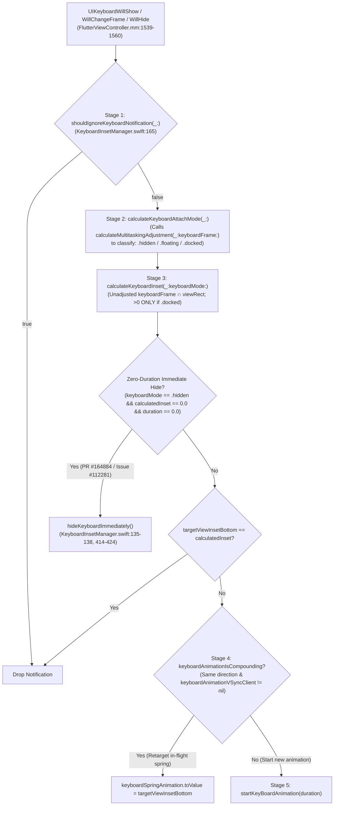

# 🥜 [Peanut #3] Viewport Metrics, Auto-Resize, Rotation & Keyboard Spring Animation

> [!NOTE]
> **Parent Blueprint:** [🌾 `FlutterViewController.md`](../FlutterViewController.md)
> **Scope of this Peanut:** How [`FlutterViewController`](../FlutterViewController.mm) and [`FlutterKeyboardInsetManager`](../KeyboardInsetManager.swift) compute and synchronize `flutter::ViewportMetrics` (physical size, Auto Layout auto-resize constraints, safe area paddings, device rotation, and VSync-animated bottom keyboard insets) with the Flutter Engine.
> **Files Covered:**
> - [`FlutterViewController.mm`](../FlutterViewController.mm) (`#L105`, `#L131`, `#L164`, `#L368-L371`, `#L396-L409`, `#L687-L696`, `#L821-L837`, `#L860-L906`, `#L952`, `#L1034-L1060`, `#L1380-L1560`, `#L1807-L1816`, `#L2307-L2335`)
> - [`FlutterViewController.h`](../../Headers/FlutterViewController.h) (`#L272`, `autoResizable`) & [`FlutterViewController_Internal.h`](../FlutterViewController_Internal.h) (`#L35-L41`, `#L59-L63`)
> - [`KeyboardInsetManager.swift`](../KeyboardInsetManager.swift) (`#L1-L492`, `FlutterKeyboardMode`, `FlutterKeyboardInsetManagerDelegate`, `FlutterKeyboardInsetManager`)
> - [`FlutterView.h`](../FlutterView.h) (`#L46-L47`, `#L67-L74`) & [`FlutterView.mm`](../FlutterView.mm) (`#L53-L110`, `FlutterAutoResizeLayoutConstraint`, `setIntrinsicContentSize:`, `resetIntrinsicContentSize`)
> - [`spring_animation.h`](../../../../../../../third_party/spring_animation/spring_animation.h) & [`spring_animation.mm`](../../../../../../../third_party/spring_animation/spring_animation.mm) (Damped harmonic oscillator curve model)
> - [`VSyncClient.swift`](../VSyncClient.swift) (`#L9-L222`) & [`DisplayLinkManager.swift`](../DisplayLinkManager.swift) (`#L33-L150`)
> - [`FlutterViewControllerTest.mm`](../FlutterViewControllerTest.mm) (`#L468-L1196`, `#L1332-L1478`, `#L1681-L1709`, `#L2823-L2858`, `#L3039-L3060`)

---

## 1. Mental Model: How UIKit Geometry Becomes `flutter::ViewportMetrics`

Flutter's Dart framework (`MediaQuery`, `Scaffold`, `SafeArea`) has no direct knowledge of UIKit views, windows, or the system keyboard. Instead, it relies entirely on a single C++ struct—[`flutter::ViewportMetrics`](../../../../../../../lib/ui/window/viewport_metrics.h)—stored as the `_viewportMetrics` ivar on `FlutterViewController` ([`#L164`](../FlutterViewController.mm#L164)) and pushed to the engine via `[self.engine updateViewportMetrics:_viewportMetrics]`.

**Every measurement in `_viewportMetrics` is in physical pixels** (UIKit logical points $\times$ `self.flutterScreenIfViewLoaded.scale`):

| `_viewportMetrics` Field | UIKit Source | Mutated By |
| :--- | :--- | :--- |
| `device_pixel_ratio` | `self.flutterScreenIfViewLoaded.scale` | [`viewDidLayoutSubviews`](../FlutterViewController.mm#L1399) (`#L1399`) |
| `physical_width`, `physical_height` | `self.view.bounds.size.{width,height} * scale` | [`setViewportMetricsSize`](../FlutterViewController.mm#L1505-L1519) (`#L1505-L1519`) |
| `physical_{min,max}_{width,height}_constraint` | Tight (`physical_width` / `physical_height`) by default; or `sizeBeforeAutoResized * scale` (with `0` $\rightarrow$ `CGFLOAT_MAX * scale`) when `autoResizable == YES` | [`setViewportMetricsSize`](../FlutterViewController.mm#L1515-L1518) (`#L1515-L1518`) & [`updateAutoResizeConstraints`](../FlutterViewController.mm#L1453-L1496) (`#L1453-L1496`) |
| `physical_padding_{top,left,right,bottom}` | `self.view.safeAreaInsets.{top,left,right,bottom} * scale` | [`setViewportMetricsPaddings`](../FlutterViewController.mm#L1524-L1535) (`#L1524-L1535`) |
| `physical_view_inset_bottom` | Intersection height of **docked** system keyboard $\times$ `scale`, interpolated per VSync frame | [`updateViewportMetricsWithInset:`](../FlutterViewController.mm#L2309-L2312) (`#L2309-L2312`), invoked by [`FlutterKeyboardInsetManager.handleKeyboardAnimationCallback(withTargetTime:)`](../KeyboardInsetManager.swift#L411) and [`ensureViewportMetricsIsCorrect()`](../KeyboardInsetManager.swift#L489) |

---

## 2. Layout, Auto-Resizable `FlutterView`, Safe Areas & The Rotation Distortion Workaround

### 2.1 The `viewDidLayoutSubviews` Ordering & Foreground Invariants
When UIKit lays out `FlutterViewController`'s view ([`#L1389-L1413`](../FlutterViewController.mm#L1389-L1413)):
1. It pins the hidden status-bar `scrollView.frame` to `CGRectMake(0.0, 0.0, viewBounds.size.width, 0.0)` and `contentOffset` to `(2.0, 2.0)` (`#L1394-L1395`).
2. It checks `bool firstViewBoundsUpdate = !_viewportMetrics.physical_width;` (`#L1398`).
3. It updates `device_pixel_ratio` (`#L1399`), calls `[self setViewportMetricsSize]` (`#L1400`), `[self checkAndUpdateAutoResizeConstraints]` (`#L1401`), `[self setViewportMetricsPaddings]` (`#L1402`), and `[self updateViewportMetricsIfNeeded]` (`#L1403`).
4. **Critical Ordering & Foreground Invariant (`#L1405-L1412`):** On the first layout (`firstViewBoundsUpdate && self.stateIsActive && self.engine`), `[self surfaceUpdated:YES]` **must** execute *after* `[self updateViewportMetricsIfNeeded]`.
   - **Why queue `updateViewportMetrics:` first?** `updateViewportMetrics:` posts a task to the UI thread, whereas `surfaceUpdated:YES` (`NotifyCreated()`) synchronously sets up the Raster surface. Queuing viewport metrics first ensures the Dart UI isolate knows the non-zero screen dimensions before rasterizing the first frame.
   - **Why `waitForFirstFrameSync:` is no longer called here:** Historically (`9776043ea5`, PR `#9506`), `viewDidLayoutSubviews` blocked the main thread with `waitForFirstFrameSync:` after `surfaceUpdated:YES`. In the current architecture, `surfaceUpdated:YES` alone is invoked here (`#L1411`).
   - **Why guard on `self.stateIsActive`? (Commit `0dc86cda19`, PR `#19592`):** UIKit does *not* guarantee the app or scene is in the foreground when calling `viewDidLayoutSubviews`. Creating the Metal rendering surface in the background triggers GPU access violations on iOS (issues `#55969` and `#57676`). All other `surfaceUpdated:YES` call sites live inside foreground lifecycle callbacks (`appOrSceneBecameActive` at `#L1037` and `viewWillAppear:` at `#L830`), making `viewDidLayoutSubviews` the only non-lifecycle site requiring an explicit `self.stateIsActive` check.

### 2.2 Auto-Resizable `FlutterView` & `FlutterAutoResizeLayoutConstraint`
**Where:** [`FlutterViewController.h#L272`](../../Headers/FlutterViewController.h#L272), [`FlutterViewController.mm#L131`](../FlutterViewController.mm#L131), [`#L1415-L1496`](../FlutterViewController.mm#L1415-L1496), [`#L1807-L1816`](../FlutterViewController.mm#L1807-L1816), [`FlutterView.h#L46-L47`](../FlutterView.h#L46-L47), [`#L67-L74`](../FlutterView.h#L67-L74), [`FlutterView.mm#L53-L110`](../FlutterView.mm#L53-L110)

When embedding a `FlutterViewController` as a child component inside native Auto Layout (such as a dynamic-height card or modal), setting `flutterViewController.autoResizable = YES` ([`#L1419-L1422`](../FlutterViewController.mm#L1419-L1422)) sets `self.flutterView.autoResizable = YES` and `self.flutterView.contentMode = UIViewContentModeCenter`:

1. **Preserving Host Constraints via `sizeBeforeAutoResized` (`updateAutoResizeConstraints`, `#L1453-L1496`):**
   - Scans `self.view.constraints` for any instance of [`FlutterAutoResizeLayoutConstraint`](../FlutterView.h#L67-L74) (`#L1454-L1460`).
   - Only if `!hasBeenAutoResized` does it capture `self.sizeBeforeAutoResized = self.view.frame.size` (`#L1461-L1463`). Once Flutter applies its own `FlutterAutoResizeLayoutConstraint`s, those constraints dictate `self.view.frame`, so preserving `sizeBeforeAutoResized` prevents Flutter from locking itself into its own previous size.
   - Initializes `minWidth`, `maxWidth`, `minHeight`, `maxHeight` from `self.sizeBeforeAutoResized` (`#L1465-L1468`).
   - If `maxWidth == 0` (`#L1472-L1481`) or `maxHeight == 0` (`#L1482-L1491`)—which happens when the host native view leaves an axis unconstrained so the Flutter widget can self-size—it sets `maxWidth` / `maxHeight` to `CGFLOAT_MAX` (`DBL_MAX`) and logs a warning via `FlutterLogger`.
   - Scales `minWidth`, `maxWidth`, `minHeight`, `maxHeight` by `_viewportMetrics.device_pixel_ratio` into `physical_{min,max}_{width,height}_constraint` (`#L1492-L1495`).
2. **Applying `FlutterAutoResizeLayoutConstraint` in `-[FlutterView setIntrinsicContentSize:]` ([`FlutterView.mm#L53-L97`](../FlutterView.mm#L53-L97)):**
   - When the engine finishes laying out the root layer tree, it calls `-[FlutterView setIntrinsicContentSize:]` with the physical pixel size.
   - If `self.autoResizable` is `YES`, `FlutterView` divides `size` by `scale` (`window.windowScene.screen.scale` or `traitCollection.displayScale`), checks if the rounded point size changed against `_intrinsicSize`, sets `self.translatesAutoresizingMaskIntoConstraints = false`, removes old `FlutterAutoResizeLayoutConstraint`s (`removeAutoResizeLayoutConstraints` at `#L104-L110`), activates new width and height `FlutterAutoResizeLayoutConstraint`s, and calls `[self setNeedsLayout]`.
   - **Why subclass `NSLayoutConstraint` as `FlutterAutoResizeLayoutConstraint`?** Relying on UIKit's `intrinsicContentSize` directly creates private `NSContentSizeLayoutConstraint`s that cannot be selectively stripped without using private APIs. Using a dedicated `NSLayoutConstraint` subclass allows `removeAutoResizeLayoutConstraints` to remove only Flutter's self-sizing constraints while leaving host Auto Layout constraints untouched.
3. **Resetting on Trait Collection Changes (`traitCollectionDidChange:`, [`FlutterViewController.mm#L1807-L1816`](../FlutterViewController.mm#L1807-L1816)):**
   - When `self.isAutoResizable` is `YES`, `traitCollectionDidChange:` calls `[self.flutterView resetIntrinsicContentSize]` ([`FlutterView.mm#L99-L102`](../FlutterView.mm#L99-L102)), resetting `_intrinsicSize` to `(UIViewNoIntrinsicMetric, UIViewNoIntrinsicMetric)` and removing all `FlutterAutoResizeLayoutConstraint`s so the next layout pass re-samples `sizeBeforeAutoResized` for the new orientation/size class.

### 2.3 The Half-Duration Rotation Delay (`viewWillTransitionToSize:`)
**Where:** [`FlutterViewController.mm#L873-L906`](../FlutterViewController.mm#L873-L906), [`#L1380-L1387`](../FlutterViewController.mm#L1380-L1387)

**The Problem ([`#16243`](https://github.com/flutter/flutter/issues/16243), [`#16322`](https://github.com/flutter/flutter/issues/16322)):**
When an iOS device rotates, UIKit immediately changes `self.view.bounds` to the final post-rotation size at the start of the rotation ($t = 0$) and applies a CoreAnimation transform over `coordinator.transitionDuration`. Because Flutter renders into a single backing texture (`CAMetalLayer`), if Flutter immediately re-layouts at $t = 0$ for the new aspect ratio, the newly rendered landscape frame is squished into the still-portrait layer at the beginning of the animation, producing $\sim 4\times$ aspect-ratio distortion (and miscalculating CJK keyboard height during rotation).

**Design Intent & Rejected Alternatives (Commit `1c1dfdabd0`, PR `#40730`):**
Before landing on the current **"delayed swap"** design, two other approaches were evaluated and rejected:
1. **Per-frame "Size Interpolation" (PR `#40412` — Rejected):** Interpolating `_viewportMetrics` width/height on every frame during the rotation forced expensive full-tree Dart relayouts every frame and did not go well.
2. **Static "Snapshot" Crossfade (Rejected):** Taking a snapshot of the view before rotating reduces distortion from $\sim 4\times$ to $\sim 2\times$, but freezes dynamic content (animations, video playback) and incurs a **$\sim 0.5\text{s}$ stall** while capturing the snapshot.
3. **"Delayed Swap" at $t = \text{duration} / 2$ (PR `#40730` — Chosen):** Waiting until halfway through the rotation to swap width/height achieves the exact same $\sim 4\times \rightarrow \sim 2\times$ distortion reduction as the snapshot solution (and hides the swap at peak angular velocity where the human eye notices it least), while keeping live animations/video running with zero snapshot penalty.

**How It Works in Code:**
1. In `viewWillTransitionToSize:withTransitionCoordinator:` ([`#L873-L906`](../FlutterViewController.mm#L873-L906)), if `coordinator.transitionDuration == 0`, it returns immediately (`#L887-L889`, validated by [`testViewWillTransitionToSize_DoesNotDelayEngineCallIfZeroDuration`](../FlutterViewControllerTest.mm#L1455-L1478)).
2. If `transitionDuration > 0`:
   - Sets `_shouldIgnoreViewportMetricsUpdatesDuringRotation = YES` (`#L892`).
   - While this flag is `YES`, `updateViewportMetricsIfNeeded` (`#L1381`) returns early without calling the engine (ignoring the immediate `viewDidLayoutSubviews` and `viewSafeAreaInsetsDidChange` calls at $t = 0$).
   - Schedules a `dispatch_after` block on `dispatch_get_main_queue()` for **`transitionDuration / 2.0`**, which sets `strongSelf->_shouldIgnoreViewportMetricsUpdatesDuringRotation = NO` and calls `[strongSelf updateViewportMetricsIfNeeded]` (`#L893-L905`).

---

## 3. The 5-Stage Keyboard Inset & Spring Animation Pipeline (`KeyboardInsetManager.swift`)

**Where:** [`KeyboardInsetManager.swift#L1-L492`](../KeyboardInsetManager.swift#L1-L492), [`FlutterViewController.mm#L368-L371`](../FlutterViewController.mm#L368-L371), [`#L1539-L1560`](../FlutterViewController.mm#L1539-L1560), [`#L2307-L2335`](../FlutterViewController.mm#L2307-L2335)

Unlike native UIKit views that can be pinned to `UIKeyboardLayoutGuide`, Flutter widgets (`Scaffold`, bottom sheets) must relayout inside the Dart UI isolate on every frame as the keyboard slides up or down.

> [!NOTE]
> **Historical Evolution (from Git History):**
> - **Static Jump (`#4420`, `#4428`):** Originally, `FlutterViewController` set `physical_view_inset_bottom` once to the final keyboard height on `UIKeyboardWillShow`, causing Flutter's bottom widgets to teleport to the top of the keyboard before the iOS keyboard even started sliding up.
> - **Dummy View + `presentationLayer` Sampling (`a43ed2ef66`, PR `#29281`):** Introduced a hidden `0x0` `UIView` (`keyboardAnimationView`) animated inside `[UIView animateWithDuration:...]` to inherit UIKit's private keyboard curve, sampling `keyboardAnimationView.layer.presentationLayer.frame.origin.y` via a `VSyncClient`.
> - **Analytical `SpringAnimation` Model (`50cfc83e2c` PR `#34871`, `165126e703` PR `#37604`):** Sampling `presentationLayer` on the main thread drifted against the rasterizer and lagged on 120Hz ProMotion displays. PR `#37604` extracted `CASpringAnimation`'s `stiffness`, `damping`, `mass`, and `initialVelocity` into [`SpringAnimation`](../../../../../../../third_party/spring_animation/spring_animation.mm) (adapted from React's spring solver) to evaluate the exact analytical position at the upcoming VSync target time, keeping `presentationLayer` only as a fallback.
> - **Swift Extraction (`KeyboardInsetManager.swift`):** Extracted the entire keyboard inset state machine out of `FlutterViewController.mm` into [`FlutterKeyboardInsetManager`](../KeyboardInsetManager.swift#L90-L491), communicating with `FlutterViewController` via [`FlutterKeyboardInsetManagerDelegate`](../KeyboardInsetManager.swift#L56-L68) (`FlutterViewController.mm#L2307-L2335`).



### Stage 1: Notification Filtering (`shouldIgnoreKeyboardNotification(_:)`, [`KeyboardInsetManager.swift#L165-L212`](../KeyboardInsetManager.swift#L165-L212))
Evaluated in strict order (validated by [`testShouldIgnoreKeyboardNotification`](../FlutterViewControllerTest.mm#L669-L762)):

| Priority | Condition Checked | Return Value (`Ignore?`) | Design Intent & Commit Context |
| :---: | :--- | :---: | :--- |
| **1** | `notification.name == UIResponder.keyboardWillHideNotification` (`#L170-L172`) | **`false` (Never ignore)** | **PR `#31982` (`7ebc7736f4`) & PR `#37719` (`479bb736fe`):** Even if fired in the background or by another app in Split View, ignoring a hide notification leaves a permanent blank inset at the bottom of the screen when the keyboard dismisses. |
| **2** | `notification.name == UIResponder.keyboardWillChangeFrameNotification && keyboardFrame == .zero` (`#L183-L187`) | **`true` (Ignore)** | **PR `#37719` (`479bb736fe`):** UIKit emits `WillChangeFrame` with `CGRectZero` while the user is actively dragging the keyboard. *(Do **not** ignore `CGRectZero` for `WillShow`, which indicates a dropped iPad Shortcuts Bar!)* |
| **3** | `keyboardFrame.isEmpty` (width or height is `0`, including `CGRectZero` on `WillShow`, `#L191-L193`) | **`false` (Do not ignore)** | **PR `#17474` (`ac574e11a0`) & PR `#37719` (`479bb736fe`):** Occurs when hiding an iPad split keyboard or switching multitasking modes; returns `false` early (bypassing Priority 4) so Stage 2 classifies it as `.floating` (`.zero`) or `.hidden` (inset `0`). |
| **4** | `isKeyboardNotificationForDifferentView(notification)` (`#L196-L198`, `#L202-L212`) | **`true` (Ignore)** | **PR `#17981` (`5f437fb4f6`) & PR `#29862` (`ec4f72b33d`):** Returns `true` if `info?[UIResponder.keyboardIsLocalUserInfoKey]` is `false` (keyboard belongs to another app in iPad Split View, `#17981`) **or** if `delegate.engine()?.viewController !== (delegate as AnyObject)` (`#29862`). |

> [!NOTE]
> **Scene Notification Isolation on iOS 27 Beta ([`FlutterViewController.mm#L687-L696`](../FlutterViewController.mm#L687-L696), Issue `#187844`):**
> On iOS 27 Beta, the system keyboard is hosted in its own `UIScene` and broadcasts `UISceneDidEnterBackgroundNotification` / `UISceneWillEnterForegroundNotification` when dismissed or shown. `FlutterViewController` guards its scene lifecycle observers with `shouldHandleSceneNotification:` (`notification.object == self.flutterWindowSceneIfViewLoaded`) so keyboard scene transitions do not falsely trigger `appOrSceneDidEnterBackground` (`#L1056-L1060`).

> [!WARNING]
> **Historical Landmine (Commit `472df41384` PR `#50364` $\rightarrow$ Reverted in `f71b7eee22` PR `#50760`, Fixed Properly in PR `#164884`):**
> Dismissing the iOS "Save Password" / PasswordManager autofill prompt fires `UIKeyboardWillShowNotification` followed immediately by a `0.0`-duration `UIKeyboardWillHideNotification` (`#112281`). PR `#50364` tried to fix this by ignoring keyboard notifications whenever `self.engine.textInputPlugin`'s view wasn't in the view hierarchy, which broke embedded Platform Views (`WKWebView`, native `UITextField`, `#143642`) and had to be reverted (`#50760`). Instead, [PR `#164884`](https://github.com/flutter/flutter/pull/164884) fixed `#112281` cleanly in [`handleKeyboardNotification(_:)` (`KeyboardInsetManager.swift#L130-L138`)](../KeyboardInsetManager.swift#L130-L138): when `keyboardMode == .hidden && calculatedInset == 0.0 && duration == 0.0`, it calls `hideKeyboardImmediately()` (`#L414-L424`) and returns immediately.

### Stage 2: Keyboard Mode Classification (`calculateKeyboardAttachMode(_:)`, [`KeyboardInsetManager.swift#L214-L274`](../KeyboardInsetManager.swift#L214-L274)) & iPad Multitasking Adjustment (`calculateMultitaskingAdjustment(_:keyboardFrame:)`, [`#L276-L303`](../KeyboardInsetManager.swift#L276-L303))
`handleKeyboardNotification(_:)` calls `calculateKeyboardAttachMode(_:)` (`#L125`), which classifies all iOS/iPadOS keyboard states (docked, undocked, split, split docked, floating, expanded/minimized shortcuts bar) into `FlutterKeyboardMode` (introduced in PR `#37719` `479bb736fe` and validated by [`testCalculateKeyboardAttachMode`](../FlutterViewControllerTest.mm#L869-L996)):
1. `notification.name == UIResponder.keyboardWillHideNotification` $\rightarrow$ `.hidden` (`#L229-L231`).
2. `keyboardFrame == .zero` $\rightarrow$ `.floating` (Shortcuts Bar dropped after dragging, `#L239-L241`).
3. `keyboardFrame.isEmpty` $\rightarrow$ `.hidden` (`#L244-L246`).
4. **Helper Call (`calculateMultitaskingAdjustment(_:keyboardFrame:)`, `#L254-L255`, `#L276-L303`):**
   When an iPad app runs in **Slide Over** (`delegate.isPadInSlideOverOrStageManagerMode()` at [`FlutterViewController.mm#L2322-L2329`](../FlutterViewController.mm#L2322-L2329): `UIUserInterfaceIdiomPad` + `UIUserInterfaceSizeClassCompact` width + `UIUserInterfaceSizeClassRegular` height), the Slide Over window floats above the bottom of the screen, and UIKit reports `keyboardFrame` without accounting for the empty space below the Slide Over card:
   - **Stage Manager Disambiguation (`#L293-L295`):** A resized window in iPad Stage Manager can have the exact same `Pad + Compact + Regular` traits, but in Stage Manager a docked keyboard sits at the bottom of the screen (`keyboardFrame.maxY == screenRect.height`). Thus, if `screenHeight == keyboardBottom`, it returns `0`.
   - **Slide Over Offset (`#L297-L300`):** Calls `delegate.convertViewRect(toScreen: delegate.view().bounds)`, computes `offset = screenHeight - viewRectInScreen.maxY`, and if `offset > 0`, adds `offset` to `adjustedKeyboardFrame.origin.y` (validated by [`testCalculateMultitaskingAdjustment`](../FlutterViewControllerTest.mm#L998-L1020)).
5. Computes `intersection = adjustedKeyboardFrame.intersection(screenRect)` (`#L260`).
   - **Why `round()` is used (`#L264`, `#L268`, PR `#37719`):** Third-party custom keyboard extensions sometimes report repeating-decimal heights like `320.666666666666666` (`screenHeight - origin.y != height`) or leave a `0.0000001` sub-point residual when hidden.
   - If `round(intersectionHeight) > 0 && intersectionWidth > 0`:
     - If `round(adjustedKeyboardBottom) < screenHeight` $\rightarrow$ `.floating` (undocked, split, or floating — **why `0` inset (`#17474`):** when a split/floating keyboard is moved toward the middle or top of the screen, adding a bottom inset creates a blank gap at the bottom without avoiding the floating keyboard).
     - Else $\rightarrow$ `.docked`.
6. Otherwise $\rightarrow$ `.hidden`.

### Stage 3: Inset Calculation (`calculateKeyboardInset(_:keyboardMode:)`, [`KeyboardInsetManager.swift#L305-L323`](../KeyboardInsetManager.swift#L305-L323)) & Zero-Duration Immediate Hide (`#L130-L138`)
- Returns `0` for `.floating` and `.hidden` (`#L309-L311`).
- For `.docked`, takes the **original unadjusted** `keyboardFrame` (`#L126`), converts `delegate.view().bounds` to `screen.coordinateSpace`, intersects `keyboardFrame` with `viewRectRelativeToScreen`, and returns `intersection.height * scale` (`#L314-L322`).
- **Zero-Duration Immediate Hide (`#L130-L138`, PR `#164884`):** If `keyboardMode == .hidden && calculatedInset == 0.0 && duration == 0.0`, calls `hideKeyboardImmediately()` (`#L414-L424`), which invalidates `keyboardAnimationVSyncClient`, removes `keyboardAnimationView` and its animations, clears `keyboardSpringAnimation`, sets `targetViewInsetBottom = 0`, and calls `ensureViewportMetricsIsCorrect()`.

### Stages 4 & 5: Compounding Retargeting & `CASpringAnimation` VSync Sampling ([`KeyboardInsetManager.swift#L140-L163`](../KeyboardInsetManager.swift#L140-L163), [`#L325-L490`](../KeyboardInsetManager.swift#L325-L490))

#### A. Stage 4: Compounding Animation Check (`#L140-L162`)
Sometimes UIKit fires two keyboard notifications back-to-back in the same direction while the first animation is already in flight (e.g., keyboard opens at height 250, then immediately expands to 500 as the predictive text bar appears):
- Computes direction: `let keyboardWillShow = beginKeyboardFrame.origin.y > keyboardFrame.origin.y` (`#L151`).
- Checks `let keyboardAnimationIsCompounding = keyboardAnimationIsShowing == keyboardWillShow && keyboardAnimationVSyncClient != nil` (`#L152-L153`).
- **If compounding (`true`):** Does **not** call `startKeyBoardAnimation(_:)` (which would reset the spring velocity to zero and cause a visual stutter). Instead, mutates `keyboardSpringAnimation.toValue = targetViewInsetBottom` in place (`#L160-L162`, added in PR `#37604` `165126e703` and validated by [`testKeyboardAnimationIsShowingAndCompounding`](../FlutterViewControllerTest.mm#L570-L667)).
  - **Why in-place `toValue` mutation works:** In [`spring_animation.mm#L51`](../../../../../../../third_party/spring_animation/spring_animation.mm#L51), `-[SpringAnimation curveFunction:]` dynamically recomputes `double x0 = _toValue - _fromValue;` on every tick rather than caching `x0` in `init`, so changing `toValue` mid-flight scales the remaining curve toward the new target without resetting `fromValue` or `keyboardAnimationStartTime`.

#### B. Stage 5: Stealing UIKit's `CASpringAnimation` & Closed-Form Oscillator Math (`#L325-L412`, `#L442-L458`)
When starting a new keyboard animation (`startKeyBoardAnimation(_:)`):
1. **Dummy View Trick (`keyboardAnimationView`, `#L329-L374`, PR `#29281`):**
   UIKit does not expose the `CASpringAnimation` parameters of the keyboard directly in `notification.userInfo`, but any `UIView` animated inside a `UIView.animate(withDuration: duration, animations: { ... })` block during the notification handler inherits UIKit's exact keyboard animation curve!
   - `FlutterKeyboardInsetManager` places a hidden `0x0` `UIView` (`keyboardAnimationView`) in `delegate.view()` at `y = delegate.physicalViewInsetBottom()` (`#L347-L348`) and records `keyboardAnimationStartTime = CACurrentMediaTime()` (`#L351`).
   - Inside `UIView.animate(withDuration: duration, ...)` (`#L363-L374`), it sets `keyboardAnimationView.frame = CGRect(x: 0, y: targetViewInsetBottom, width: 0, height: 0)` and queries `keyboardAnimationView.layer.animation(forKey: "position")`.
2. **Damped Harmonic Oscillator Model ([`spring_animation.mm`](../../../../../../../third_party/spring_animation/spring_animation.mm), PR `#37604`):**
   - If the extracted `CAAnimation` is a `CASpringAnimation`, `setUpKeyboardSpringAnimationIfNeeded(_:)` (`#L442-L458`) passes its `stiffness` ($k$), `damping` ($c$), `mass` ($m$), and `initialVelocity` ($v_{\text{init}}$) to `SpringAnimation`:
     $$\zeta = \frac{c}{2\sqrt{km}}, \quad \omega_0 = \sqrt{\frac{k}{m}}, \quad \omega_1 = \omega_0\sqrt{1 - \zeta^2}, \quad v_0 = -v_{\text{init}}, \quad x_0 = y_{\text{to}} - y_{\text{from}}$$
   - On each tick at elapsed time $t = \text{targetTime} - \text{keyboardAnimationStartTime}$ (`#L405`), `keyboardSpringAnimation.curveFunction(timeElapsed)` evaluates:
     - **Under-damped ($\zeta < 1$):**
       $$y(t) = y_{\text{to}} - e^{-\zeta\omega_0 t}\left(\frac{v_0 + \zeta\omega_0 x_0}{\omega_1}\sin(\omega_1 t) + x_0\cos(\omega_1 t)\right)$$
     - **Critically damped ($\zeta \ge 1$):**
       $$y(t) = y_{\text{to}} - e^{-\omega_0 t}\left(x_0 + (v_0 + \omega_0 x_0)t\right)$$
   - **Fallback (`#L407-L409`):** If `animation(forKey: "position")` is nil or not a `CASpringAnimation`, `keyboardSpringAnimation` is set to `nil` and each tick reads `keyboardAnimationView.layer.presentation()?.frame.origin.y`.

#### C. Why `keyboardAnimationVSyncClient` Bounces Through `uiTaskRunner` $\rightarrow$ Main Queue ([`KeyboardInsetManager.swift#L460-L486`](../KeyboardInsetManager.swift#L460-L486))
Look closely at `setUpKeyboardAnimationVsyncClient(_:)`:
```swift
    // Make sure the new viewport metrics get sent after the begin frame event has processed.
    let vsyncCallback: (CFTimeInterval, CFTimeInterval) -> Void = { startTime, targetTime in
      let frameInterval = targetTime - startTime
      let projectedTargetTime = targetTime + frameInterval
      DispatchQueue.main.async {
        animationCallback(projectedTargetTime)
      }
    }

    keyboardAnimationVSyncClient = VSyncClient(
      taskRunner: taskRunner,
      isVariableRefreshRateEnabled: displayLinkManager.maxRefreshRateEnabledOnIPhone,
      maxRefreshRate: displayLinkManager.displayRefreshRate,
      callback: vsyncCallback)
    keyboardAnimationVSyncClient?.allowPauseAfterVsync = false
    keyboardAnimationVSyncClient?.await()
```
1. **Why doesn't `VSyncClient` run directly on `platformTaskRunner` — and why does it `DispatchQueue.main.async` back to the main queue? (The PR `#42312` $\rightarrow$ Revert `#43422` $\rightarrow$ Reland `#43463` Saga):**
   - **The Jitter Bug (`#120555`, PR `#42312` `a5ff3629df`):** Originally, `VSyncClient` ran on `platformTaskRunner` (main thread). That allowed `updateViewportMetrics:` for the *next* frame to arrive on the UI thread **before** the framework's current VSync callback (rebuild/layout/paint) ran, causing visible keyboard animation jitter.
   - **The Crash (`#130028`, Reverted in PR `#43422` `3ade212082`):** PR `#42312` fixed the jitter by running `VSyncClient` and `animationCallback` directly on `self.engine.uiTaskRunner`. However, running `animationCallback` on the UI thread accessed UIKit properties (`isViewLoaded`, `keyboardAnimationView`) off the main thread and crashed when the engine was destroyed mid-animation (`#130028`).
   - **The Reland (`cf67f834cf`, PR `#43463`):** Keeps `VSyncClient` bound to `delegate.uiTaskRunner()` (so the VSync callback is strictly ordered *after* the UI thread's `BeginFrame`), and immediately hops back via `DispatchQueue.main.async` so `animationCallback` safely accesses UIKit on the main thread (validated by [`testKeyboardAnimationCallbackIsDeliveredAsynchronously`](../FlutterViewControllerTest.mm#L834-L867) and [`testKeyboardAnimationWillNotCrashWhenEngineDestroyed`](../FlutterViewControllerTest.mm#L764-L774)).
2. **Continuous Firing (`allowPauseAfterVsync = false`, `#L484`):**
   - In [`VSyncClient.swift#L40`](../VSyncClient.swift#L40), `VSyncClient` defaults `allowPauseAfterVsync` to `true` (requiring an explicit `await()` per frame). Setting `keyboardAnimationVSyncClient?.allowPauseAfterVsync = false` keeps the `CADisplayLink` unpaused so a single `await()` call fires continuously on every VSync until `invalidate()` is called.

#### D. Cleanup & Disappearance Guarantees ([`FlutterViewController.mm#L860-L871`](../FlutterViewController.mm#L860-L871), [`#L952`](../FlutterViewController.mm#L952), [`KeyboardInsetManager.swift#L375-L385`](../KeyboardInsetManager.swift#L375-L385), [`#L414-L429`](../KeyboardInsetManager.swift#L414-L429))
- When the `UIView.animate(withDuration:...)` completion block runs (`#L375`), it checks `if strongSelf.keyboardAnimationVSyncClient === currentVsyncClient` (verifying no newer animation superseded it), invalidates the VSync client, removes `keyboardAnimationView` from superview, and calls `strongSelf.ensureViewportMetricsIsCorrect()` (snapping `physical_view_inset_bottom = targetViewInsetBottom`, PR `#31982`).
- If `viewDidDisappear:` is called while a keyboard is open or animating (`FlutterViewController.mm#L863`), guarded by `if (self.engine.viewController == self)`, it immediately calls `[self.keyboardInsetManager hideKeyboardImmediately]`, which invalidates `keyboardAnimationVSyncClient`, sets `targetViewInsetBottom = 0`, and updates `physical_view_inset_bottom` to `0` (validated by [`testEnsureViewportMetricsWillInvokeAndDisplayLinkWillInvalidateInViewDidDisappear`](../FlutterViewControllerTest.mm#L1178-L1196)).
- In `-[FlutterViewController dealloc]` (`#L952`), `[self.keyboardInsetManager invalidate]` tears down any active `VSyncClient` and removes `keyboardAnimationView`.

---

## 4. Test Coverage Matrix (`FlutterViewControllerTest.mm`)

When modifying any code in this subsystem, run `ios_debug_sim_unittests` and check these tests in [`FlutterViewControllerTest.mm`](../FlutterViewControllerTest.mm):

| Test Method | Lines | Invariant Verified |
| :--- | :--- | :--- |
| `testStartKeyboardAnimationWillInvokeSetupKeyboardSpringAnimationIfNeeded` & `testSetupKeyboardSpringAnimationIfNeeded` | [`#L468-L561`](../FlutterViewControllerTest.mm#L468-L561) | `startKeyBoardAnimation(_:)` extracts `CASpringAnimation` from `keyboardAnimationView` and initializes `SpringAnimation`. |
| `testKeyboardAnimationIsShowingAndCompounding` | [`#L570-L667`](../FlutterViewControllerTest.mm#L570-L667) | Consecutive show/hide notifications in the same direction compound (`keyboardSpringAnimation.toValue = targetViewInsetBottom`) rather than restarting. |
| `testShouldIgnoreKeyboardNotification` | [`#L669-L762`](../FlutterViewControllerTest.mm#L669-L762) | All 4 Stage-1 filtering rules (`willHide` never ignored, `CGRectZero` vs 0-height, `isLocal`, `engine.viewController !== delegate`). |
| `testKeyboardAnimationWillNotCrashWhenEngineDestroyed` | [`#L764-L774`](../FlutterViewControllerTest.mm#L764-L774) | Destroying engine context while `keyboardAnimationVSyncClient` is active does not crash (`#130028`). |
| `testKeyboardAnimationFirstVsyncCallbackCalculatesSafeInset` | [`#L776-L832`](../FlutterViewControllerTest.mm#L776-L832) | `timeElapsed = targetTime - keyboardAnimationStartTime` using `CACurrentMediaTime()` produces valid spring inset on first tick. |
| `testKeyboardAnimationCallbackIsDeliveredAsynchronously` | [`#L834-L867`](../FlutterViewControllerTest.mm#L834-L867) | VSync callback on `uiTaskRunner` dispatches asynchronously to the main queue (`#120555`, `#130028`). |
| `testCalculateKeyboardAttachMode` | [`#L869-L996`](../FlutterViewControllerTest.mm#L869-L996) | Classification of `.hidden`, `.floating`, `.docked`, and `round()` handling for fractional heights. |
| `testCalculateMultitaskingAdjustment` | [`#L998-L1020`](../FlutterViewControllerTest.mm#L998-L1020) | iPad Slide Over (`Pad + Compact + Regular`) Y-offset calculation vs Stage Manager disambiguation. |
| `testCalculateKeyboardInset` | [`#L1022-L1042`](../FlutterViewControllerTest.mm#L1022-L1042) | Physical pixel inset calculation (`intersection.height * screen.scale`) for docked keyboard. |
| `testHandleKeyboardNotification` & `testEnsureBottomInsetIsZeroWhenKeyboardDismissed` | [`#L1044-L1116`](../FlutterViewControllerTest.mm#L1044-L1116) | End-to-end notification handling and zero inset guarantee upon keyboard dismissal. |
| `testStopKeyBoardAnimationWhenReceivedWillHideNotificationAfterWillShowNotification` | [`#L1118-L1176`](../FlutterViewControllerTest.mm#L1118-L1176) | Zero-duration `UIKeyboardWillHideNotification` immediately stops in-flight show animation (`#112281`, PR `#164884`). |
| `testEnsureViewportMetricsWillInvokeAndDisplayLinkWillInvalidateInViewDidDisappear` | [`#L1178-L1196`](../FlutterViewControllerTest.mm#L1178-L1196) | `viewDidDisappear:` calls `hideKeyboardImmediately`, invalidates `keyboardAnimationVSyncClient`, and resets inset to `0`. |
| `testUpdatedViewportMetricsDoesResizeFlutterViewWhenAutoResizable` & `...WhenNotAutoResizable` | [`#L1361-L1397`](../FlutterViewControllerTest.mm#L1361-L1397) | Verifies `autoResizable` constraint relaxation, `FlutterAutoResizeLayoutConstraint` activation, and warning logs when host bounds are `0`. |
| `testUpdateViewportMetricsIfNeeded_*` & `testViewWillTransitionToSize_*` | [`#L1332-L1359`](../FlutterViewControllerTest.mm#L1332-L1359), [`#L1399-L1478`](../FlutterViewControllerTest.mm#L1399-L1478) | `engine.viewController == self` guard and half-duration rotation delay when `transitionDuration > 0`. |
| `testTraitCollectionDidChangeCallsResetIntrinsicContentSizeWhenAutoResizable` | [`#L1681-L1709`](../FlutterViewControllerTest.mm#L1681-L1709) | `traitCollectionDidChange:` calls `[self.flutterView resetIntrinsicContentSize]` when `autoResizable == YES`. |
| `testSetupKeyboardAnimationVsyncClientWillCreateNewVsyncClientForFlutterViewController` & `testFlutterViewControllerStartKeyboardAnimationWillCreateVsyncClientCorrectly` | [`#L2823-L2858`](../FlutterViewControllerTest.mm#L2823-L2858), [`#L3039-L3060`](../FlutterViewControllerTest.mm#L3039-L3060) | Verifies `VSyncClient` creation with `DisplayLinkManager` refresh rate and `allowPauseAfterVsync == false`. |
