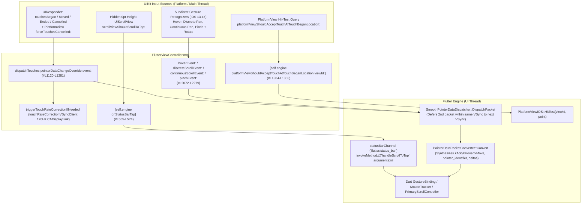
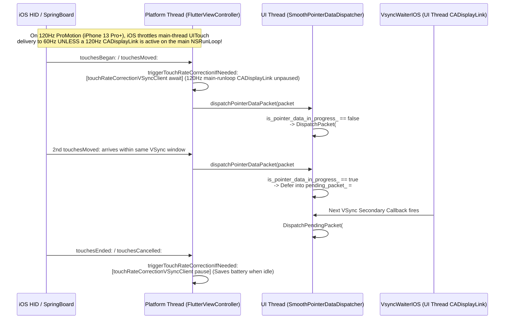
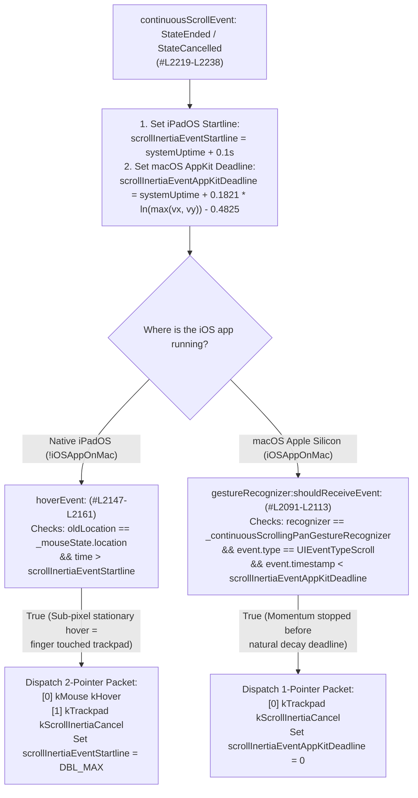

# 🥜 [Peanut #4] Pointer, Touch, Stylus, ProMotion VSync & Trackpad Input

> [!NOTE]
> **Parent Blueprint:** [🌾 `FlutterViewController.md`](../FlutterViewController.md)
> **Scope of this Peanut:** How [`FlutterViewController`](../FlutterViewController.mm) translates direct touchscreen touches, Apple Pencil/stylus angles, PlatformView hit-test interception (`platformViewShouldAcceptTouchAtTouchBeganLocation:`), 120Hz ProMotion touch-rate VSync signals (`FlutterDisplayLinkManager` & `FlutterVSyncClient`), mouse/trackpad gestures (`UIHoverGestureRecognizer`, discrete/continuous `UIPanGestureRecognizer`, `UIPinchGestureRecognizer`, `UIRotationGestureRecognizer`), scroll inertia cancellations, and iOS status-bar tap-to-scroll events (`flutter/status_bar`) into [`flutter::PointerDataPacket`](../../../../../../../lib/ui/window/pointer_data.h) payloads and platform channel calls for the Flutter Engine.
> **Files Covered:**
> - [`FlutterViewController.mm`](../FlutterViewController.mm) (`#L43-L44`, `#L56-L62`, `#L95-L100`, `#L111-L127`, `#L137-L150`, `#L166`, `#L532-L574`, `#L757-L791`, `#L866`, `#L908-L937`, `#L953`, `#L957-L962`, `#L1075-L1376`, `#L1394-L1395`, `#L2072-L2279`)
> - [`FlutterViewController_Internal.h`](../FlutterViewController_Internal.h) (`#L65`, `forceTouchesCancelled:`) & [`FlutterViewResponder.h`](../FlutterViewResponder.h) (`#L36-L56`, `platformViewShouldAcceptTouchAtTouchBeganLocation:`)
> - [`VSyncClient.swift`](../VSyncClient.swift) (`#L9-L222`), [`DisplayLinkManager.swift`](../DisplayLinkManager.swift) (`#L33-L150`), [`vsync_waiter_ios.h`](../vsync_waiter_ios.h) & [`vsync_waiter_ios.mm`](../vsync_waiter_ios.mm)
> - [`FlutterEngine.mm`](../FlutterEngine.mm) (`#L430-L440`, `#L702-L706`, `#L1592-L1597`, `dispatchPointerDataPacket:`, `platformViewShouldAcceptTouchAtTouchBeganLocation:viewId:`, `onStatusBarTap`)
> - [`platform_view_ios.mm`](../../../platform_view_ios.mm) (`#L118-L122`, `PlatformViewIOS::GetDispatcherMaker`)
> - [`pointer_data_dispatcher.h`](../../../../../../common/pointer_data_dispatcher.h) & [`pointer_data_dispatcher.cc`](../../../../../../common/pointer_data_dispatcher.cc) (`SmoothPointerDataDispatcher`)
> - [`pointer_data_packet_converter.cc`](../../../../../../../lib/ui/window/pointer_data_packet_converter.cc) (`PointerDataPacketConverter` state & delta synthesis)
> - [`FlutterPlatformViews.mm`](../FlutterPlatformViews.mm) (`#L623-L640`, `#L808-L853`, `FlutterTouchInterceptingView`, `ForwardingGestureRecognizer`)
> - [`FlutterViewControllerTest.mm`](../FlutterViewControllerTest.mm) (`#L456-L466`, `#L2275-L2439`, `#L2893-L3037`), [`VSyncClientTests.swift`](../VSyncClientTests.swift), [`DisplayLinkManagerTests.swift`](../DisplayLinkManagerTests.swift), [`VsyncWaiterIOSTest.mm`](../VsyncWaiterIOSTest.mm)

---

## 1. End-to-End Architecture & Touch Dispatch Pipeline

Flutter does not use UIKit's `UIGestureRecognizer` arena for standard touch or stylus interactions; instead, `FlutterViewController` acts as a raw `UIResponder` funnel that packs every `UITouch` and indirect gesture into a binary [`flutter::PointerDataPacket`](../../../../../../../lib/ui/window/pointer_data.h) and hands it to `[self.engine dispatchPointerDataPacket:]`.



### 1.1 `dispatchTouches:pointerDataChangeOverride:event:` & `FlutterPointerPacket` Packing
**Where:** [`FlutterViewController.mm#L1077-L1302`](../FlutterViewController.mm#L1077-L1302)

All four `UIResponder` touch methods (`touchesBegan:withEvent:`, `touchesMoved:withEvent:`, `touchesEnded:withEvent:`, `touchesCancelled:withEvent:` at [`#L1283-L1297`](../FlutterViewController.mm#L1283-L1297)) forward to `dispatchTouches:pointerDataChangeOverride:event:` with `overridden_change = nullptr`. Every `UITouch*` in the `NSSet*` is converted into a 36-field `flutter::PointerData` struct:

| `flutter::PointerData` Field | `FlutterViewController` Source | Design Intent & Commit Context |
| :--- | :--- | :--- |
| `time_stamp` | `touch.timestamp * kMicrosecondsPerSecond` (`#L1170`), or `NSProcessInfo.processInfo.systemUptime * 1e6` for synthesized events (`#L561`, `#L2079`) | **PR `#30422` (`56187fa24a`):** `UITouch.timestamp` is measured in seconds since **system startup** (`systemUptime`). Previously, synthesized events (`generatePointerDataForFake`, `flushOngoingTouches`) used `[[NSDate date] timeIntervalSince1970]` (UNIX epoch), creating a decades-wide timestamp jump that corrupted Flutter velocity trackers when mixed with real touches. |
| `change` | `overridden_change ? *overridden_change : PointerDataChangeFromUITouchPhase(touch.phase)` (`#L1077-L1097`, `#L1172-L1174`) | **PR `#6430` (`45c5fe5613`):** Removed the legacy 16-slot `TouchMapper` bitfield. Maps `Began` $\rightarrow$ `kDown`, `Moved` & `Stationary` $\rightarrow$ `kMove` (Flutter has no stationary event type, so it passes `kMove` with unchanged coordinates), `Ended` $\rightarrow$ `kUp`, `Cancelled` $\rightarrow$ `kCancel`. |
| `kind` | `DeviceKindFromTouchType(touch)` (`#L1099-L1114`, `#L1176`) | Maps `UITouchTypeDirect` & `UITouchTypeIndirect` $\rightarrow$ `kTouch`; `UITouchTypeStylus` (`UITouchTypePencil`) $\rightarrow$ `kStylus` (**PR `#3955` `b08167ba52`**); `UITouchTypeIndirectPointer` $\rightarrow$ `kMouse` (**PR `#27019` `cb1c312b4d`**). |
| `device` | `reinterpret_cast<int64_t>(touch)` (`#L1178`) | Uses the `UITouch*` object pointer address directly as the unique device identifier for the lifetime of that touch sequence. |
| `view_id` | `self.viewIdentifier` (`#L1180`) | **PR `#46213` (`b24076e4eb`):** Tags every pointer event with the target view ID (`kFlutterImplicitViewId = 0` until multi-view is exposed publicly). |
| `pointer_identifier`, `physical_delta_x`, `physical_delta_y` | Initialized to `0` / `0.0` (`#L1183`, `#L1189-L1190`) | **PR `#13697` (`132d38cd22`):** Left zero in `FlutterViewController` because [`PointerDataPacketConverter`](../../../../../../../lib/ui/window/pointer_data_packet_converter.cc#L413-L444) in the Engine maintains per-`device` state, assigns monotonic `pointer_identifier`s (`++pointer_`), and computes `physical_delta_{x,y}` from the previous coordinates. |
| `physical_x`, `physical_y` | `[touch locationInView:self.view].{x,y} * scale` (`#L1157`, `#L1164`, `#L1185-L1186`) | Converts UIKit logical points in `self.view` into physical device pixels using `scale = self.flutterScreenIfViewLoaded.scale`. |
| `pressure`, `pressure_max` | `touch.force`, `touch.maximumPossibleForce` (`#L1219-L1220`) | **PR `#3955` (`b08167ba52`):** `pressure_min` is always `0.0` (cleared by `pointer_data.Clear()`). |
| `radius_major`, `radius_min`, `radius_max` | `majorRadius`, `majorRadius - majorRadiusTolerance`, `majorRadius + majorRadiusTolerance` (`#L1221-L1223`) | **PR `#3955` (`b08167ba52`):** Extracts touch contact ellipse radius and hardware tolerance bounds. |
| `buttons` | `event.buttonMask` (`UIEventButtonMaskPrimary` / `Secondary`, `#L1260-L1269`) | **PR `#27019` (`cb1c312b4d`):** Maps primary/secondary button masks on iOS 13.4+ to `kPointerButtonMousePrimary` (`1`) and `kPointerButtonMouseSecondary` (`2`) for iPadOS trackpad/mouse right-clicks. For normal finger taps (`buttons = 0`), the Dart framework infers `buttons = 1`. |

### 1.2 Four Subtle Touch & PlatformView Lifecycle Invariants

1. **Why Every `Ended` / `Cancelled` Touch Appends a Synthetic `Change::kRemove` (`touches_to_remove_count`, [`#L1127-L1152`](../FlutterViewController.mm#L1127-L1152), [`#L1273-L1277`](../FlutterViewController.mm#L1273-L1277)):**
   - **Commit Context (`0236853959` PR `#28319` & `3a195fd837` PR `#31591`):** When `UIApplicationSupportsIndirectInputEvents` is `YES` in `Info.plist`, iPadOS delivers trackpad clicks as `UITouch` instances of type `UITouchTypeIndirectPointer` (`DeviceKind::kMouse`), allocating a **new `UITouch*` address (`device` ID) on every click**. In Flutter's `MouseTracker`, any `kMouse` device that is not explicitly removed with `Change::kRemove` stays alive forever and continues triggering hover callbacks.
   - Because removing `kTouch` devices upon touch completion is also completely harmless (`PointerDataPacketConverter` automatically synthesizes `Change::kAdd` on the next `kDown` at [`pointer_data_packet_converter.cc#L183-L191`](../../../../../../../lib/ui/window/pointer_data_packet_converter.cc#L183-L191)), `dispatchTouches:` counts `touches_to_remove_count`, allocates a packet of size `touches.count + touches_to_remove_count`, and immediately writes a copy of `pointer_data` with `change = Change::kRemove` after each `UITouchPhaseEnded` or `UITouchPhaseCancelled` touch.
2. **Why `forceTouchesCancelled:` Exists for Platform Views ([`#L1299-L1302`](../FlutterViewController.mm#L1299-L1302)):**
   - **Commit Context (`b9ecd8aca6`, PR `#24333`):** When an embedded native iOS Platform View (`FlutterTouchInterceptingView`) is removed from the hierarchy while a touch is active, UIKit invokes `-[ForwardingGestureRecognizer touchesCancelled:withEvent:]` ([`FlutterPlatformViews.mm#L840-L853`](../FlutterPlatformViews.mm#L840-L853)), **but leaves `UITouch.phase` set to `UITouchPhaseStationary`** instead of `UITouchPhaseCancelled`!
   - If `ForwardingGestureRecognizer` called `touchesCancelled:withEvent:`, `PointerDataChangeFromUITouchPhase` would translate `UITouchPhaseStationary` into `Change::kMove` instead of `Change::kCancel`, leaking the gesture in Dart. Calling `forceTouchesCancelled:` passes `overridden_change = &cancel` (`Change::kCancel`) to force cancellation regardless of `touch.phase`.
3. **Why `platformViewShouldAcceptTouchAtTouchBeganLocation:` Exists ([`#L1304-L1308`](../FlutterViewController.mm#L1304-L1308), [`FlutterViewResponder.h#L54`](../FlutterViewResponder.h#L54)):**
   - During UIKit's synchronous `-[FlutterTouchInterceptingView hitTest:withEvent:]` ([`FlutterPlatformViews.mm#L623-L640`](../FlutterPlatformViews.mm#L623-L640)), `FlutterTouchInterceptingView` converts the touch point into `FlutterViewController.view` coordinates and calls `[controller platformViewShouldAcceptTouchAtTouchBeganLocation:point]`.
   - `FlutterViewController` forwards `flutter::PointData{location.x, location.y}` and `self.viewIdentifier` to [`-[FlutterEngine platformViewShouldAcceptTouchAtTouchBeganLocation:viewId:]`](file:///usr/local/google/home/louisehsu/.gemini/jetski/brain/f61f8251-c20d-4de6-ae1a-3274b193d650/scratch/flutter_monorepo/engine/src/flutter/shell/platform/darwin/ios/framework/Source/FlutterEngine.mm#L434-L440), which synchronously runs `self.platformView->HitTest(viewId, location).has_platform_view` so `FlutterTouchInterceptingView` can decline touches that hit a Flutter widget rendered on top of the native platform view.
4. **Why `_ongoingTouches` & `flushOngoingTouches` Exist ([`#L95`](../FlutterViewController.mm#L95), [`#L866`](../FlutterViewController.mm#L866), [`#L908-L937`](../FlutterViewController.mm#L908-L937), [`#L1192-L1216`](../FlutterViewController.mm#L1192-L1216)):**
   - **Commit Context (`8b74cba20b`, PR `#8400`):** If a user touches a Flutter button that immediately presents a native `UIViewController` (such as `UIImagePickerController` or a share sheet), `FlutterViewController` transitions offscreen (`viewDidDisappear:`) before the user lifts their finger, so UIKit never delivers `touchesEnded:` or `touchesCancelled:` to `FlutterViewController`.
   - `dispatchTouches:` records `@(pointer_data.device)` in `self.ongoingTouches` on `kDown` and removes it on `kUp`/`kCancel`. When `viewDidDisappear:` runs (`#L866`), `flushOngoingTouches` emits a synthetic `Change::kCancel` packet for every remaining `device` in `self.ongoingTouches` and clears the set.

---

## 2. Apple Pencil / Stylus Math (`UITouchTypeStylus` / `UITouchTypePencil`)

**Where:** [`FlutterViewController.mm#L1104-L1105`](../FlutterViewController.mm#L1104-L1105), [`#L1225-L1258`](../FlutterViewController.mm#L1225-L1258) (Added in Commit `b08167ba52`, PR `#3955`)

In UIKit's `<UIKit/UITouch.h>`, `UITouchTypePencil` is a synonym for `UITouchTypeStylus`. `DeviceKindFromTouchType` maps `UITouchTypeStylus` to `flutter::PointerData::DeviceKind::kStylus` (`#L1104-L1105`), and `dispatchTouches:` converts UIKit's 3D spherical stylus angles into Flutter's `PointerData` conventions:

| Stylus Angle | UIKit Property & Convention | Flutter `PointerData` Convention | Exact Conversion in `FlutterViewController.mm` |
| :--- | :--- | :--- | :--- |
| **Elevation / Tilt** | **`touch.altitudeAngle`** $\in [0, \frac{\pi}{2}]$<br/>• $0$: Stylus is **parallel (flat)** against the screen surface.<br/>• $\frac{\pi}{2}$: Stylus is **perpendicular (orthogonal)** to the screen surface. | **`pointer_data.tilt`** $\in [0, \frac{\pi}{2}]$<br/>• $0$: Stylus is **orthogonal** to the screen surface.<br/>• $\frac{\pi}{2}$: Stylus is **flat** on the screen surface. | **Same range, swapped origins (`#L1238`):**<br/>$$\text{tilt} = \frac{\pi}{2} - \text{altitudeAngle}$$<br/>`pointer_data.tilt = M_PI_2 - touch.altitudeAngle;` |
| **Azimuth / Orientation** | **`[touch azimuthAngleInView:nil]`** $\in [0, 2\pi)$<br/>• $0$: Cap end of stylus points along the **positive $x$-axis** (right).<br/>• Increases **clockwise** around the tip ($\frac{\pi}{2}$ = down, $\pi$ = left, $\frac{3\pi}{2}$ = up). | **`pointer_data.orientation`** $\in (-\pi, \pi]$<br/>• $0$: Stylus projected onto surface points **vertically up** ($-y$ in screen coordinates).<br/>• Increases **clockwise** ($+\frac{\pi}{4}$ = up-right, $+\frac{\pi}{2}$ = right, $\pm\pi$ = down, $-\frac{\pi}{2}$ = left). | **Same clockwise sweep, $-\frac{\pi}{2}$ phase shift (`#L1258`):**<br/>$$\text{orientation} = \text{azimuthAngle} - \frac{\pi}{2}$$<br/>`pointer_data.orientation = [touch azimuthAngleInView:nil] - M_PI_2;` |

> [!WARNING]
> **Historical Landmine — Apple Pencil 2 Double-Tap (`UIPencilInteraction`):**
> Commit `99a81a81f7` (PR `#39267`, relanded in `b310be5ceb` PR `#39637`) attempted to support Apple Pencil 2 double-tap actions by attaching a `UIPencilInteraction` to `FlutterViewController` and dispatching a location-less `SignalKind::kStylusAuxiliaryAction` `PointerData` packet. It was reverted in Commit `ce7be00933` (PR `#41138`) because `UIPencilInteraction` provides no screen coordinates, making it incompatible with `PointerDataPacketConverter` and hit-tested `PointerEvent` routing in the framework.

---

## 3. 120Hz ProMotion Touch-Rate Correction (`SmoothPointerDataDispatcher`, `FlutterDisplayLinkManager` & `FlutterVSyncClient`)

Smooth touch tracking on iOS relies on **two complementary mechanisms** working together: an Engine-side VSync packet buffer (`SmoothPointerDataDispatcher`, added for 60Hz iPhones with 120Hz touch sampling) and a Platform-side main-thread `CADisplayLink` (`touchRateCorrectionVSyncClient`, added for 120Hz ProMotion iPhones).



### 3.1 Engine-Side: `SmoothPointerDataDispatcher` (60Hz Display vs. 120Hz Touch Sampling)
**Where:** [`platform_view_ios.mm#L118-L122`](../../../platform_view_ios.mm#L118-L122), [`pointer_data_dispatcher.h#L102-L164`](../../../../../../common/pointer_data_dispatcher.h#L102-L164), [`pointer_data_dispatcher.cc#L28-L73`](../../../../../../common/pointer_data_dispatcher.cc#L28-L73)

- **The Problem (Commit `9675ca2f6b`, PR `#12385`):** Starting with iPhone X/XS, iOS sampled touches at 120Hz while the display refreshed at 60Hz, and delivered touch callbacks to the app with slight timing jitter relative to VSync. Consequently, two `touchesMoved:` packets frequently arrived during frame $N$ and **zero** arrived before frame $N+1$'s VSync deadline, causing Flutter to drop up to half of scroll frames.
- **How `SmoothPointerDataDispatcher` Smooths Delivery:**
  1. `PlatformViewIOS::GetDispatcherMaker()` ([`platform_view_ios.mm#L118-L122`](../../../platform_view_ios.mm#L118-L122)) overrides the default `DefaultPointerDataDispatcher` with `SmoothPointerDataDispatcher`.
  2. When a packet arrives in `SmoothPointerDataDispatcher::DispatchPacket` ([`pointer_data_dispatcher.cc#L28-L49`](../../../../../../common/pointer_data_dispatcher.cc#L28-L49)):
     - **First packet in the current VSync (`!is_pointer_data_in_progress_`):** Immediately forwards the packet (whether `kDown`, `kMove`, or `kUp`) to `DefaultPointerDataDispatcher::DispatchPacket`, sets `is_pointer_data_in_progress_ = true`, and schedules a secondary VSync callback via `delegate_.ScheduleSecondaryVsyncCallback(...)`.
     - **Second packet in the same VSync (`is_pointer_data_in_progress_ == true`):** Instead of consuming both packets in the same frame, it stores the second packet in `pending_packet_` (`#L40`). *(If a third packet arrives in the same VSync while `pending_packet_ != nullptr`, it flushes the older `pending_packet_` immediately via `DispatchPendingPacket()` at `#L37-L39` before buffering the newest one, bounding maximum input latency to at most 1 frame).*
  3. **Why `ScheduleSecondaryVsyncCallback` is used (`#L51-L63`, Issue `#40863`):** At the next VSync edge, right after `Animator`'s main `BeginFrame` callback, the secondary VSync callback runs on the UI thread: if `pending_packet_ != nullptr`, it dispatches `pending_packet_` for the new frame; otherwise it resets `is_pointer_data_in_progress_ = false`. Using a dedicated secondary VSync callback (rather than relying on `Animator::RequestFrame`) guarantees that non-scrolling packets like taps (`kDown`/`kUp`) that don't schedule a new frame still reset `is_pointer_data_in_progress_` on the next VSync.

### 3.2 Platform-Side: `touchRateCorrectionVSyncClient` (120Hz ProMotion Display vs. 60Hz Main-Thread Touch Delivery)
**Where:** [`FlutterViewController.mm#L121-L127`](../FlutterViewController.mm#L121-L127), [`#L757`](../FlutterViewController.mm#L757), [`#L953`](../FlutterViewController.mm#L953), [`#L1155`](../FlutterViewController.mm#L1155), [`#L1310-L1376`](../FlutterViewController.mm#L1310-L1376), [`VSyncClient.swift#L9-L222`](../VSyncClient.swift#L9-L222), [`DisplayLinkManager.swift#L33-L150`](../DisplayLinkManager.swift#L33-L150)

- **The Problem on iPhone 13 Pro+ (Commit `2c62210af4`, PR `#35592`):**
  When 120Hz ProMotion iPhones debuted (iPhone 13 Pro and later, with `CADisableMinimumFrameDurationOnPhone = YES` in `Info.plist`), a new mismatch appeared in the **opposite** direction:
  - Flutter's rendering `VsyncWaiterIOS` attaches its `CADisplayLink` to the **UI thread's `NSRunLoop`** (`task_runners_.GetUITaskRunner()`, [`vsync_waiter_ios.mm#L30-L35`](../vsync_waiter_ios.mm#L30-L35)), driving rendering at **120Hz**.
  - However, UIKit delivers `touchesMoved:` on the **Platform (main) thread's `NSRunLoop`**. On ProMotion iPhones, iOS throttles main-thread `UITouch` delivery to **60Hz** unless there is an active unpaused 120Hz `CADisplayLink` registered on the **main thread's `NSRunLoop`**!
  - Because Flutter had no 120Hz `CADisplayLink` on the main thread during drags, `touchesMoved:` arrived at 60Hz while the UI thread rendered at 120Hz, starving every second 120Hz frame of touch input and causing visible drag/scroll stutter.
- **How `touchRateCorrectionVSyncClient` Fixes It:**
  1. **Thread-Safe Refresh-Rate Caching via `FlutterDisplayLinkManager` ([`DisplayLinkManager.swift#L33-L150`](../DisplayLinkManager.swift#L33-L150)):**
     - `FlutterDisplayLinkManager.shared` reads `CADisableMinimumFrameDurationOnPhone` into `maxRefreshRateEnabledOnIPhone` (`#L100-L103`) and caches `Double(UIScreen.main.maximumFramesPerSecond)` in `displayRefreshRate` protected by `NSLock` (`#L63-L81`), automatically updating the cache on `UIScreen.modeDidChangeNotification`, `NSProcessInfoPowerStateDidChange`, `ProcessInfo.thermalStateDidChangeNotification`, and `UIApplication.didBecomeActiveNotification` (`#L130-L149`).
  2. **Conditional Creation in `viewDidLoad` (`createTouchRateCorrectionVSyncClientIfNeeded`, `#L757`, `#L1312-L1347`):**
     - Reads `double displayRefreshRate = self.displayLinkManager.displayRefreshRate;` (`#L1318`).
     - If `displayRefreshRate < 60.0 + 0.1` ($\le 60\text{Hz}$), it returns immediately (`#L1320-L1325`)—on 60Hz devices, touch delivery and rendering are already both 60Hz.
     - **Null-Safety Guard on `platformTaskRunner` (`#L1327-L1335`):** Checks `FlutterFMLTaskRunner* platformTaskRunner = self.engine.platformTaskRunner; if (platformTaskRunner == nil)` logs a warning via `FlutterLogger` and returns early (validated by [`testCreateTouchRateCorrectionVSyncClientWillNotCreateVsyncClientWithoutTaskRunner`](../FlutterViewControllerTest.mm#L2940-L2959)).
     - If $> 60\text{Hz}$ and `platformTaskRunner != nil`, it creates a Swift [`FlutterVSyncClient`](../VSyncClient.swift#L9-L222) bound to **`platformTaskRunner`** (the main thread!) with `isVariableRefreshRateEnabled: self.displayLinkManager.maxRefreshRateEnabledOnIPhone`, `maxRefreshRate: self.displayLinkManager.displayRefreshRate`, and a **no-op `(CFTimeInterval, CFTimeInterval)` callback** (`#L1337-L1345`), and sets `self.touchRateCorrectionVSyncClient.allowPauseAfterVsync = NO` (`#L1346`). Inside `VSyncClient.init` ([`VSyncClient.swift#L50-L105`](../VSyncClient.swift#L50-L105)), the `CADisplayLink` starts paused (`link.isPaused = true`) with `preferredFrameRateRange = CAFrameRateRange(minimum: 60, maximum: 120, preferred: 120)`.
  3. **Dynamic Unpausing/Pausing per Touch Phase (`triggerTouchRateCorrectionIfNeeded:`, `#L1155`, `#L1349-L1371`):**
     - Called on every `dispatchTouches:` invocation.
     - Iterates over `touches`: if **any** touch in the set has `touch.phase == UITouchPhaseBegan || touch.phase == UITouchPhaseMoved`, sets `isUserInteracting = YES` (`#L1358-L1364`).
     - If `isUserInteracting && self.engine.viewController == self`, calls `[self.touchRateCorrectionVSyncClient await]` (`displayLink.isPaused = false`), waking the main-runloop `CADisplayLink` so iOS immediately boosts `UITouch` delivery to 120Hz.
     - When the user lifts their finger or the gesture cancels (all touches in the set are `UITouchPhaseEnded` or `UITouchPhaseCancelled`, so `isUserInteracting == NO`), calls `[self.touchRateCorrectionVSyncClient pause]` (`displayLink.isPaused = true`, `#L1369`), ensuring zero idle CPU/battery overhead.
  4. **Teardown (`invalidateTouchRateCorrectionVSyncClient`, `#L953`, `#L1373-L1376`):**
     - Called in `-[FlutterViewController dealloc]` to invalidate the `CADisplayLink`.

---

## 4. Indirect Input: Mouse Hover, Trackpad Pan/Pinch/Rotate & Scroll Inertia Cancellation

**Where:** [`FlutterViewController.mm#L56-L62`](../FlutterViewController.mm#L56-L62), [`#L111-L119`](../FlutterViewController.mm#L111-L119), [`#L137-L150`](../FlutterViewController.mm#L137-L150), [`#L759-L791`](../FlutterViewController.mm#L759-L791), [`#L2072-L2279`](../FlutterViewController.mm#L2072-L2279)

### 4.1 The 5 Indirect Gesture Recognizers (`API_AVAILABLE(ios(13.4))`)
In `viewDidLoad` ([`#L759-L791`](../FlutterViewController.mm#L759-L791)), `FlutterViewController` attaches 5 gesture recognizers to `self.flutterView` with `delegate = self`:

| Recognizer Property | Class & Configuration | Action Selector | `PointerData` Emitted | Design Intent & Commit Context |
| :--- | :--- | :--- | :--- | :--- |
| `_hoverGestureRecognizer` | `UIHoverGestureRecognizer` | [`hoverEvent:`](../FlutterViewController.mm#L2115-L2167) (`#L2115-L2167`) | `kind = kMouse`<br/>`Began` $\rightarrow$ `kAdd`<br/>`Changed` $\rightarrow$ `kHover`<br/>`Ended`/`Cancelled` $\rightarrow$ `kRemove` | **PR `#23636` (`a8a7534eab`):** Tracks mouse and trackpad cursor hover across `FlutterView`. Also drives iPadOS scroll inertia cancellation (see [§4.2](#42-scroll-inertia-cancellation-native-ipados-vs-macos-apple-silicon-iosapponmac)). |
| `_discreteScrollingPanGestureRecognizer` | `UIPanGestureRecognizer`<br/>`allowedScrollTypesMask = UIScrollTypeMaskDiscrete`<br/>`allowedTouchTypes = @[]` | [`discreteScrollEvent:`](../FlutterViewController.mm#L2169-L2197) (`#L2169-L2197`) | `kind = kMouse`<br/>`signal_kind = kScroll`<br/>`scroll_delta_x = dx`<br/>`scroll_delta_y = -dy` | **PR `#23636` (`a8a7534eab`) & PR `#31591` (`3a195fd837`):** Handles physical mouse scroll wheels. Because `translationInView:` is cumulative since gesture start, `_mouseState.last_translation` tracks the prior physical translation (`translation * scale`) to compute per-event deltas (`scroll_delta_y` is negated) and resets to `CGPointZero` on `StateEnded`. |
| `_continuousScrollingPanGestureRecognizer` | `UIPanGestureRecognizer`<br/>`allowedScrollTypesMask = UIScrollTypeMaskContinuous`<br/>`allowedTouchTypes = @[]` | [`continuousScrollEvent:`](../FlutterViewController.mm#L2199-L2249) (`#L2199-L2249`) | `kind = kTrackpad`<br/>`Began` $\rightarrow$ `kPanZoomStart`<br/>`Changed` $\rightarrow$ `kPanZoomUpdate` (`pan_x`, `pan_y`, `scale = 1`)<br/>`Ended`/`Cancelled` $\rightarrow$ `kPanZoomEnd` | **PR `#31591` (`3a195fd837`):** Handles 2-finger trackpad pans and Magic Mouse smooth scrolls. `pan_delta_x/y` are left `0` here and computed from cumulative `pan_x/y` by [`PointerDataPacketConverter`](../../../../../../../lib/ui/window/pointer_data_packet_converter.cc#L417-L418). |
| `_pinchGestureRecognizer` | `UIPinchGestureRecognizer`<br/>`allowedTouchTypes = @[]` | [`pinchEvent:`](../FlutterViewController.mm#L2251-L2279) (`#L2251-L2279`) | `kind = kTrackpad`<br/>`Began` $\rightarrow$ `kPanZoomStart`<br/>`Changed` $\rightarrow$ `kPanZoomUpdate` (`scale = recognizer.scale`, `rotation = _rotationGestureRecognizer.rotation`)<br/>`Ended`/`Cancelled` $\rightarrow$ `kPanZoomEnd` | **PR `#31591` (`3a195fd837`):** Handles 2-finger trackpad pinch-to-zoom and rotation simultaneously. |
| `_rotationGestureRecognizer` | `UIRotationGestureRecognizer`<br/>`allowedTouchTypes = @[]` | *(None — polled by `pinchEvent:` at `#L2263`)* | Bundled into `pinchEvent:`'s `pointer_data.rotation` | **PR `#31591` (`3a195fd837`):** Because `shouldRecognizeSimultaneouslyWithGestureRecognizer:` returns `YES` (`#L2085-L2089`), `_rotationGestureRecognizer` updates its `.rotation` property concurrently while `pinchEvent:` fires. |

> [!IMPORTANT]
> **Two Critical Recognizer Invariants:**
> 1. **Why `allowedTouchTypes = @[]` is set on all pan/pinch/rotation recognizers (`#L772-L789`):** If direct touches were permitted, `UIPanGestureRecognizer` and `UIPinchGestureRecognizer` would consume touchscreen drags and pinches instead of allowing them to reach `touchesBegan:`/`touchesMoved:`. Trackpad and mouse scroll/pinch/rotate gestures are delivered by iPadOS as system scroll/transform events rather than `UITouch` events, so `allowedTouchTypes = @[]` isolates these recognizers strictly to indirect input.
> 2. **Why `updateMousePointerDataFrom:` queries `[gestureRecognizer locationInView:self.view]` on every event (`#L2072-L2083`, Commit `b96e910bbd`, PR `#55285`):** Originally, `discreteScrollEvent:`, `continuousScrollEvent:`, and `pinchEvent:` reused the `_mouseState.location` cached by `hoverEvent:`. However, **iOS 18 iPhone Mirroring on macOS** sends trackpad pan/pinch gestures *without* preceding hover events (`#153897`), which caused all scrolls to occur at `(0, 0)`. `updateMousePointerDataFrom:` now refreshes `_mouseState.location` from the active recognizer on every callback.

### 4.2 Scroll Inertia Cancellation: Native iPadOS vs. macOS Apple Silicon (`iOSAppOnMac`)
**Where:** [`FlutterViewController.mm#L111-L119`](../FlutterViewController.mm#L111-L119), [`#L2091-L2113`](../FlutterViewController.mm#L2091-L2113), [`#L2141-L2166`](../FlutterViewController.mm#L2141-L2166), [`#L2219-L2238`](../FlutterViewController.mm#L2219-L2238) (Added in Commit `c99ae01d42`, PR `#34929`)

When a user flicks two fingers on a trackpad and lifts them, `continuousScrollEvent:` receives `UIGestureRecognizerStateEnded` (`Change::kPanZoomEnd`) and Flutter's Dart framework begins a ballistic scroll inertia simulation. If the user places their fingers back on the trackpad to stop the scrolling, Flutter must receive a `PointerData` with `kind = DeviceKind::kTrackpad`, `device = reinterpret_cast<int64_t>(_continuousScrollingPanGestureRecognizer)`, and `signal_kind = SignalKind::kScrollInertiaCancel`.

Because UIKit provides no direct API for "finger rested on trackpad", `FlutterViewController` uses two platform-specific heuristics gated on `[NSProcessInfo processInfo].iOSAppOnMac` (`#L2146`):



1. **Native iPadOS (`!isRunningOnMac`) — Stationary Sub-Pixel Hover Heuristic (`#L2141-L2166`, `#L2221-L2223`):**
   - iPadOS reports trackpad `UIHoverGestureRecognizer` movements with sub-pixel precision. Therefore, receiving a `hoverEvent:` with the **exact same coordinates** as the previous event (`CGPointEqualToPoint(oldLocation, _mouseState.location)`) only happens when a finger makes or breaks contact with the trackpad surface without moving.
   - To ignore the stationary hover event generated when the user *lifts* their fingers at the end of the scroll flick itself, `continuousScrollEvent:` sets a $100\text{ ms}$ grace period (`self.scrollInertiaEventStartline = systemUptime + 0.1`, `#L2221-L2223`).
   - Any stationary `hoverEvent:` arriving after `scrollInertiaEventStartline` packs a 2-event `PointerDataPacket` (`kHover` + `kScrollInertiaCancel`) and disarms `self.scrollInertiaEventStartline = DBL_MAX` (`#L2152-L2161`).
2. **macOS Apple Silicon Emulation (`[NSProcessInfo processInfo].iOSAppOnMac`) — AppKit `UIEventTypeScroll` Deadline (`#L2091-L2113`, `#L2232-L2236`):**
   - When an iOS app runs in compatibility mode on an Apple Silicon Mac (`iOSAppOnMac`), trackpad input goes through an AppKit translation layer that does not emit stationary hover events on touch contact.
   - Instead, AppKit delivers a `UIEvent` with `event.type == UIEventTypeScroll` to `gestureRecognizer:shouldReceiveEvent:` (`#L2093-L2094`) when macOS's internal scroll momentum stops—**both** when cancelled early by a user touch *and* when AppKit's momentum naturally finishes!
   - Because Flutter's Dart scroll inertia curve does not match AppKit's native momentum duration, `FlutterViewController` must distinguish a user-initiated cancel from AppKit's natural momentum end. When the pan gesture ends (`#L2232-L2236`), it calculates an empirically curve-fitted cutoff timestamp from the release velocity $\max(v_x, v_y) = \max(\texttt{velocityInView:}.x, \texttt{velocityInView:}.y)$:
     $$t_{\text{deadline}} = t_{\text{uptime}} + 0.1821 \ln\!\big(\max(v_x, v_y)\big) - 0.4825$$
   - If `gestureRecognizer:shouldReceiveEvent:` receives `UIEventTypeScroll` with `event.timestamp < self.scrollInertiaEventAppKitDeadline` (`#L2102`), it dispatches `SignalKind::kScrollInertiaCancel` and resets `self.scrollInertiaEventAppKitDeadline = 0`. If the event arrives *after* the deadline, it is ignored as natural AppKit momentum decay.

---

## 5. The Hidden `UIScrollView` Trick & `flutter/status_bar` Channel for Status-Bar Tap-to-Scroll

**Where:** [`FlutterViewController.mm#L44`](../FlutterViewController.mm#L44), [`#L96-L100`](../FlutterViewController.mm#L96-L100), [`#L539-L574`](../FlutterViewController.mm#L539-L574), [`#L957`](../FlutterViewController.mm#L957), [`#L1394-L1395`](../FlutterViewController.mm#L1394-L1395), [`FlutterEngine.mm#L702-L706`](../FlutterEngine.mm#L702-L706), [`#L1592-L1597`](../FlutterEngine.mm#L1592-L1597)

### 5.1 Why iOS 13 Broke Status-Bar Touch Interception (Commit `59b4d9b3b8`, PR `#16820`)
- **Pre-iOS 13 (`handleStatusBarTouches:`):** Prior to iOS 13, tapping the iOS status bar delivered `touchesBegan:withEvent:` to `FlutterAppDelegate`, which forwarded the event to `-[FlutterViewController handleStatusBarTouches:]` to check if the touch landed inside `[UIApplication sharedApplication].statusBarFrame` and synthesize a fake tap at that point.
- **iOS 13+ (`UIScene` Isolation, Issue `#35050`):** Starting in iOS 13, SpringBoard hosts the status bar in a separate scene/window and no longer routes status-bar `UITouch` events to `UIApplicationDelegate.touchesBegan:withEvent:`. Instead, iOS exclusively triggers UIKit's built-in scroll-to-top heuristic on the key window.

### 5.2 How the Dummy `UIScrollView` Traps UIKit's Scroll-to-Top Gesture & Notifies Dart via `flutter/status_bar`
For UIKit to invoke `-[UIScrollViewDelegate scrollViewShouldScrollToTop:]` when the user taps the status bar, a `UIScrollView` in the active window must satisfy **four conditions**:
1. `scrollsToTop == YES` (true by default on `UIScrollView`).
2. Its frame spans the horizontal width of the screen under the status bar.
3. Its `contentSize.height` is non-zero and its `contentOffset.y > 0` (so UIKit believes the scroll view is currently scrolled down and *can* scroll to the top).
4. It is attached to the view hierarchy.

`FlutterViewController` satisfies all four conditions without rendering anything visible or intercepting normal touches:
1. **Creation in `loadView` (`#L44`, `#L539-L551`):**
   - Allocates `self.scrollView = [[UIScrollView alloc] init]` with `delegate = self` and `autoresizingMask = UIViewAutoresizingFlexibleWidth`.
   - Sets `scrollView.contentSize = CGSizeMake(kScrollViewContentSize, kScrollViewContentSize)` and `scrollView.contentOffset = CGPointMake(kScrollViewContentSize, kScrollViewContentSize)` where `kScrollViewContentSize = 2.0` (`#L44`, `#L546-L548`).
2. **Zero-Height Frame Pinning in `viewDidLayoutSubviews` (`#L1394-L1395`):**
   - Sets `self.scrollView.frame = CGRectMake(0.0, 0.0, viewBounds.size.width, 0.0)` (full width, **`0.0` height** so it is invisible and never hit-tested by normal touches) and re-asserts `self.scrollView.contentOffset = CGPointMake(2.0, 2.0)`.
3. **Intercepting `scrollViewShouldScrollToTop:` & Invoking `onStatusBarTap` (`#L565-L574`):**
   ```objc
   - (BOOL)scrollViewShouldScrollToTop:(UIScrollView*)scrollView {
     if (!self.engine) {
       return NO;
     }
     if (self.isViewLoaded) {
       // Status bar taps before the UI is visible should be ignored.
       [self.engine onStatusBarTap];
     }
     return NO;
   }
   ```
   - **Evolution from `SendFakeTouchEvent` to `flutter/status_bar`:** Originally (`PR #16820`), `scrollViewShouldScrollToTop:` called `SendFakeTouchEvent` to inject synthetic `Change::kDown` and `Change::kUp` pointer packets at `CGPointZero`. In the current architecture, `scrollViewShouldScrollToTop:` calls [`[self.engine onStatusBarTap]`](file:///usr/local/google/home/louisehsu/.gemini/jetski/brain/f61f8251-c20d-4de6-ae1a-3274b193d650/scratch/flutter_monorepo/engine/src/flutter/shell/platform/darwin/ios/framework/Source/FlutterEngine.mm#L1592-L1597), which sends `[self.statusBarChannel invokeMethod:@"handleScrollToTop" arguments:nil]` over the unbuffered (`resizeChannelBuffer:0`) `flutter/status_bar` JSON method channel ([`FlutterEngine.mm#L702-L706`](../FlutterEngine.mm#L702-L706)).
   - **Why `scrollViewShouldScrollToTop:` returns `NO` (`#L573`):** Returning `NO` prevents UIKit from actually animating `self.scrollView.contentOffset` back to `(0, 0)`, keeping `contentOffset = (2.0, 2.0)` armed for future status-bar taps!

---

## 6. Test Coverage Matrix

When modifying touch, stylus, VSync touch-rate correction, trackpad gesture, or status-bar scroll code, verify these unit and UI tests across [`FlutterViewControllerTest.mm`](../FlutterViewControllerTest.mm), [`VSyncClientTests.swift`](../VSyncClientTests.swift), [`DisplayLinkManagerTests.swift`](../DisplayLinkManagerTests.swift), [`VsyncWaiterIOSTest.mm`](../VsyncWaiterIOSTest.mm), [`FlutterPlatformViewsTest.mm`](../FlutterPlatformViewsTest.mm), [`StatusBarTest.m`](../../../../../../../testing/ios_scenario_app/ios/Scenarios/ScenariosUITests/StatusBarTest.m), and [`iPadGestureTests.m`](../../../../../../../testing/ios_scenario_app/ios/Scenarios/ScenariosUITests/iPadGestureTests.m):

| Test File & Method | Lines | Invariant Verified |
| :--- | :--- | :--- |
| `FlutterViewControllerTest`<br/>`testViewDidLoadWillInvokeCreateTouchRateCorrectionVSyncClient` | [`#L456-L466`](../FlutterViewControllerTest.mm#L456-L466) | `viewDidLoad` invokes `createTouchRateCorrectionVSyncClientIfNeeded`. |
| `FlutterViewControllerTest`<br/>`testPanGestureRecognizer` | [`#L2275-L2299`](../FlutterViewControllerTest.mm#L2275-L2299) | `UIPanGestureRecognizer` is installed on `vc.view` in `viewDidLoad` on iOS 13.4+. |
| `FlutterViewControllerTest`<br/>`testMouseSupport` | [`#L2301-L2322`](../FlutterViewControllerTest.mm#L2301-L2322) | `discreteScrollEvent:` queries `[recognizer locationInView:]` on every event (`#55285`) and dispatches a `PointerDataPacket`. |
| `FlutterViewControllerTest`<br/>`testStylusTouchFieldsSurviveConversion` & `testStylusTiltEndpoints` | [`#L2329-L2425`](../FlutterViewControllerTest.mm#L2329-L2425) | `UITouchTypePencil` conversion of `tilt` (`M_PI_2 - altitudeAngle`), `orientation` (`azimuthAngle - M_PI_2`), `pressure`, `pressure_max`, and `radius_major`. |
| `FlutterViewControllerTest`<br/>`testFakeEventTimeStamp` | [`#L2427-L2439`](../FlutterViewControllerTest.mm#L2427-L2439) | `generatePointerDataForFake` uses `NSProcessInfo.processInfo.systemUptime * 1e6` within 2ms tolerance (`#30422`). |
| `FlutterViewControllerTest`<br/>`testCreateTouchRateCorrectionVSyncClient*` | [`#L2893-L2975`](../FlutterViewControllerTest.mm#L2893-L2975) | Creates `touchRateCorrectionVSyncClient` when `displayRefreshRate` is `120` Hz (`#35592`), skips at `60` Hz, is idempotent, and safely returns when `platformTaskRunner == nil` (`#L2940-L2959`). |
| `FlutterViewControllerTest`<br/>`testTriggerTouchRateCorrectionVSyncClientCorrectly` | [`#L2977-L3037`](../FlutterViewControllerTest.mm#L2977-L3037) | Unpauses `CADisplayLink` when any touch is `Began`/`Moved` (including mixed sets like `{Moved, Ended}`) and pauses it when all touches are `Ended`/`Cancelled`. |
| `VSyncClientTests` & `DisplayLinkManagerTests` | [`VSyncClientTests.swift#L44-L286`](../VSyncClientTests.swift#L44-L286), [`DisplayLinkManagerTests.swift#L10-L62`](../DisplayLinkManagerTests.swift#L10-L62) | Verifies `VSyncClient.allowPauseAfterVsync = false` continuous mode, `await()` / `pause()`, `CAFrameRateRange`, and `DisplayLinkManager` thread-safe refresh rate caching. |
| `FlutterPlatformViewsTest`<br/>`testFlutterPlatformViewTouchesCancelledEventAreForcedToBeCancelled` | [`#L938-L999`](../FlutterPlatformViewsTest.mm#L938-L999) | Verifies `ForwardingGestureRecognizer` calls `forceTouchesCancelled:` on `FlutterViewController` (`#24333`). |
| `StatusBarTest`<br/>`testTapStatusBar` | [`#L18-L48`](../../../../../../../testing/ios_scenario_app/ios/Scenarios/ScenariosUITests/StatusBarTest.m#L18-L48) | End-to-end XCUITest tapping SpringBoard's status bar and verifying `handleScrollToTop` is invoked (`#16820`). |
| `iPadGestureTests`<br/>`testPointerButtons`, `testPointerHover`, `testPointerScroll` | [`#L42-L307`](../../../../../../../testing/ios_scenario_app/ios/Scenarios/ScenariosUITests/iPadGestureTests.m#L42-L307) | End-to-end XCUITests verifying primary tap (`buttons=0` + `kRemove`), right-click (`buttons=2`), hover (`kAdd` $\rightarrow$ `kHover` $\rightarrow$ `kRemove`), 2-finger scroll (`kPanZoomStart` $\rightarrow$ `kPanZoomUpdate` $\rightarrow$ `kPanZoomEnd`), and stationary hover `kScrollInertiaCancel` (`#27019`, `#28319`, `#31591`, `#34929`). |
