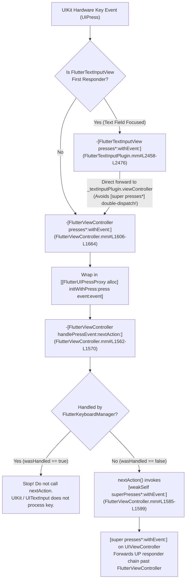

# 🥜 [Peanut #5] Hardware Keyboard, Text Input & Scribble Integration

> [!NOTE]
> **Parent Blueprint:** [🌾 `FlutterViewController.md`](../FlutterViewController.md)
> - **Primary Implementation Ranges:**
>   - [`FlutterViewController.mm` (`#L742-L819`, `#L852-L871`, `#L939-L963`, `#L1562-L1664`, `#L2053-L2070`, `#L2303-L2305`)](../FlutterViewController.mm#L796-L819)
>   - [`FlutterViewController_Internal.h` (`#L34-L66`)](../FlutterViewController_Internal.h#L34-L66)
> - **Collaborating Subsystems:**
>   - [`UIPressProxy.swift` (`#L1-L73`)](../UIPressProxy.swift#L1-L73) & [`FakeUIPressProxy.swift` (`#L1-L56`)](../FakeUIPressProxy.swift#L1-L56)
>   - [`FlutterKeyboardManager.h` (`#L1-L75`)](../FlutterKeyboardManager.h#L1-L75) / [`FlutterKeyboardManager.mm` (`#L1-L134`)](../FlutterKeyboardManager.mm#L1-L134)
>   - [`FlutterKeyPrimaryResponder.h` (`#L1-L35`)](../FlutterKeyPrimaryResponder.h#L1-L35) & [`FlutterKeySecondaryResponder.h` (`#L1-L32`)](../FlutterKeySecondaryResponder.h#L1-L32)
>   - [`FlutterEmbedderKeyResponder.mm` (`#L124-L147`, `#L503-L871`)](../FlutterEmbedderKeyResponder.mm#L503-L871) & [`FlutterChannelKeyResponder.mm` (`#L53-L76`, `#L103-L246`)](../FlutterChannelKeyResponder.mm#L103-L246)
>   - [`FlutterTextInputPlugin.h` (`#L1-L195`)](../FlutterTextInputPlugin.h#L1-L195) / [`FlutterTextInputPlugin.mm` (`#L833-L883`, `#L1247-L1267`, `#L2458-L2476`, `#L2590-L2609`, `#L2799-L2894`, `#L3171-L3328`)](../FlutterTextInputPlugin.mm#L2458-L3328)
>   - [`KeyboardInsetManager.swift` (`#L414-L424`)](../KeyboardInsetManager.swift#L414-L424)
>   - [`FlutterEngine.mm` (`#L505-L611`, `#L748-L756`, `#L1239-L1262`)](../FlutterEngine.mm#L505-L611)
> - **Verification Suites:**
>   - [`FlutterViewControllerTest.mm` (`#L1178-L1196`, `#L1533-L1565`, `#L2079-L2124`, `#L2165-L2273`)](../FlutterViewControllerTest.mm#L1533-L2273)
>   - [`FlutterKeyboardManagerTest.mm` (`#L1-L314`)](../FlutterKeyboardManagerTest.mm#L1-L314)
>   - [`FlutterChannelKeyResponderTest.mm` (`#L1-L144`)](../FlutterChannelKeyResponderTest.mm#L1-L144)

---

## 1. Physical Keyboard Pipeline (`UIPress` $\rightarrow$ `UIPressProxy` $\rightarrow$ `FlutterKeyboardManager`)

### End-to-End Dispatch Sequence

When a physical hardware keyboard (Smart Keyboard, Magic Keyboard, or Bluetooth keyboard) is attached to an iOS/iPadOS device, UIKit delivers `UIPress` events along the `UIResponder` chain via `pressesBegan:withEvent:`, `pressesChanged:withEvent:`, `pressesEnded:withEvent:`, and `pressesCancelled:withEvent:`.

Because UIKit requires a responder to synchronously invoke `[super presses*:withEvent:]` during the event dispatch turn if it does not consume a key press—whereas Flutter's Dart framework evaluates key bindings **asynchronously** on the UI thread—[`FlutterViewController`](../FlutterViewController.mm#L1562-L1664) and [`FlutterKeyboardManager`](../FlutterKeyboardManager.mm#L53-L132) bridge the two worlds using a Swift-backed `UIPressProxy` wrapper, a dual-responder fan-out, and a mode-restricted nested `CFRunLoop`.

```mermaid
sequenceDiagram
    autonumber
    participant UIKit as "UIKit (UIResponder Chain)"
    participant TIV as "FlutterTextInputView (If Focused)"
    participant FVC as "FlutterViewController"
    participant FKM as "FlutterKeyboardManager"
    participant Prim as "Primary Responders (Embedder + Channel)"
    participant Dart as "Dart UI Thread (HardwareKeyboard & RawKeyboard)"
    participant Sec as "Secondary Responders (FlutterTextInputPlugin)"
    participant Super as "[UIViewController presses*:withEvent:]"

    alt Text field focused (FlutterTextInputView is first responder)
        UIKit->>TIV: pressesBegan/Changed/Ended/Cancelled:withEvent:
        TIV->>FVC: [_textInputPlugin.viewController presses*:presses withEvent:event]
    else No text field focused
        UIKit->>FVC: pressesBegan/Changed/Ended/Cancelled:withEvent:
    end

    loop For each UIPress in presses
        FVC->>FVC: Wrap in [[FlutterUIPressProxy alloc] initWithPress:press event:event]
        FVC->>FKM: handlePress:pressProxy nextAction:^()
        alt Phase is Began or Ended
            par Fan-out to all Primary Responders
                FKM->>Prim: FlutterEmbedderKeyResponder handlePress:callback:
                Prim->>Dart: sendKeyEvent (flutter/keydata packet)
            and
                FKM->>Prim: FlutterChannelKeyResponder handlePress:callback:
                Prim->>Dart: keyEventChannel sendMessage: (flutter/keyevent JSON)
            end
            Note over FKM: Blocks platform thread in nested run loop:<br/>CFRunLoopRunInMode(kMessageLoopCFRunLoopMode, kDistantFuture, NO)
            Dart-->>Prim: Async replies (handled: YES/NO)
            Prim-->>FKM: replyCallback(BOOL handled)
            alt Both primary responders replied handled == NO
                FKM->>Sec: dispatchToSecondaryResponders:complete:
                Sec-->>FKM: -[FlutterTextInputPlugin handlePress:] (returns NO)
            end
            Note over FKM: CFRunLoopStop(CFRunLoopGetCurrent()) wakes platform thread
        else Phase is Changed, Cancelled, or Stationary
            Note over FKM: Ignored by Flutter (wasHandled = false immediately)
        end

        alt wasHandled == false
            FKM->>FVC: Execute nextAction() block
            FVC->>Super: [weakSelf superPresses*:[NSSet setWithObject:press] withEvent:event]
        else wasHandled == true
            Note over FKM: Drop nextAction(); event consumed by Flutter
        end
    end
```

---

### Step 1: Registration in `addInternalPlugins` (`#L796-L819`)

During [`-[FlutterViewController viewDidLoad]`](file:///usr/local/google/home/louisehsu/.gemini/jetski/brain/f61f8251-c20d-4de6-ae1a-3274b193d650/scratch/flutter_monorepo/engine/src/flutter/shell/platform/darwin/ios/framework/Source/FlutterViewController.mm#L742-L794), after launching or attaching the `FlutterEngine`, `FlutterViewController` calls [`[self addInternalPlugins]`](file:///usr/local/google/home/louisehsu/.gemini/jetski/brain/f61f8251-c20d-4de6-ae1a-3274b193d650/scratch/flutter_monorepo/engine/src/flutter/shell/platform/darwin/ios/framework/Source/FlutterViewController.mm#L796-L815) (introduced in commit `50b5b3f7e5`, PR [#25961](https://github.com/flutter/engine/pull/25961); verified by [`testInternalPluginsInvokeInViewDidLoad`](../FlutterViewControllerTest.mm#L1552-L1565)). This method constructs `self.keyboardManager` and wires up a two-tier responder hierarchy:

| Tier | Responder Class | Registration Site | Underlying Transport | Purpose |
| :--- | :--- | :--- | :--- | :--- |
| **Primary #1** | [`FlutterEmbedderKeyResponder`](../FlutterEmbedderKeyResponder.mm#L503-L871) | [`FlutterViewController.mm#L798-L804`](../FlutterViewController.mm#L798-L804) | [`-[FlutterEngine sendKeyEvent:callback:userData:]`](file:///usr/local/google/home/louisehsu/.gemini/jetski/brain/f61f8251-c20d-4de6-ae1a-3274b193d650/scratch/flutter_monorepo/engine/src/flutter/shell/platform/darwin/ios/framework/Source/FlutterEngine.mm#L505-L550) $\rightarrow$ binary `flutter::KeyDataPacket` on `"flutter/keydata"` | Feeds Flutter's modern `HardwareKeyboard` / `KeyEvent` system (`KeyData` protocol). |
| **Primary #2** | [`FlutterChannelKeyResponder`](../FlutterChannelKeyResponder.mm#L103-L246) | [`FlutterViewController.mm#L805-L807`](../FlutterViewController.mm#L805-L807) | `self.engine.keyEventChannel` (`FlutterBasicMessageChannel` with `FlutterJSONMessageCodec` on `"flutter/keyevent"`) | Preserves backward compatibility with Flutter's legacy `RawKeyboard` / `RawKeyEvent` API. |
| **Secondary** | [`FlutterTextInputPlugin`](../FlutterTextInputPlugin.mm#L3326-L3328) | [`FlutterViewController.mm#L808-L811`](../FlutterViewController.mm#L808-L811) | Synchronous `-[FlutterTextInputPlugin handlePress:]` | Consulted only if **neither** primary responder handles the key press; currently a stub returning `NO` (`#L3326-L3328`), allowing unhandled keys to fall through to UIKit's responder chain via `nextAction`. |

> [!IMPORTANT]
> **Preventing Retain Cycles & Dangling Engine Pointers in `sendEvent` (`#L798-L803`)**
> When `FlutterEmbedderKeyResponder` is initialized in [`addInternalPlugins`](../FlutterViewController.mm#L798-L804), its `sendEvent` block captures `__weak FlutterViewController* weakSelf = self`.
> - In commit `c19137fd56` (PR [#29623](https://github.com/flutter/engine/pull/29623)), `self` was originally captured strongly (`self.engine`), which caused a retain cycle: `FlutterViewController` $\rightarrow$ `keyboardManager` $\rightarrow$ `FlutterEmbedderKeyResponder` $\rightarrow$ `sendEvent` block $\rightarrow$ `FlutterViewController`.
> - In commits `132a1e7de0` (PR [#30968](https://github.com/flutter/engine/pull/30968)) and `23c2bd69d0` (PR [#31008](https://github.com/flutter/engine/pull/31008)), storing a weak pointer to `FlutterEngine` directly was found to crash if the `FlutterViewController` deallocated while a key event was in flight. Capturing `__weak FlutterViewController* weakSelf` and routing through `[weakSelf.engine sendKeyEvent:...]` safely nil-short-circuits if `FlutterViewController` has deallocated (verified by [`testInternalPluginsWeakPtrNotCrash`](../FlutterViewControllerTest.mm#L1533-L1549)).
> - On teardown, [`-[FlutterViewController dealloc]`](file:///usr/local/google/home/louisehsu/.gemini/jetski/brain/f61f8251-c20d-4de6-ae1a-3274b193d650/scratch/flutter_monorepo/engine/src/flutter/shell/platform/darwin/ios/framework/Source/FlutterViewController.mm#L946-L963) calls [`[self removeInternalPlugins]`](file:///usr/local/google/home/louisehsu/.gemini/jetski/brain/f61f8251-c20d-4de6-ae1a-3274b193d650/scratch/flutter_monorepo/engine/src/flutter/shell/platform/darwin/ios/framework/Source/FlutterViewController.mm#L817-L819), which sets `self.keyboardManager = nil` (verified by [`testReleasesKeyboardManagerOnDealloc`](../FlutterViewControllerTest.mm#L2100-L2113)).

---

### Step 2: `UIPressProxy` & `FakeUIPressProxy` (Swift Migration in `InternalFlutterSwift`)

Because UIKit does not allow unit tests to directly instantiate or initialize `UIPress` or `UIPressesEvent` objects, `FlutterViewController` wraps every incoming `UIPress*` and `UIPressesEvent*` in a proxy object before calling [`-[FlutterViewController handlePressEvent:nextAction:]`](file:///usr/local/google/home/louisehsu/.gemini/jetski/brain/f61f8251-c20d-4de6-ae1a-3274b193d650/scratch/flutter_monorepo/engine/src/flutter/shell/platform/darwin/ios/framework/Source/FlutterViewController.mm#L1562-L1570):

- **Production Wrapper ([`UIPressProxy.swift#L10-L72`](../UIPressProxy.swift#L10-L72)):**
  Exported to Objective-C via `@objc(FlutterUIPressProxy)` inside `InternalFlutterSwift`, `UIPressProxy` stores optional `private var press: UIPress?` and `private var event: UIEvent?` references (`#L14-L15`).
  - In [`FlutterViewController.mm#L1606-L1664`](../FlutterViewController.mm#L1606-L1664), `pressesBegan:withEvent:`, `pressesChanged:withEvent:`, `pressesEnded:withEvent:`, and `pressesCancelled:withEvent:` construct `[[FlutterUIPressProxy alloc] initWithPress:press event:event]` (bridged from `@objc init(press: UIPress, event: UIEvent)` at [`UIPressProxy.swift#L21-L25`](../UIPressProxy.swift#L21-L25)) and pass it to `handlePressEvent:nextAction:`.
  - Exposes `@objc public func phase() -> UIPress.Phase`, `key() -> UIKey?`, `type() -> UIEvent.EventType`, and `timestamp() -> TimeInterval` (`#L43-L71`).
- **Test Fake Subclass ([`FakeUIPressProxy.swift#L10-L55`](../FakeUIPressProxy.swift#L10-L55) & [`FlutterFakeKeyEvents.mm#L59-L97`](../FlutterFakeKeyEvents.mm#L59-L97)):**
  `UIPressProxy` provides an `@objc override init()` initializer (`#L32-L36`) specifically so `FakeUIPressProxy` (`@objc(FlutterFakeUIPressProxy)`) can subclass it without holding a real `UIPress` or `UIEvent`, injecting synthetic `dataPhase`, `dataKey`, `dataType`, and `dataTimestamp` values in unit tests.

---

### Step 3: Why `FlutterKeyboardManager` Spins a Nested `CFRunLoop` in `kMessageLoopCFRunLoopMode`

Inside [`-[FlutterKeyboardManager handlePress:nextAction:]`](file:///usr/local/google/home/louisehsu/.gemini/jetski/brain/f61f8251-c20d-4de6-ae1a-3274b193d650/scratch/flutter_monorepo/engine/src/flutter/shell/platform/darwin/ios/framework/Source/FlutterKeyboardManager.mm#L53-L110):

1. **Phase Filtering (`#L67-L106`):**
   - Only `UIPressPhaseBegan` and `UIPressPhaseEnded` are dispatched to Flutter responders.
   - `UIPressPhaseChanged`, `UIPressPhaseCancelled`, and `UIPressPhaseStationary` immediately break out of the `switch` with `wasHandled = false` ([`FlutterKeyboardManager.mm#L102-L106`](../FlutterKeyboardManager.mm#L102-L106)) and invoke `next()` synchronously so UIKit still receives them (verified by [`testIgnoredKeyEvents`](../FlutterViewControllerTest.mm#L2237-L2273)).
2. **Concurrent Primary Fan-Out (`#L70-L97`):**
   - Both `FlutterEmbedderKeyResponder` and `FlutterChannelKeyResponder` are invoked before waiting.
   - Each responder must invoke `replyCallback(BOOL handled)` exactly once. When `unreplied == 0` (`#L81`), if `anyHandled` is `YES`, `completeCallback(true, press)` records `wasHandled = true` and stops the nested run loop via `CFRunLoopStop(CFRunLoopGetCurrent())` (`#L64`). If `anyHandled` is `NO`, it calls [`dispatchToSecondaryResponders:complete:`](../FlutterKeyboardManager.mm#L114-L131).
3. **Mode-Isolated Nested Run Loop (`#L99`):**
   ```objc
   // Wait until completeCallback is called.
   CFRunLoopRunInMode(fml::MessageLoopDarwin::kMessageLoopCFRunLoopMode, kDistantFuture, NO);
   ```

> [!WARNING]
> **Why `kMessageLoopCFRunLoopMode` Instead of `CFRunLoopRun()`? (PR [#29113](https://github.com/flutter/engine/pull/29113))**
> When `FlutterKeyboardManager` was first landed in commit `50b5b3f7e5` (PR [#25961](https://github.com/flutter/engine/pull/25961)), line 99 called `CFRunLoopRun()`, which runs the current run loop in `kCFRunLoopDefaultMode`.
>
> **The Bug:** Because UIKit dispatches hardware `UIPress` events on `kCFRunLoopDefaultMode`, spinning a nested `CFRunLoopRun()` while waiting for Dart's async reply allowed UIKit to pump the **next** key press into `FlutterViewController` $\rightarrow$ `FlutterKeyboardManager` **re-entrantly** before the first key press's run loop had exited! Fast typing on a physical keyboard interleaved nested `handlePress:nextAction:` frames on the call stack and produced duplicate characters.
>
> **The Fix (Commit `b83eabca5a`, PR [#29113](https://github.com/flutter/engine/pull/29113)):** Switching to `CFRunLoopRunInMode(fml::MessageLoopDarwin::kMessageLoopCFRunLoopMode, kDistantFuture, NO)` runs the nested loop **exclusively** in FML's custom Darwin message loop mode. In this mode:
> - Tasks posted back to the platform thread from the Dart UI thread (the key-event reply callbacks) **are** processed and call `CFRunLoopStop(CFRunLoopGetCurrent())`.
> - UIKit input sources (which are scheduled on `kCFRunLoopDefaultMode` / `UITrackingRunLoopMode`) are **held back** until the current key press finishes and `handlePress:nextAction:` returns (verified by [`testEventsProcessedSequentially`](../FlutterKeyboardManagerTest.mm#L244-L311)).

---

### Step 4: iOS Hardware Key Normalization in `FlutterEmbedderKeyResponder` & `FlutterChannelKeyResponder`

Both primary responders inspect the `FlutterUIPressProxy*` and compensate for several iOS UIKit hardware keyboard quirks:

1. **Stripping Bogus Control Characters on Function Keys (`getEventCharacters`):**
   - On iOS, pressing non-printable function keys (`UIKeyboardHIDUsageKeyboardF1` through `F24`, Home, End, PageUp, PageDown, etc.) populates `press.key.characters` with `"\^P"` (ASCII `0x10` `DLE` / `SHIFT IN`). Both [`FlutterEmbedderKeyResponder.mm#L124-L147`](../FlutterEmbedderKeyResponder.mm#L124-L147) and [`FlutterChannelKeyResponder.mm#L53-L76`](../FlutterChannelKeyResponder.mm#L53-L76) check `isKeyCodePrintable(press.key.keyCode)` and substitute `@""` when non-printable.
2. **Normalizing Modifier Flags on Modifier Key-Up (`adjustModifiers:`):**
   - Unlike macOS `NSEvent`, when a user releases a modifier key (Shift, Control, Option, Command) on iOS, the `UIPressPhaseEnded` event for that modifier key **still has that modifier's flag bit set** in `press.key.modifierFlags`.
   - Furthermore, iOS never sets the device-dependent left/right sided modifier bits (`kModifierFlagShiftLeft`, etc.) that `kKeyCodeToModifierFlag` expects.
   - [`-[FlutterEmbedderKeyResponder adjustModifiers:]`](file:///usr/local/google/home/louisehsu/.gemini/jetski/brain/f61f8251-c20d-4de6-ae1a-3274b193d650/scratch/flutter_monorepo/engine/src/flutter/shell/platform/darwin/ios/framework/Source/FlutterEmbedderKeyResponder.mm#L811-L871) and [`-[FlutterChannelKeyResponder adjustModifiers:]`](file:///usr/local/google/home/louisehsu/.gemini/jetski/brain/f61f8251-c20d-4de6-ae1a-3274b193d650/scratch/flutter_monorepo/engine/src/flutter/shell/platform/darwin/ios/framework/Source/FlutterChannelKeyResponder.mm#L236-L246) clear the released modifier's bit on `UIPressPhaseEnded`, set it on `UIPressPhaseBegan`, and mirror generic modifier flags onto the left-sided bit masks via `fixSidedFlags:`.
3. **Synthesizing Modifier State & Guarding Stray Key Events (`FlutterEmbedderKeyResponder`):**
   - [`FlutterEmbedderKeyResponder`](../FlutterEmbedderKeyResponder.mm#L503-L745) maintains `_pressingRecords` (`physicalKey -> logicalKey`), synthesizes missing modifier key-down/up events when `modifierFlags` disagree with tracked state ([`synchronizeModifiers:`](../FlutterEmbedderKeyResponder.mm#L542-L590)), synthesizes paired key-down + key-up events for `CapsLock` toggles ([`synthesizeCapsLockTapWithTimestamp:`](../FlutterEmbedderKeyResponder.mm#L592-L611)), and sends an empty `FlutterKeyEvent` (`physical = 0, logical = 0`) when a stray `UIPressPhaseEnded` arrives for an untracked key (e.g. when focus switches into `FlutterViewController` mid-keystroke in an add-to-app host, [`#L713-L725`](../FlutterEmbedderKeyResponder.mm#L713-L725)).

---

## 2. Responder Chain Forwarding & Loop/Cycle Avoidance (`FlutterTextInputView` $\rightarrow$ `FlutterViewController` $\rightarrow$ `superPresses*`)

### Why Key Events Must Be Intercepted in Two Places

In UIKit, hardware key events start at the **first responder** and travel up the responder chain (`UIView` $\rightarrow$ `superview` $\rightarrow$ ... $\rightarrow$ `UIViewController` $\rightarrow$ `UIWindow` $\rightarrow$ `UIApplication`):

- **Outside a text field:** No subview is first responder, so `UIPress` events reach [`FlutterViewController`](../FlutterViewController.mm#L1606-L1664) directly.
- **Inside a focused Flutter text field:** [`FlutterTextInputView`](../FlutterTextInputPlugin.mm#L833-L883) (a `UIView <UITextInput>` subview hosted inside `_inputHider` inside `FlutterViewController.view`) is the UIKit **first responder**. Consequently, UIKit delivers `pressesBegan:withEvent:` to `FlutterTextInputView` *before* `FlutterViewController` ever sees it! If `FlutterTextInputView` let `UIView`'s default `UITextInput` implementation consume the key (such as Arrow keys, Escape, Tab, or Enter) before consulting Flutter, Dart's `HardwareKeyboard` / `FocusNode` / `Shortcuts` system would never get a chance to intercept the keystroke.



---

### Git Archaeology: Eliminating the Double-Dispatch Loop (PR [#30580](https://github.com/flutter/engine/pull/30580))

When `FlutterKeyboardManager` was introduced in commit `50b5b3f7e5` (PR [#25961](https://github.com/flutter/engine/pull/25961)), both `FlutterTextInputView` and `FlutterViewController` implemented `pressesBegan:withEvent:` by calling `handlePressEvent:nextAction:` with `nextAction: ^() { [super pressesBegan:...]; }`.

**What went wrong:**
1. While a Flutter `TextField` was focused, `FlutterTextInputView` received `pressesBegan:withEvent:` first and dispatched the key to `FlutterKeyboardManager`.
2. When the Dart framework replied `handled: false` (which is the normal case for regular typing keys or unhandled shortcuts), `FlutterTextInputView`'s `nextAction` called `[super pressesBegan:presses withEvent:event]`.
3. Because `FlutterTextInputView` is a child view of `_inputHider` inside `FlutterViewController.view`, `[super pressesBegan:...]` on `UIResponder` walked **up the responder chain** to `FlutterViewController`!
4. `FlutterViewController`'s `pressesBegan:withEvent:` then ran for the **exact same `UIPress`** and dispatched it through `FlutterKeyboardManager` a **second time** (`flutter/keydata` and `flutter/keyevent` received duplicate key events for every unhandled keystroke when a text field had focus!).

**The Fix (Commit `70798c3174`, PR [#30580](https://github.com/flutter/engine/pull/30580)):**
[`FlutterTextInputView`](../FlutterTextInputPlugin.mm#L2458-L2476) was simplified so its `pressesBegan:` / `Changed:` / `Ended:` / `Cancelled:` methods never call `super` or `handlePressEvent:` directly; instead, they forward directly to `_textInputPlugin.viewController`:

```objc
// FlutterTextInputPlugin.mm#L2458-L2476
- (void)pressesBegan:(NSSet<UIPress*>*)presses withEvent:(UIPressesEvent*)event {
  [_textInputPlugin.viewController pressesBegan:presses withEvent:event];
}
```

When `FlutterViewController` finishes running `FlutterKeyboardManager`, if the key was **not** handled, `FlutterViewController`'s `nextAction` invokes `[super pressesBegan:...]` on `FlutterViewController` (`UIViewController`), which forwards the event **up** the responder chain *above* `FlutterViewController` (never re-entering `FlutterTextInputView` or `FlutterViewController`).

---

### Why `superPressesBegan:` / `Changed:` / `Ended:` / `Cancelled:` Helper Methods Exist (`#L1572-L1599`)

In [`FlutterViewController.mm#L1572-L1664`](../FlutterViewController.mm#L1572-L1664), `FlutterViewController` defines four private helper methods:

```objc
- (void)superPressesBegan:(NSSet<UIPress*>*)presses withEvent:(UIPressesEvent*)event {
  [super pressesBegan:presses withEvent:event];
}
```

And invokes them from the `nextAction` block inside `pressesBegan:withEvent:` (and `Changed:` / `Ended:` / `Cancelled:`):

```objc
- (void)pressesBegan:(NSSet<UIPress*>*)presses
           withEvent:(UIPressesEvent*)event API_AVAILABLE(ios(13.4)) {
  __weak FlutterViewController* weakSelf = self;
  for (UIPress* press in presses) {
    FlutterUIPressProxy* pressProxy = [[FlutterUIPressProxy alloc] initWithPress:press event:event];
    [self handlePressEvent:pressProxy
                nextAction:^() {
                  [weakSelf superPressesBegan:[NSSet setWithObject:press] withEvent:event];
                }];
  }
}
```

1. **ARC Weak-Self Capture (Commit `3162aaad00`, PR [#55669](https://github.com/flutter/engine/pull/55669)):**
   In Objective-C, calling `[super ...]` inside a block (`^{ [super pressesBegan:...]; }`) implicitly captures a **strong** reference to `self` (`objc_msgSendSuper2` takes `self` as the receiver in its `objc_super` struct). During the ARC migration of `FlutterViewController.mm` (PR [#55669](https://github.com/flutter/engine/pull/55669)), `-superPressesBegan:withEvent:` through `-superPressesCancelled:withEvent:` (`#L1585-L1599`) were extracted so the `nextAction` block can capture `__weak FlutterViewController* weakSelf = self` without strongly retaining `FlutterViewController`.
2. **Per-Press Splitting (`#L1572-L1583`):**
   As noted in the source comment at [`FlutterViewController.mm#L1572-L1583`](../FlutterViewController.mm#L1572-L1583), `FlutterViewController` splits `NSSet<UIPress*>* presses` into individual `[NSSet setWithObject:press]` calls so that if a multi-press event contains one key handled by Flutter and another unhandled key, only the unhandled `UIPress` is passed to `super`.

---

## 3. `FlutterTextInputPlugin` & Apple Pencil Scribble (`UIIndirectScribbleInteraction`)

### How Apple Pencil Scribble Works Across Focused and Unfocused Flutter Text Fields

On iPadOS 14+, Apple Pencil **Scribble** allows users to handwrite directly into any text field on screen. In a standard UIKit app, every text field is a concrete `UITextField` / `UITextView` in the view hierarchy at all times. In Flutter, however, **unfocused text fields exist only in the Dart widget/element tree**—there is no `UIView` in the UIKit hierarchy until a text field becomes focused and opens a `TextInputConnection`.

To bridge this gap (introduced in commit `1ae721c023`, PR [#24224](https://github.com/flutter/engine/pull/24224)), [`FlutterTextInputPlugin`](../FlutterTextInputPlugin.mm#L3221-L3317) uses **two** complementary UIKit interactions:

```mermaid
sequenceDiagram
    autonumber
    participant Pencil as "iPadOS Scribble (Apple Pencil)"
    participant FView as "FlutterViewController.view (UIIndirectScribbleInteraction)"
    participant TIP as "FlutterTextInputPlugin"
    participant Engine as "FlutterEngine (FlutterIndirectScribbleDelegate)"
    participant Dart as "Dart TextInput (TextInputClient)"
    participant ActiveView as "FlutterTextInputView (UIScribbleInteraction)"

    Note over FView,TIP: Initialization during -[FlutterViewController viewDidLoad] -> addInternalPlugins
    FView->>TIP: [textInputPlugin setUpIndirectScribbleInteraction:self]
    TIP->>FView: [viewResponder.view addInteraction:[[UIIndirectScribbleInteraction alloc] initWithDelegate:self]]

    Note over Pencil,Dart: Phase 1: Pencil hovers/touches over unfocused Flutter canvas
    Pencil->>TIP: indirectScribbleInteraction:requestElementsInRect:completion:
    TIP->>Engine: flutterTextInputPlugin:requestElementsInRect:result:
    Engine->>Dart: invokeMethod:"TextInputClient.requestElementsInRect"
    Dart-->>TIP: List of [elementIdentifier, x, y, width, height]
    TIP-->>Pencil: Cache _scribbleElements dict & invoke completion(elementIdentifiers)
    Pencil->>TIP: indirectScribbleInteraction:frameForElement:
    TIP-->>Pencil: CGRect converted from _viewResponder.view coordinates

    Note over Pencil,ActiveView: Phase 2: User begins handwriting inside an element
    Pencil->>TIP: indirectScribbleInteraction:focusElementIfNeeded:referencePoint:completion:
    TIP->>Engine: flutterTextInputPlugin:focusElement:atPoint:result:
    Engine->>Dart: invokeMethod:"TextInputClient.focusElement"
    Dart->>TIP: TextInput.setClient + TextInput.setEditableSizeAndTransform + TextInput.show
    Note over TIP,ActiveView: Sizes _inputHider & _activeView over the widget rect;<br/>_activeView has direct UIScribbleInteraction
    TIP-->>Pencil: completion(_activeView)
    Pencil->>ActiveView: Direct UITextInput & UIScribbleInteraction handwriting insertion
```

1. **Unfocused Discovery (`UIIndirectScribbleInteraction` on `FlutterViewController.view`):**
   - [`-[FlutterTextInputPlugin setUpIndirectScribbleInteraction:]`](file:///usr/local/google/home/louisehsu/.gemini/jetski/brain/f61f8251-c20d-4de6-ae1a-3274b193d650/scratch/flutter_monorepo/engine/src/flutter/shell/platform/darwin/ios/framework/Source/FlutterTextInputPlugin.mm#L3301-L3313) attaches a `UIIndirectScribbleInteraction` (whose delegate is `FlutterTextInputPlugin`) to `viewResponder.view` (`FlutterViewController.view`).
   - When the user brings Apple Pencil near the screen, UIKit calls [`indirectScribbleInteraction:requestElementsInRect:completion:`](../FlutterTextInputPlugin.mm#L3271-L3297). `FlutterTextInputPlugin` asks `FlutterEngine` (conforming to [`FlutterIndirectScribbleDelegate`](../FlutterIndirectScribbleDelegate.h#L14-L23)) to invoke `"TextInputClient.requestElementsInRect"` on the Dart `flutter/textinput` channel ([`FlutterEngine.mm#L1252-L1262`](../FlutterEngine.mm#L1252-L1262)), caches the returned widget frames in `_scribbleElements`, and reports the element identifiers to UIKit.
   - When the user begins writing in an unfocused element, UIKit calls [`indirectScribbleInteraction:focusElementIfNeeded:referencePoint:completion:`](../FlutterTextInputPlugin.mm#L3229-L3243), which sends `"TextInputClient.focusElement"` to Dart ([`FlutterEngine.mm#L1239-L1250`](../FlutterEngine.mm#L1239-L1250)) and passes `_activeView` (`FlutterTextInputView`) to UIKit's completion block once focused.
2. **Focused Handwriting, Native Edit Menu & Touch Forwarding (`UIScribbleInteraction` + `UIEditMenuInteraction` + `FlutterViewResponder`):**
   - Each [`FlutterTextInputView`](../FlutterTextInputPlugin.mm#L871-L880) registers both a direct `UIScribbleInteraction` (`#L871-L874`) and, on iOS 16+, a `UIEditMenuInteraction` (`#L877-L880`).
   - While a text field is focused, [`-[FlutterTextInputPlugin setEditableSizeAndTransform:]`](file:///usr/local/google/home/louisehsu/.gemini/jetski/brain/f61f8251-c20d-4de6-ae1a-3274b193d650/scratch/flutter_monorepo/engine/src/flutter/shell/platform/darwin/ios/framework/Source/FlutterTextInputPlugin.mm#L2799-L2827) positions `_inputHider.frame` and `_activeView.frame` directly over the Flutter text widget's on-screen rectangle (with `tintColor = [UIColor clearColor]` so UIKit's native caret stays invisible).
   - Because `_activeView` now covers the Flutter text field's bounds in the UIKit view hierarchy, normal finger touches on the text field hit `FlutterTextInputView` instead of `FlutterView`. To prevent `_activeView` from swallowing touches meant for Flutter's gesture arena, [`FlutterTextInputView`](../FlutterTextInputPlugin.mm#L1247-L1267) forwards `touchesBegan:`, `touchesMoved:`, `touchesEnded:`, `touchesCancelled:`, and `forceTouchesCancelled:` back to `FlutterViewController` through the [`FlutterViewResponder`](../FlutterViewResponder.h#L16-L51) protocol (`_viewResponder`).
3. **Deferred View Removal During Active `UIScribbleInteraction` (`clearTextInputClient`, Issue [#180842](https://github.com/flutter/flutter/issues/180842)):**
   - If `TextInput.clearClient` arrives while a user is mid-handwriting or while `_scribbleFocusStatus` is still active (`FlutterScribbleFocusStatusFocusing` / `Focused` or `_activeView.scribbleInteractionStatus != FlutterScribbleInteractionStatusNone`), immediately removing `_activeView` from its superview causes UIKit's `UIScribbleInteraction` to crash or corrupt state.
   - [`-[FlutterTextInputPlugin clearTextInputClient]`](file:///usr/local/google/home/louisehsu/.gemini/jetski/brain/f61f8251-c20d-4de6-ae1a-3274b193d650/scratch/flutter_monorepo/engine/src/flutter/shell/platform/darwin/ios/framework/Source/FlutterTextInputPlugin.mm#L3171-L3202) checks whether Scribble is active (`#L3179-L3185`). If so, it retains `_activeView` and `_inputHider` in `_viewsToRemove` (`#L3190-L3196`) rather than detaching them immediately, and cleans them up once the Scribble interaction finishes (`removeViewsToRemove:` at `#L3204-L3217`) or on `hideTextInput` (`#L2889-L2893`).

---

### Attachment & Teardown Lifecycle (`viewDidLoad` vs. `dealloc`)

The lifecycle coupling between `FlutterViewController`, `FlutterEngine`, and `FlutterTextInputPlugin` was hardened across commits `1ae721c023` (PR [#24224](https://github.com/flutter/engine/pull/24224)), `7fda9c9695` (PR [#34642](https://github.com/flutter/engine/pull/34642)), and `6b532e866e` (PR [#36642](https://github.com/flutter/engine/pull/36642)):

| Lifecycle Event | Method / Notification | Exact Action & Rationale |
| :--- | :--- | :--- |
| **Engine Channel Setup** | [`-[FlutterEngine setUpChannels]`](file:///usr/local/google/home/louisehsu/.gemini/jetski/brain/f61f8251-c20d-4de6-ae1a-3274b193d650/scratch/flutter_monorepo/engine/src/flutter/shell/platform/darwin/ios/framework/Source/FlutterEngine.mm#L753-L756) | Allocates `FlutterTextInputPlugin` (`delegate:self`) and calls `[textInputPlugin setUpIndirectScribbleInteraction:self.viewController]`. If the engine was pre-warmed without a view controller (or before `viewDidLoad`), `self.viewController` is `nil` at this point. |
| **View Controller Attach** | [`-[FlutterEngine setViewController:]`](file:///usr/local/google/home/louisehsu/.gemini/jetski/brain/f61f8251-c20d-4de6-ae1a-3274b193d650/scratch/flutter_monorepo/engine/src/flutter/shell/platform/darwin/ios/framework/Source/FlutterEngine.mm#L559-L584) | Sets `self.textInputPlugin.viewController = viewController` (`weak` property on `FlutterTextInputPlugin`, `#L565`) and registers `FlutterEngine` as an observer for `FlutterViewControllerWillDealloc` on that view controller (`#L569-L575`). |
| **View Loaded (`viewDidLoad`)** | [`-[FlutterViewController addInternalPlugins]`](file:///usr/local/google/home/louisehsu/.gemini/jetski/brain/f61f8251-c20d-4de6-ae1a-3274b193d650/scratch/flutter_monorepo/engine/src/flutter/shell/platform/darwin/ios/framework/Source/FlutterViewController.mm#L808-L815) | Adds `textInputPlugin` (accessed via [`-[FlutterViewController textInputPlugin]`](file:///usr/local/google/home/louisehsu/.gemini/jetski/brain/f61f8251-c20d-4de6-ae1a-3274b193d650/scratch/flutter_monorepo/engine/src/flutter/shell/platform/darwin/ios/framework/Source/FlutterViewController.mm#L2303-L2305)) as a secondary responder to `self.keyboardManager`, and—if `self.engine.viewController == self`—calls `[textInputPlugin setUpIndirectScribbleInteraction:self]`. Calling this in `addInternalPlugins` (called from `viewDidLoad`, `#L754`) guarantees `self.view` is already loaded without triggering premature `loadView` during `initWithEngine:` (fixed in commit `7fda9c9695`, PR [#34642](https://github.com/flutter/engine/pull/34642), verified by [`testDoesntLoadViewInInit`](../FlutterViewControllerTest.mm#L2115-L2124)). Inside [`setUpIndirectScribbleInteraction:`](../FlutterTextInputPlugin.mm#L3301-L3313), `if (_viewResponder != viewResponder)` prevents duplicate interactions. |
| **View Controller `dealloc`** | [`-[FlutterViewController dealloc]`](file:///usr/local/google/home/louisehsu/.gemini/jetski/brain/f61f8251-c20d-4de6-ae1a-3274b193d650/scratch/flutter_monorepo/engine/src/flutter/shell/platform/darwin/ios/framework/Source/FlutterViewController.mm#L946-L963) $\rightarrow$ [`deregisterNotifications`](../FlutterViewController.mm#L939-L944) | Posts `FlutterViewControllerWillDealloc` synchronously before removing notification observers (verified by [`testWillDeallocNotification`](../FlutterViewControllerTest.mm#L2079-L2098)). `FlutterEngine` receives this in [`-[FlutterEngine notifyViewControllerDeallocated]`](file:///usr/local/google/home/louisehsu/.gemini/jetski/brain/f61f8251-c20d-4de6-ae1a-3274b193d650/scratch/flutter_monorepo/engine/src/flutter/shell/platform/darwin/ios/framework/Source/FlutterEngine.mm#L601-L611), which clears `self.textInputPlugin.viewController = nil` and calls [`[self.textInputPlugin resetViewResponder]`](file:///usr/local/google/home/louisehsu/.gemini/jetski/brain/f61f8251-c20d-4de6-ae1a-3274b193d650/scratch/flutter_monorepo/engine/src/flutter/shell/platform/darwin/ios/framework/Source/FlutterTextInputPlugin.mm#L3315-L3317) (`_viewResponder = nil`). |
| **Plugin `dealloc`** | [`-[FlutterTextInputPlugin dealloc]`](file:///usr/local/google/home/louisehsu/.gemini/jetski/brain/f61f8251-c20d-4de6-ae1a-3274b193d650/scratch/flutter_monorepo/engine/src/flutter/shell/platform/darwin/ios/framework/Source/FlutterTextInputPlugin.mm#L2590-L2592) | Calls [`[self reset]`](file:///usr/local/google/home/louisehsu/.gemini/jetski/brain/f61f8251-c20d-4de6-ae1a-3274b193d650/scratch/flutter_monorepo/engine/src/flutter/shell/platform/darwin/ios/framework/Source/FlutterTextInputPlugin.mm#L2605-L2609) $\rightarrow$ [`[self hideTextInput]`](file:///usr/local/google/home/louisehsu/.gemini/jetski/brain/f61f8251-c20d-4de6-ae1a-3274b193d650/scratch/flutter_monorepo/engine/src/flutter/shell/platform/darwin/ios/framework/Source/FlutterTextInputPlugin.mm#L2882-L2894), which resigns first responder on `_activeView` (`[_activeView resignFirstResponder]`) and removes `_activeView`, `_inputHider`, and any deferred `_viewsToRemove` from their superviews. |

---

## 4. Modal Presentation (`presentViewController:animated:completion:`) & View Disappearance (`viewWillDisappear:` / `viewDidDisappear:`)

### Tracking Native Modal Presentation (`#L2053-L2070`)

[`FlutterViewController`](../FlutterViewController.mm#L2053-L2070) overrides `presentViewController:animated:completion:` and exposes the internal readonly property `isPresentingViewController` (declared in [`FlutterViewController_Internal.h#L36`](../FlutterViewController_Internal.h#L36) and backed by `isPresentingViewControllerAnimating` at [`FlutterViewController.mm#L90`](../FlutterViewController.mm#L90)):

```objc
// FlutterViewController.mm#L2053-L2070
- (void)presentViewController:(UIViewController*)viewControllerToPresent
                     animated:(BOOL)flag
                   completion:(void (^)(void))completion {
  self.isPresentingViewControllerAnimating = YES;
  __weak FlutterViewController* weakSelf = self;
  [super presentViewController:viewControllerToPresent
                      animated:flag
                    completion:^{
                      weakSelf.isPresentingViewControllerAnimating = NO;
                      if (completion) {
                        completion();
                      }
                    }];
}

- (BOOL)isPresentingViewController {
  return self.presentedViewController != nil || self.isPresentingViewControllerAnimating;
}
```

> [!TIP]
> **Why `isPresentingViewController` Tracks Both `presentedViewController` and `isPresentingViewControllerAnimating` (PR [#18544](https://github.com/flutter/engine/pull/18544))**
> Introduced in commit `f1d37398f4` (PR [#18544](https://github.com/flutter/engine/pull/18544)), `isPresentingViewController` is queried by [`AccessibilityBridge::IosDelegate::IsFlutterViewControllerPresentingModalViewController`](../accessibility_bridge.mm#L26-L33):
> - When a Flutter app opens a native modal `UIViewController` (such as `UIImagePickerController`, `MFMailComposeViewController`, or `UIActivityViewController`) while simultaneously popping a Flutter route (e.g. closing a bottom sheet that triggered the picker), Flutter's `SemanticsUpdate` carries `SemanticsFlags::kScopesRoute`.
> - Normally, `AccessibilityBridge` posts `UIAccessibilityScreenChangedNotification` on route changes, which forces iOS VoiceOver focus onto the Flutter view—**stealing accessibility focus away from the newly presented native modal view controller** (or even locking VoiceOver focus onto the backgrounded Flutter view).
> - Checking `[view_controller isPresentingViewController]` (including the animation window before `presentedViewController` stabilizes) suppresses `UIAccessibilityScreenChangedNotification`, `UIAccessibilityLayoutChangedNotification`, and `UIAccessibilityPageScrolledNotification` whenever a native modal is being presented over `FlutterViewController` (verified by [`testAnnouncesIgnoresRouteChangesWhenModal`](../accessibility_bridge_test.mm#L2161-L2214), [`testAnnouncesIgnoresLayoutChangeWhenModal`](../accessibility_bridge_test.mm#L2216-L2274), and [`testAnnouncesIgnoresScrollChangeWhenModal`](../accessibility_bridge_test.mm#L2276-L2330)).

---

### Disappearance & Keyboard Inset Cleanup (`viewWillDisappear:` / `viewDidDisappear:`)

When `FlutterViewController` disappears (either because it is popped/dismissed or because a full-screen native `UIViewController` is presented over it), [`viewWillDisappear:`](../FlutterViewController.mm#L852-L858) and [`viewDidDisappear:`](../FlutterViewController.mm#L860-L871) coordinate lifecycle transitions and keyboard animation cleanup:

1. **`viewWillDisappear:` (`#L852-L858`):**
   - Guarded by `if (self.engine.viewController == self)`, sends `"AppLifecycleState.inactive"` over `self.engine.lifecycleChannel`.
2. **`viewDidDisappear:` (`#L860-L871`):**
   - Guarded by `if (self.engine.viewController == self)`:
     - Calls [`[self.keyboardInsetManager hideKeyboardImmediately]`](file:///usr/local/google/home/louisehsu/.gemini/jetski/brain/f61f8251-c20d-4de6-ae1a-3274b193d650/scratch/flutter_monorepo/engine/src/flutter/shell/platform/darwin/ios/framework/Source/FlutterViewController.mm#L863) (implemented in [`KeyboardInsetManager.swift#L414-L424`](../KeyboardInsetManager.swift#L414-L424)), which:
       1. Calls `invalidateKeyboardAnimationVSyncClient()` to halt any in-flight `VSyncClient` driving a keyboard spring animation.
       2. Removes `keyboardAnimationView` from its superview and clears `keyboardSpringAnimation = nil`.
       3. Resets `targetViewInsetBottom = 0` and calls `ensureViewportMetricsIsCorrect()` (originally added in commit `479bb736fe`, PR [#37719](https://github.com/flutter/engine/pull/37719)) so that if `FlutterViewController` disappears mid-keyboard-animation, `_viewportMetrics.physical_view_inset_bottom` snaps cleanly to `targetViewInsetBottom` instead of freezing at an intermediate spring value (verified by [`testEnsureViewportMetricsWillInvokeAndDisplayLinkWillInvalidateInViewDidDisappear`](../FlutterViewControllerTest.mm#L1178-L1196)).
     - Calls `[self surfaceUpdated:NO]` (`#L864`), sends `"AppLifecycleState.paused"` (`#L865`), flushes ongoing pointer touches (`[self flushOngoingTouches]` at `#L866`), and purges cached memory (`[self.engine notifyLowMemory]` at `#L867`).
3. **Keyboard Notifications While Presenting a Native View Controller (`shouldIgnoreKeyboardNotification:`):**
   - As detailed in [Peanut #3: Viewport Metrics, Safe Areas & Keyboard Spring Animation](./3_viewport_and_keyboard_inset.md), when a native modal presented over `FlutterViewController` (or another view controller in the same window) triggers `UIKeyboardWillHideNotification`, [`KeyboardInsetManager.shouldIgnoreKeyboardNotification(_:)`](../KeyboardInsetManager.swift#L220-L253) **never** ignores `UIKeyboardWillHideNotification` (`#L225-L227`, commit `ec4f72b33d`, PR [#29862](https://github.com/flutter/engine/pull/29862)), ensuring Flutter's bottom keyboard inset resets to `0` even if the keyboard was dismissed while a native modal was active.

---

## 5. Test Coverage Matrix

### `FlutterViewControllerTest.mm`

| Test Name | Source Location | Key Invariant Verified |
| :--- | :--- | :--- |
| [`testEnsureViewportMetricsWillInvokeAndDisplayLinkWillInvalidateInViewDidDisappear`](../FlutterViewControllerTest.mm#L1178-L1196) | `#L1178-L1196` | `viewDidDisappear:` invokes `[self.keyboardInsetManager hideKeyboardImmediately]`, which calls both `ensureViewportMetricsIsCorrect` and `invalidateKeyboardAnimationVSyncClient`. |
| [`testInternalPluginsWeakPtrNotCrash`](../FlutterViewControllerTest.mm#L1533-L1549) | `#L1533-L1549` | Deallocating `FlutterViewController` and `FlutterEngine` before `FlutterKeyboardManager` dispatches a `UIPress` does not crash inside `FlutterEmbedderKeyResponder`'s `sendEvent` block (`weakSelf.engine`). |
| [`testInternalPluginsInvokeInViewDidLoad`](../FlutterViewControllerTest.mm#L1552-L1565) | `#L1552-L1565` | `viewDidLoad` invokes `[self addInternalPlugins]` after the view is loaded (regression test for PR `#32098`). |
| [`testWillDeallocNotification`](../FlutterViewControllerTest.mm#L2079-L2098) | `#L2079-L2098` | `-[FlutterViewController dealloc]` posts `FlutterViewControllerWillDealloc` via `deregisterNotifications`. |
| [`testReleasesKeyboardManagerOnDealloc`](../FlutterViewControllerTest.mm#L2100-L2113) | `#L2100-L2113` | `-[FlutterViewController dealloc]` calls `removeInternalPlugins` and releases `FlutterKeyboardManager` (`weakKeyboardManager == nil` after `viewController = nil`). |
| [`testDoesntLoadViewInInit`](../FlutterViewControllerTest.mm#L2115-L2124) | `#L2115-L2124` | Initializing `FlutterViewController` with an attached `FlutterEngine` does not prematurely load `FlutterViewController.view` (`isViewLoaded` remains `NO` until `viewDidLoad`, when `addInternalPlugins` sets up `UIIndirectScribbleInteraction`). |
| [`testValidKeyUpEvent`](../FlutterViewControllerTest.mm#L2165-L2198) & [`testValidKeyDownEvent`](../FlutterViewControllerTest.mm#L2200-L2235) | `#L2165-L2235` | `UIPressPhaseBegan` and `UIPressPhaseEnded` events wrapped in `FlutterUIPressProxy` are accepted by `FlutterKeyboardManager` and dispatched to `keyEventChannel`. |
| [`testIgnoredKeyEvents`](../FlutterViewControllerTest.mm#L2237-L2273) | `#L2237-L2273` | `UIPressPhaseChanged`, `UIPressPhaseCancelled`, and `UIPressPhaseStationary` are ignored by `FlutterKeyboardManager` (`wasHandled = false`) and never sent over `keyEventChannel`. |

### `FlutterKeyboardManagerTest.mm` & `FlutterChannelKeyResponderTest.mm`

| Test Name | Source Location | Key Invariant Verified |
| :--- | :--- | :--- |
| [`testSinglePrimaryResponder`](../FlutterKeyboardManagerTest.mm#L94-L124) & [`testDoublePrimaryResponder`](../FlutterKeyboardManagerTest.mm#L126-L187) | `FlutterKeyboardManagerTest.mm#L94-L187` | All primary responders receive every key event; `nextAction` runs iff **all** primary (and secondary) responders return `NO`. |
| [`testSingleSecondaryResponder`](../FlutterKeyboardManagerTest.mm#L189-L242) | `FlutterKeyboardManagerTest.mm#L189-L242` | Secondary responders are consulted only when all primary responders reply `NO`, and can still suppress `nextAction` by returning `YES`. |
| [`testEventsProcessedSequentially`](../FlutterKeyboardManagerTest.mm#L244-L311) | `FlutterKeyboardManagerTest.mm#L244-L311` | `CFRunLoopRunInMode(kMessageLoopCFRunLoopMode, ...)` prevents a second `UIPress` on `kCFRunLoopDefaultMode` from re-entering `handlePress:nextAction:` before the first event's async reply finishes. |
| [`testBasicKeyEvent`](../FlutterChannelKeyResponderTest.mm#L44-L105) & [`testEmptyResponseIsTakenAsHandled`](../FlutterChannelKeyResponderTest.mm#L107-L141) | `FlutterChannelKeyResponderTest.mm#L44-L141` | Verifies `flutter/keyevent` JSON payload encoding, modifier flag adjustment on key-up, and default `handled = YES` fallback when the channel has no registered Dart handler. |
