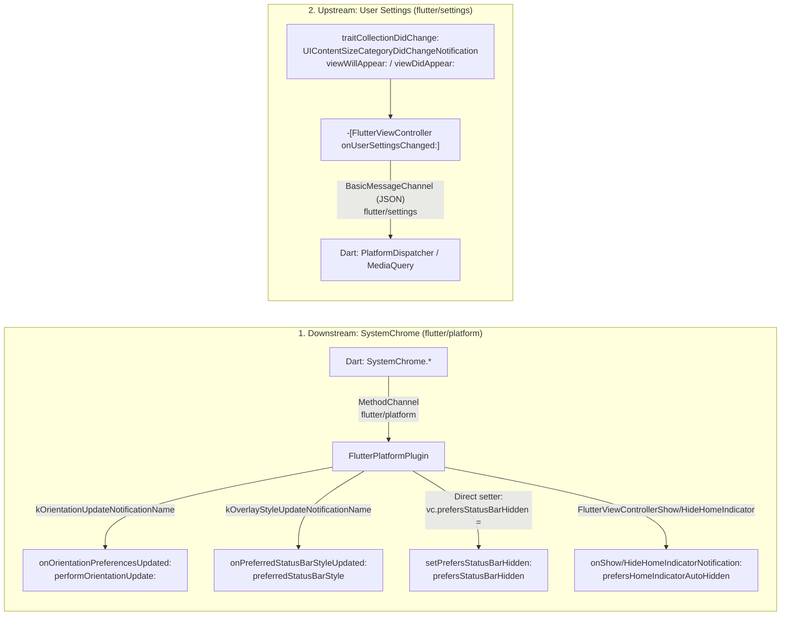
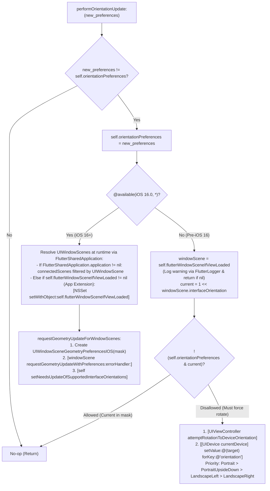

# 🥜 [Peanut #6] System Chrome, Orientation Locks & User Settings (`flutter/settings`)

> [!NOTE]
> **Parent Blueprint:** [🌾 `FlutterViewController.md`](../FlutterViewController.md)
> **Scope of this Peanut:** How [`FlutterViewController`](../FlutterViewController.mm) and [`FlutterPlatformPlugin`](../FlutterPlatformPlugin.mm) enforce `SystemChrome` preferences (device orientation locks, status bar style/visibility, and home indicator auto-hiding), coordinate runtime App Extension detection via [`FlutterSharedApplication`](../FlutterSharedApplication.mm), and synchronize iOS system traits and user preferences with the Dart framework over the `flutter/settings` channel.
> **Files Covered:**
> - [`FlutterViewController.mm`](../FlutterViewController.mm) (`#L50-L53`, `#L82-L83`, `#L89`, `#L93`, `#L364-L365`, `#L380-L388`, `#L418-L431`, `#L824-L827`, `#L841-L843`, `#L1666-L1773`, `#L1805-L1960`)
> - [`FlutterViewController_Internal.h`](../FlutterViewController_Internal.h) (`#L26-L32`, `#L49`, `#L67`)
> - [`FlutterSharedApplication.h`](../FlutterSharedApplication.h) (`#L1-L41`) & [`FlutterSharedApplication.mm`](../FlutterSharedApplication.mm) (`#L1-L70`)
> - [`FlutterPlatformPlugin.h`](../FlutterPlatformPlugin.h) & [`FlutterPlatformPlugin.mm`](../FlutterPlatformPlugin.mm) (`#L31-L70`, `#L92-L111`, `#L180-L197`, `#L287-L390`)
> - [`FlutterHourFormat.h`](../../../../common/framework/Headers/FlutterHourFormat.h) & [`FlutterHourFormat.mm`](../../../../common/framework/Source/FlutterHourFormat.mm) (`#L1-L27`)
> - [`FlutterViewControllerTest.mm`](../FlutterViewControllerTest.mm) (`#L1248-L1301`, `#L1600-L1814`, `#L1864-L2069`, `#L2126-L2138`, `#L3073-L3085`)
> - [`FlutterPlatformPluginTest.mm`](../FlutterPlatformPluginTest.mm) (`#L404-L649`)

---

## 1. Mental Model: Two Opposing Pipelines (`flutter/platform` vs. `flutter/settings`)

This slice of [`FlutterViewController.mm`](../FlutterViewController.mm) bridges two opposite directions of platform integration:

1. **Downstream (`Dart` $\rightarrow$ `flutter/platform` $\rightarrow$ `FlutterPlatformPlugin` $\rightarrow$ `FlutterViewController` $\rightarrow$ `UIKit`):**
   When a Flutter app calls `SystemChrome` APIs in Dart, method calls arrive on `FlutterEngine.platformChannel` ([`FlutterEngine.mm#L793-L795`](../FlutterEngine.mm#L793-L795)) and are decoded by [`FlutterPlatformPlugin`](../FlutterPlatformPlugin.mm). Because UIKit queries the active `UIViewController` for supported interface orientations, status bar style/visibility, and home indicator auto-hiding, `FlutterPlatformPlugin` forwards these updates (via `NSNotificationCenter` or direct property mutation) to `FlutterViewController`, which updates its backing properties and asks UIKit to re-evaluate its appearance.
2. **Upstream (`UIKit` $\rightarrow$ `FlutterViewController` $\rightarrow$ `flutter/settings` $\rightarrow$ `Dart`):**
   When iOS system settings or `UITraitCollection` properties change (Dark Mode, High Contrast, Dynamic Type text size, 24-hour clock format), `FlutterViewController` snapshots all 6 user settings in `onUserSettingsChanged:` ([`#L1818-L1827`](../FlutterViewController.mm#L1818-L1827)) and pushes a JSON dictionary over `self.engine.settingsChannel` ([`FlutterEngine.mm#L743-L746`](../FlutterEngine.mm#L743-L746)).



---

## 2. Device Orientation Locking (`onOrientationPreferencesUpdated:` & `performOrientationUpdate:`)

**Where:** [`FlutterPlatformPlugin.mm#L287-L313`](../FlutterPlatformPlugin.mm#L287-L313), [`FlutterViewController.mm#L364`](../FlutterViewController.mm#L364), [`#L380-L383`](../FlutterViewController.mm#L380-L383), [`#L1666-L1746`](../FlutterViewController.mm#L1666-L1746), [`#L1767-L1773`](../FlutterViewController.mm#L1767-L1773)

### 2.1 How `FlutterPlatformPlugin` Translates `SystemChrome.setPreferredOrientations`
1. **Default Initialization (`#L364`):** During `performCommonViewControllerInitialization`, `FlutterViewController` initializes `_orientationPreferences = UIInterfaceOrientationMaskAll`, so all orientations are permitted until Dart requests otherwise. `shouldAutorotate` (`#L1767-L1769`) always returns `YES`, and `supportedInterfaceOrientations` (`#L1771-L1773`) returns `self.orientationPreferences`.
2. **Mask Construction ([`FlutterPlatformPlugin.mm#L287-L308`](../FlutterPlatformPlugin.mm#L287-L308)):**
   - If the Dart `orientations` array is empty (`orientations.count == 0`), `mask` is set to `UIInterfaceOrientationMaskAll` (`#L290-L291`), restoring unrestricted rotation.
   - Otherwise, each string element is OR-ed into `UIInterfaceOrientationMask`:
     - `"DeviceOrientation.portraitUp"` $\rightarrow$ `UIInterfaceOrientationMaskPortrait`
     - `"DeviceOrientation.portraitDown"` $\rightarrow$ `UIInterfaceOrientationMaskPortraitUpsideDown`
     - `"DeviceOrientation.landscapeLeft"` $\rightarrow$ `UIInterfaceOrientationMaskLandscapeLeft`
     - `"DeviceOrientation.landscapeRight"` $\rightarrow$ `UIInterfaceOrientationMaskLandscapeRight`
   - If `mask == 0` (e.g., an invalid non-empty array), it returns early (`#L306-L308`).
3. **Notification Dispatch (`#L309-L312`):** Posts `@(flutter::kOrientationUpdateNotificationName)` (`"io.flutter.plugin.platform.SystemChromeOrientationNotificationName"`) to `NSNotificationCenter.defaultCenter` with `userInfo: @{@(kOrientationUpdateNotificationKey): @(mask)}`.
4. **Main-Queue Hop (`onOrientationPreferencesUpdated:`, `#L1668-L1679`):** Because notifications may not arrive on the iOS main thread, `FlutterViewController` dispatches asynchronously to `dispatch_get_main_queue()`, unpacks `update.unsignedIntegerValue`, and calls `[weakSelf performOrientationUpdate:]`.

### 2.2 The iOS 16+ vs. Pre-iOS 16 Rotation Architecture (`performOrientationUpdate:`)



#### A. Why iOS 16 Required a Completely New API (`#L1681-L1713`)
- **The Deprecation of `UIDevice` Orientation KVC (Commits `69f2bc881f` PR `#36874` & `9584880f4f` PR `#37302`):**
  Prior to iOS 16, when an app locked itself to an orientation different from the device's current orientation, the only way to force UIKit to rotate immediately was calling `[UIViewController attemptRotationToDeviceOrientation]` followed by a Key-Value Coding (KVC) write to the read-only property `[[UIDevice currentDevice] setValue:@(...) forKey:@"orientation"]` (introduced in commits `c38ed2ca1c` PR `#12295` and `3a32d9fe5c` PR `#13170`).
  In iOS 16, Apple deprecated `attemptRotationToDeviceOrientation` and made setting `UIDevice.orientation` via KVC a no-op that logs a runtime error:
  > `[Orientation] BUG IN CLIENT OF UIKIT: Setting UIDevice.orientation is not supported. Please use UIWindowScene.requestGeometryUpdate(_:)`
  Instead, iOS 16 requires constructing a `UIWindowSceneGeometryPreferencesIOS` with the `UIInterfaceOrientationMask`, passing it to `-[UIWindowScene requestGeometryUpdateWithPreferences:errorHandler:]` (logging errors via `os_log_error`), and calling `-[UIViewController setNeedsUpdateOfSupportedInterfaceOrientations]` (`#L1681-L1695`).
- **Why iOS 16+ Always Updates Preferences Without Checking `currentInterfaceOrientation` (Commit `dd1dc7258b`, PR `#38230`):**
  In the initial iOS 16 implementation (`#37302`), `FlutterViewController` only called `requestGeometryUpdateWithPreferences:` and `setNeedsUpdateOfSupportedInterfaceOrientations` when `!(_orientationPreferences & currentInterfaceOrientation)` (matching the pre-iOS 16 check).
  However, on iOS 16+, UIKit caches `supportedInterfaceOrientations` and will **not** re-query `-[FlutterViewController supportedInterfaceOrientations]` on subsequent physical device rotations unless `setNeedsUpdateOfSupportedInterfaceOrientations` is called! For example, if a user was in Portrait, locked to `Portrait`, and then unlocked to `All` while still holding the phone in Portrait (`_orientationPreferences & currentInterfaceOrientation` is non-zero), skipping `setNeedsUpdateOfSupportedInterfaceOrientations` left the app permanently stuck in Portrait. PR `#38230` removed the `currentInterfaceOrientation` check on iOS 16+ so `requestGeometryUpdateForWindowScenes:` runs whenever `new_preferences != self.orientationPreferences` (validated in [`FlutterViewControllerTest.mm#L2022-L2036`](../FlutterViewControllerTest.mm#L2022-L2036)).

> [!WARNING]
> **Historical Memory Leak Pitfall (`UIWindowSceneGeometryPreferencesIOS`):**
> When PR `#36874` (`69f2bc881f`) was reverted (`32d2d937ba` PR `#37165`) and relanded (`9584880f4f` PR `#37302`) while `FlutterViewController.mm` still used Manual Retain-Release (MRC), the `autorelease` fix from PR `#36958` (`4d3336b78c`) was accidentally dropped, leaking every `UIWindowSceneGeometryPreferencesIOS` instance until PR `#40957` (`d1dad6acbe`) restored `autorelease` and added the `XCTAssertNil(weakPreferences)` regression check in [`FlutterViewControllerTest.mm#L2012-L2068`](../FlutterViewControllerTest.mm#L2012-L2068). (`FlutterViewController.mm` has since been migrated to ARC in commit `3162aaad00`, PR `#55669`).

#### B. Pre-iOS 16 Rotation & Priority Cascade (`#L1714-L1744`)
On iOS versions prior to 16.0:
1. **Current Orientation Lookup (`#L1716-L1723`, Commit `9bd30c3938`, PR `#42846`):**
   - Uses `self.flutterWindowSceneIfViewLoaded.interfaceOrientation` (avoiding `UIApplication.statusBarOrientation`, which was deprecated in iOS 9; note that the legacy `< iOS 13` fallback has been removed since Flutter's minimum iOS deployment target is now iOS 13+).
   - If `windowScene` is `nil` (e.g., view not yet in a window), it logs a warning via `[FlutterLogger logWarning:...]` and returns early (`#L1717-L1722`).
   - Converts the `UIInterfaceOrientation` enum to a `UIInterfaceOrientationMask` bitmask via `1 << windowScene.interfaceOrientation` (`#L1723`).
2. **Forced KVC Rotation Cascade (`#L1724-L1743`, PR `#13170` `3a32d9fe5c`):**
   If `!(self.orientationPreferences & currentInterfaceOrientation)` (the current orientation is forbidden by the new mask), it calls `[UIViewController attemptRotationToDeviceOrientation]` and forces `UIDevice.currentDevice`'s `"orientation"` key to the first matching bit in `self.orientationPreferences`:
   $$\text{Portrait} \succ \text{PortraitUpsideDown} \succ \text{LandscapeLeft} \succ \text{LandscapeRight}$$
   *(Note: Because `UIInterfaceOrientationMaskLandscape` is `UIInterfaceOrientationMaskLandscapeLeft | UIInterfaceOrientationMaskLandscapeRight`, locking to `Landscape` while in `Portrait` always rotates to `UIInterfaceOrientationLandscapeLeft`, as verified by [`testPerformOrientationUpdateForcesOrientationChange`](../FlutterViewControllerTest.mm#L1895-L1903)).*

#### C. Runtime App Extension Scene Resolution via `FlutterSharedApplication` (`#L1702-L1712`)
Originally (commits `d5f6b007c7` PR `#43449` and `9446392af6` PR `#45351`), App Extension compatibility used compile-time `#if APPLICATION_EXTENSION_API_ONLY` guards because `[UIApplication sharedApplication]` is marked `NS_EXTENSION_UNAVAILABLE_IOS`. However, since `Flutter.framework` is compiled once as a shared binary and linked into both standard apps and App Extensions, compile-time macros could not dynamically adapt at runtime without building separate framework variants.

In current `master`, [`FlutterSharedApplication`](../FlutterSharedApplication.mm#L16-L37) resolves this at **runtime**:
- `FlutterSharedApplication.isAppExtension` (`#L16-L24`) checks whether `[[NSBundle mainBundle] objectForInfoDictionaryKey:@"NSExtension"]` is a dictionary containing a non-nil `"NSExtensionPointIdentifier"`.
- `FlutterSharedApplication.application` (`#L26-L37`) returns `nil` when `isAppExtension` is `YES`; otherwise it invokes `[UIApplication sharedApplication]` dynamically after checking `[UIApplication respondsToSelector:@selector(sharedApplication)]`.
- In [`performOrientationUpdate:`](../FlutterViewController.mm#L1702-L1712):
  - **Standard Application (`flutterApplication != nil`):** Filters `flutterApplication.connectedScenes` for all scenes where `[scene isKindOfClass:[UIWindowScene class]]`.
  - **App Extension (`flutterApplication == nil`):** Falls back to `self.flutterWindowSceneIfViewLoaded ? [NSSet setWithObject:self.flutterWindowSceneIfViewLoaded] : [NSSet set]`.

---

## 3. Status Bar & Home Indicator Control (`SystemChrome`)

**Where:** [`FlutterPlatformPlugin.mm#L50-L70`](../FlutterPlatformPlugin.mm#L50-L70), [`#L92-L111`](../FlutterPlatformPlugin.mm#L92-L111), [`#L319-L390`](../FlutterPlatformPlugin.mm#L319-L390), [`FlutterViewController.mm#L50-L53`](../FlutterViewController.mm#L50-L53), [`#L83`](../FlutterViewController.mm#L83), [`#L89`](../FlutterViewController.mm#L89), [`#L93`](../FlutterViewController.mm#L93), [`#L365`](../FlutterViewController.mm#L365), [`#L385-L388`](../FlutterViewController.mm#L385-L388), [`#L423-L431`](../FlutterViewController.mm#L423-L431), [`#L1748-L1765`](../FlutterViewController.mm#L1748-L1765), [`#L1922-L1960`](../FlutterViewController.mm#L1922-L1960)

### 3.1 `UIViewControllerBasedStatusBarAppearance` Routing (Commit `4a61d61a8c`, PR `#42643`)
In `-[FlutterPlatformPlugin initWithEngine:]` ([`FlutterPlatformPlugin.mm#L98-L107`](../FlutterPlatformPlugin.mm#L98-L107)), the plugin inspects `[[NSBundle mainBundle] objectForInfoDictionaryKey:@"UIViewControllerBasedStatusBarAppearance"]`:
- **Default (`nil` or `@YES`) $\rightarrow$ `_enableViewControllerBasedStatusBarAppearance = YES`:** Status bar visibility and style are delegated to `FlutterViewController` (`prefersStatusBarHidden`, `preferredStatusBarStyle`, and `[self setNeedsStatusBarAppearanceUpdate]`).
- **Legacy Opt-Out (`@NO`) $\rightarrow$ `_enableViewControllerBasedStatusBarAppearance = NO`:** Calls the deprecated `UIApplication` setters via `SetStatusBarHiddenForSharedApplication` and `SetStatusBarStyleForSharedApplication` ([`FlutterPlatformPlugin.mm#L50-L70`](../FlutterPlatformPlugin.mm#L50-L70)). Both helpers query `FlutterSharedApplication.application` at runtime and log a warning via `FlutterLogger` if `flutterApplication` is `nil` (App Extension), verified by [`testStatusBarHiddenNotUpdatedInAppExtension`](../FlutterPlatformPluginTest.mm#L533-L581) and [`testStatusBarStyleNotUpdatedInAppExtension`](../FlutterPlatformPluginTest.mm#L616-L649).

### 3.2 Status Bar Style (`preferredStatusBarStyle` & `onPreferredStatusBarStyleUpdated:`)
When Dart calls `SystemChrome.setSystemUIOverlayStyle`, [`FlutterPlatformPlugin.mm#L366-L390`](../FlutterPlatformPlugin.mm#L366-L390) reads `message[@"statusBarBrightness"]`:
- **Why `"Brightness.dark"` maps to `UIStatusBarStyleLightContent` (Commit `87da608a95`, PR `#5239` & Commit `81011362d3`, PR `#13119`):**
  In Flutter's `SystemUiOverlayStyle`, `statusBarBrightness` follows the iOS `UINavigationBar.barStyle` convention where "brightness" describes the **background** of the bar, whereas `UIStatusBarStyle` describes the **foreground text/icon** color:
  - `@"Brightness.dark"` (dark status bar background) $\rightarrow$ `UIStatusBarStyleLightContent` (white icons/text, `#L373-L374`).
  - `@"Brightness.light"` (light status bar background) $\rightarrow$ `UIStatusBarStyleDarkContent` (black icons/text, `#L375-L376`, PR `#13119`).
  - `[NSNull null]` or unrecognized string $\rightarrow$ returns early (`#L368-L370`, `#L378`, PR `#6011` `6e780fdc67`).
- When `enableViewControllerBasedStatusBarAppearance == YES`, `FlutterPlatformPlugin` posts `@(flutter::kOverlayStyleUpdateNotificationName)` (`"io.flutter.plugin.platform.SystemChromeOverlayNotificationName"`).
- `-[FlutterViewController onPreferredStatusBarStyleUpdated:]` (`#L1928-L1949`) dispatches to `dispatch_get_main_queue()`, checks `if (style != strongSelf.statusBarStyle)`, updates `strongSelf.statusBarStyle = style` (initialized to `UIStatusBarStyleDefault` at `#L365`), and calls `[strongSelf setNeedsStatusBarAppearanceUpdate]`.

### 3.3 Status Bar Visibility (`prefersStatusBarHidden`) & Home Indicator Auto-Hiding (`prefersHomeIndicatorAutoHidden`)

Both `SystemChrome.setEnabledSystemUIOverlays` (PR `#17574` `1c6934eaad`) and `SystemChrome.setEnabledSystemUIMode` (PR `#27018` `53ac32f93e`) control the top status bar and bottom home indicator on iOS:

| `SystemChrome` Method & Argument | Top Status Bar (`prefersStatusBarHidden`) | Bottom Home Indicator (`prefersHomeIndicatorAutoHidden`) | Mechanism Used by `FlutterPlatformPlugin` |
| :--- | :---: | :---: | :--- |
| `setEnabledSystemUIOverlays` with `"SystemUiOverlay.top"` | **`NO` (Shown)** | *(Controlled by `.bottom`)* | Direct property setter `[self.engine viewController].prefersStatusBarHidden = NO` (or `UIApplication.statusBarHidden = NO`) |
| `setEnabledSystemUIOverlays` without `"SystemUiOverlay.top"` | **`YES` (Hidden)** | *(Controlled by `.bottom`)* | Direct property setter `[self.engine viewController].prefersStatusBarHidden = YES` (or `UIApplication.statusBarHidden = YES`) |
| `setEnabledSystemUIOverlays` with `"SystemUiOverlay.bottom"` | *(Controlled by `.top`)* | **`NO` (Shown)** | Posts `FlutterViewControllerShowHomeIndicator` $\rightarrow$ `onShowHomeIndicatorNotification:` |
| `setEnabledSystemUIOverlays` without `"SystemUiOverlay.bottom"` | *(Controlled by `.top`)* | **`YES` (Auto-hidden)** | Posts `FlutterViewControllerHideHomeIndicator` $\rightarrow$ `onHideHomeIndicatorNotification:` |
| `setEnabledSystemUIMode("SystemUiMode.edgeToEdge")` | **`NO` (Shown)** | **`NO` (Shown)** | Sets `prefersStatusBarHidden = NO` + posts `FlutterViewControllerShowHomeIndicator` |
| `setEnabledSystemUIMode` (any other mode: `immersive`, `immersiveSticky`, `leanBack`, `manual`) | **`YES` (Hidden)** | **`YES` (Auto-hidden)** | Sets `prefersStatusBarHidden = YES` + posts `FlutterViewControllerHideHomeIndicator` |

> [!NOTE]
> **iOS Nuances in `SystemChrome` Overlay & Mode Handling:**
> - **Why `flutterPrefersStatusBarHidden` backs `prefersStatusBarHidden` (`#L93`, `#L1951-L1960`):** `UIViewController.prefersStatusBarHidden` is `readonly` in UIKit, whereas [`FlutterViewController_Internal.h#L49`](../FlutterViewController_Internal.h#L49) redeclares it `readwrite` so `FlutterPlatformPlugin` can assign `viewController.prefersStatusBarHidden = ...` directly. `setPrefersStatusBarHidden:` (`#L1951-L1956`) stores the value in `self.flutterPrefersStatusBarHidden` (cleaned up from `@synthesize` in commit `a63841d0c6`, PR `#56665`) and calls `[self setNeedsStatusBarAppearanceUpdate]` on change.
> - **Home Indicator Auto-Hide (`#L1748-L1765`):** `onHideHomeIndicatorNotification:` and `onShowHomeIndicatorNotification:` mutate `self.isHomeIndicatorHidden` (`#L1756-L1761`), which calls `[self setNeedsUpdateOfHomeIndicatorAutoHidden]` when the boolean changes so UIKit re-queries `prefersHomeIndicatorAutoHidden` (`#L1763-L1765`).
> - **Unimplemented Android Chrome Concepts on iOS:** `FlutterViewController` does **not** override `preferredScreenEdgesDeferringSystemGestures`, and `FlutterPlatformPlugin` treats `restoreSystemChromeSystemUIOverlays` (`#L362-L364`) and `setSystemChromeApplicationSwitcherDescription` (`#L315-L317`) as intentional no-ops on iOS.

---

## 4. The `flutter/settings` Pipeline (`onUserSettingsChanged:` & `traitCollectionDidChange:`)

**Where:** [`FlutterViewController.mm#L418-L421`](../FlutterViewController.mm#L418-L421), [`#L824-L827`](../FlutterViewController.mm#L824-L827), [`#L841-L843`](../FlutterViewController.mm#L841-L843), [`#L1805-L1920`](../FlutterViewController.mm#L1805-L1920), [`FlutterHourFormat.mm#L1-L27`](../../../../common/framework/Source/FlutterHourFormat.mm#L1-L27)

### 4.1 All 6 Keys Sent in `onUserSettingsChanged:` (`#L1818-L1827`)
Whenever `-[FlutterViewController onUserSettingsChanged:]` fires, it sends a 6-key JSON dictionary over `self.engine.settingsChannel` (`flutter/settings`, configured with `FlutterJSONMessageCodec`):

```objc
- (void)onUserSettingsChanged:(NSNotification*)notification {
  [self.engine.settingsChannel sendMessage:@{
    @"textScaleFactor" : @(self.textScaleFactor),
    @"alwaysUse24HourFormat" : @(FlutterHourFormat.isAlwaysUse24HourFormat),
    @"platformBrightness" : self.brightnessMode,
    @"platformContrast" : self.contrastMode,
    @"nativeSpellCheckServiceDefined" : @YES,
    @"supportsShowingSystemContextMenu" : @(self.supportsShowingSystemContextMenu)
  }];
}
```

| JSON Key | Value / Method | Possible Values | Design Intent & Commit Context |
| :--- | :--- | :--- | :--- |
| **`"textScaleFactor"`** | `@(self.textScaleFactor)` (`#L1829-L1886`) | `CGFloat` ($\frac{14}{17}$ to $\frac{53}{17}$, default `1.0`) | **PR `#4202` (`23f5ccd25c`) & PR `#4586` (`2fe8b648ed`):** Maps `FlutterSharedApplication.application.preferredContentSizeCategory` to Apple HIG "Body" text ratios relative to `Large` ($17\text{ pt}$). Logs a warning via `FlutterLogger` and returns `1.0` in App Extensions (`#L1830-L1834`). |
| **`"alwaysUse24HourFormat"`** | `@(FlutterHourFormat.isAlwaysUse24HourFormat)` ([`FlutterHourFormat.mm#L8-L24`](../../../../common/framework/Source/FlutterHourFormat.mm#L8-L24)) | `@YES` or `@NO` | **PR `#4202` (`23f5ccd25c`) & PR `#53795` (`17e3c7d520`):** Detects iOS's unexposed "24-Hour Time" toggle by formatting template `@"j"` with `[NSLocale currentLocale]` and checking if AM/PM symbol `'a'` is absent. Extracted to `FlutterHourFormat` in PR `#53795` to share with macOS. |
| **`"platformBrightness"`** | `self.brightnessMode` (`#L1899-L1907`) | `@"dark"` or `@"light"` | **PR `#9722` (`65fd5d4d62`) & PR `#10791` (`5bb144ca8b`):** Reads `self.traitCollection.userInterfaceStyle`. Returns `@"dark"` iff `style == UIUserInterfaceStyleDark`; returns `@"light"` for `Light` or `Unspecified`. |
| **`"platformContrast"`** | `self.contrastMode` (`#L1912-L1920`) | `@"high"` or `@"normal"` | **PR `#10791` (`5bb144ca8b`):** Reads `self.traitCollection.accessibilityContrast`. Returns `@"high"` iff `contrast == UIAccessibilityContrastHigh`; otherwise `@"normal"`. |
| **`"nativeSpellCheckServiceDefined"`** | `@YES` (`#L1824`) | `@YES` (constant) | **PR `#35742` (`9eb565bd40`):** Informs the Dart framework that iOS provides a native `UITextChecker`-backed `FlutterSpellCheckPlugin` on `flutter/spellcheck`. |
| **`"supportsShowingSystemContextMenu"`** | `@(self.supportsShowingSystemContextMenu)` (`#L1888-L1894`) | `@YES` (iOS 16+) or `@NO` ($< \text{iOS } 16$) | **PR `#50095` (`f8e373da52`):** Indicates whether `UIEditMenuInteraction` (introduced in iOS 16.0) is available for `ContextMenu.showSystemContextMenu` in `FlutterPlatformPlugin` (`#L180-L197`). |

> [!IMPORTANT]
> **Cross-Channel & Cross-Platform Clarifications:**
> 1. **Dual High-Contrast Reporting (`"platformContrast"` vs. `kHighContrast`):**
>    When the user toggles **Settings $\rightarrow$ Accessibility $\rightarrow$ Display & Text Size $\rightarrow$ Increase Contrast** on iOS, `FlutterViewController` reports it via *two* pathways:
>    - `traitCollectionDidChange:` (`#L1809`) $\rightarrow$ `onUserSettingsChanged:` $\rightarrow$ sends `"platformContrast": @"high"` over `flutter/settings`.
>    - `UIAccessibilityDarkerSystemColorsStatusDidChangeNotification` (`#L406-L409`) $\rightarrow$ `onAccessibilityStatusChanged:` (`#L1777`) $\rightarrow$ sets `flutter::AccessibilityFeatureFlag::kHighContrast` (`#L1798-L1800`) via `[self.engine enableSemantics:withFlags:]` (covered in [Peanut #7](./7_accessibility_and_semantics.md)).
> 2. **Auto-Resizable `FlutterView` Intrinsic Size Reset in `traitCollectionDidChange:` (`#L1810-L1815`):**
>    In addition to calling `[self onUserSettingsChanged:nil]`, `traitCollectionDidChange:` checks `if (self.isAutoResizable)` and calls `[self.flutterView resetIntrinsicContentSize]` (`#L1813-L1815`). Because physical device rotation changes horizontal/vertical size classes in `traitCollection`, resetting `FlutterView`'s intrinsic content size forces Auto Layout to re-query the view's sizing constraints (verified by [`testTraitCollectionDidChangeCallsResetIntrinsicContentSizeWhenAutoResizable`](../FlutterViewControllerTest.mm#L1681-L1709)).
> 3. **iOS vs. macOS/Android Naming & Keys:**
>    On iOS, the sender method in `FlutterViewController.mm` is `onUserSettingsChanged:` (whereas macOS `FlutterEngine.mm` calls its equivalent `sendUserSettingsData:`). Android-only keys such as `brieflyShowPassword` are not sent by iOS.

### 4.2 Every Trigger of `onUserSettingsChanged:`
`onUserSettingsChanged:` is invoked from **4 places** in [`FlutterViewController.mm`](../FlutterViewController.mm):
1. **`UIContentSizeCategoryDidChangeNotification` (`#L418-L421`):** Registered in `setUpNotificationCenterObservers` when the user adjusts Dynamic Type text size in iOS Settings or Control Center.
2. **`traitCollectionDidChange:` (`#L1807-L1816`):** Called by UIKit whenever the view controller's `UITraitCollection` changes (e.g., toggling Dark Mode, Increase Contrast, or rotating the device).
3. **`viewWillAppear:` (`#L824-L827`, guarded by `if (self.engine.viewController == self)`):**
   - **Why both `viewWillAppear:` and `viewDidAppear:`? (Commit `65fd5d4d62` PR `#9722` & Commit `5bb144ca8b` PR `#10791`):** Originally (PR `#4202`), settings were only sent in `viewDidAppear:`. When Dark Mode support was added in iOS 13 (`#9722`), relying solely on `viewDidAppear:` meant the initial frame was rendered with default light brightness before flashing to dark after the appearance transition finished. Furthermore, a `UIViewController`'s `traitCollection` is only guaranteed to inherit the window's traits once it enters the hierarchy in `viewWillAppear:`. Calling `onUserSettingsChanged:` in `viewWillAppear:` ensures the Dart isolate receives the true `platformBrightness` and `platformContrast` before rendering the first frame.
4. **`viewDidAppear:` (`#L841-L843`, guarded by `if (self.engine.viewController == self)`):**
   - Retained from PR `#4202` (`23f5ccd25c`), ensuring user settings are re-synchronized once the view controller finishes appearing (tested by [`testEngineConfigSyncMethodWillExecuteWhenViewControllerInEngineIsCurrentViewControllerInViewWillAppear`](../FlutterViewControllerTest.mm#L1248-L1273) and [`...InViewDidAppear`](../FlutterViewControllerTest.mm#L1276-L1301)).

> [!TIP]
> **Why `[NSLocale currentLocale]` is Mandatory in `FlutterHourFormat` ([`FlutterHourFormat.mm#L8-L24`](../../../../common/framework/Source/FlutterHourFormat.mm#L8-L24)):**
> `[NSDateFormatter dateFormatFromTemplate:@"j" options:0 locale:[NSLocale currentLocale]]` only respects the user's iOS **24-Hour Time** override when passed the exact `[NSLocale currentLocale]` singleton. Passing any custom `NSLocale`—even one initialized with `[NSLocale currentLocale].localeIdentifier`—ignores the user's 24-hour setting because UIKit stores that override in an internal field on `currentLocale`.

---

## 5. Dynamic Type Mapping (`textScaleFactor`)

**Where:** [`FlutterViewController.mm#L1829-L1886`](../FlutterViewController.mm#L1829-L1886)

> [!NOTE]
> **Historical Evolution (Commit `23f5ccd25c` PR `#4202` $\rightarrow$ Commit `2fe8b648ed` PR `#4586`):**
> In its first implementation (`#4202`), `textScaleFactor` used a synthetic linear step ($\Delta = 0.055555$) across only the 7 standard sizes (`XS` through `XXXL`) and completely omitted the 5 `UIContentSizeCategoryAccessibility*` sizes (which fell into the `else` branch and returned `1.0`!). PR `#4586` (`2fe8b648ed`) replaced the linear approximation with Apple's Human Interface Guidelines (HIG) point sizes for **"Body"** text, normalized against the default `UIContentSizeCategoryLarge` ($l = 17\text{ pt}$).

At runtime (`#L1830-L1834`), `textScaleFactor` queries `UIApplication* flutterApplication = FlutterSharedApplication.application;`. If `flutterApplication` is `nil` (App Extension), it logs a warning via `FlutterLogger` and returns `1.0`. Otherwise, it maps `flutterApplication.preferredContentSizeCategory` as follows:

| `UIContentSizeCategory` Constant | Category Tier | HIG "Body" Size ($\text{pt}$) | Exact Ratio ($\text{size} / 17$) | Approximate `textScaleFactor` |
| :--- | :---: | :---: | :---: | :---: |
| `UIContentSizeCategoryExtraSmall` (`xs`) | Standard | $14$ | $14 / 17$ | $\approx 0.8235$ |
| `UIContentSizeCategorySmall` (`s`) | Standard | $15$ | $15 / 17$ | $\approx 0.8824$ |
| `UIContentSizeCategoryMedium` (`m`) | Standard | $16$ | $16 / 17$ | $\approx 0.9412$ |
| **`UIContentSizeCategoryLarge` (`l` — iOS Default)** | **Standard** | **$17$** | **$1.0$** | **$1.0000$** |
| `UIContentSizeCategoryExtraLarge` (`xl`) | Standard | $19$ | $19 / 17$ | $\approx 1.1176$ |
| `UIContentSizeCategoryExtraExtraLarge` (`xxl`) | Standard | $21$ | $21 / 17$ | $\approx 1.2353$ |
| `UIContentSizeCategoryExtraExtraExtraLarge` (`xxxl`) | Standard | $23$ | $23 / 17$ | $\approx 1.3529$ |
| `UIContentSizeCategoryAccessibilityMedium` (`ax1`) | Accessibility | $28$ | $28 / 17$ | $\approx 1.6471$ |
| `UIContentSizeCategoryAccessibilityLarge` (`ax2`) | Accessibility | $33$ | $33 / 17$ | $\approx 1.9412$ |
| `UIContentSizeCategoryAccessibilityExtraLarge` (`ax3`) | Accessibility | $40$ | $40 / 17$ | $\approx 2.3529$ |
| `UIContentSizeCategoryAccessibilityExtraExtraLarge` (`ax4`) | Accessibility | $47$ | $47 / 17$ | $\approx 2.7647$ |
| `UIContentSizeCategoryAccessibilityExtraExtraExtraLarge` (`ax5`) | Accessibility | $53$ | $53 / 17$ | $\approx 3.1176$ |
| `else` (e.g., `UIContentSizeCategoryUnspecified`) | Fallback | — | $1.0$ | $1.0000$ |

---

## 6. Test Coverage Matrix (`FlutterViewControllerTest.mm` & `FlutterPlatformPluginTest.mm`)

When modifying any code in this subsystem, run `ios_debug_sim_unittests` and check these tests in [`FlutterViewControllerTest.mm`](../FlutterViewControllerTest.mm) and [`FlutterPlatformPluginTest.mm`](../FlutterPlatformPluginTest.mm):

| Test Method | File & Lines | Invariant Verified |
| :--- | :--- | :--- |
| `testEngineConfigSyncMethodWillExecuteWhenViewControllerInEngineIsCurrentViewControllerInViewWillAppear` & `...WillNotExecute...` | [`FlutterViewControllerTest.mm#L1248-L1273`](../FlutterViewControllerTest.mm#L1248-L1273) | `viewWillAppear:` calls `onUserSettingsChanged:nil` iff `self.engine.viewController == self`. |
| `testEngineConfigSyncMethodWillExecuteWhenViewControllerInEngineIsCurrentViewControllerInViewDidAppear` & `...WillNotExecute...` | [`FlutterViewControllerTest.mm#L1276-L1301`](../FlutterViewControllerTest.mm#L1276-L1301) | `viewDidAppear:` calls `onUserSettingsChanged:nil` iff `self.engine.viewController == self`. |
| `testItReportsLightPlatformBrightnessByDefault` | [`FlutterViewControllerTest.mm#L1600-L1619`](../FlutterViewControllerTest.mm#L1600-L1619) | `traitCollectionDidChange:` reports `"platformBrightness": @"light"` by default. |
| `testItReportsPlatformBrightnessWhenViewWillAppear` | [`FlutterViewControllerTest.mm#L1621-L1641`](../FlutterViewControllerTest.mm#L1621-L1641) | `viewWillAppear:` sends `"platformBrightness"` over `settingsChannel` before first frame. |
| `testItReportsDarkPlatformBrightnessWhenTraitCollectionRequestsIt` | [`FlutterViewControllerTest.mm#L1643-L1671`](../FlutterViewControllerTest.mm#L1643-L1671) | `UIUserInterfaceStyleDark` in `traitCollection` maps to `"platformBrightness": @"dark"`. |
| `testTraitCollectionDidChangeCallsResetIntrinsicContentSizeWhenAutoResizable` | [`FlutterViewControllerTest.mm#L1681-L1709`](../FlutterViewControllerTest.mm#L1681-L1709) | `traitCollectionDidChange:` calls `[self.flutterView resetIntrinsicContentSize]` when `isAutoResizable == YES` and skips it when `NO`. |
| `testItReportsNormalPlatformContrastByDefault` & `testItReportsPlatformContrastWhenViewWillAppear` | [`FlutterViewControllerTest.mm#L1713-L1755`](../FlutterViewControllerTest.mm#L1713-L1755) | Reports `"platformContrast": @"normal"` by default on `traitCollectionDidChange:` and `viewWillAppear:`. |
| `testItReportsHighContrastWhenTraitCollectionRequestsIt` | [`FlutterViewControllerTest.mm#L1757-L1785`](../FlutterViewControllerTest.mm#L1757-L1785) | `UIAccessibilityContrastHigh` in `traitCollection` maps to `"platformContrast": @"high"`. |
| `testItReportsAlwaysUsed24HourFormat` | [`FlutterViewControllerTest.mm#L1787-L1814`](../FlutterViewControllerTest.mm#L1787-L1814) | Forwards `FlutterHourFormat.isAlwaysUse24HourFormat` (`@YES` / `@NO`) in `onUserSettingsChanged:`. |
| `testPerformOrientationUpdateForcesOrientationChange` & `testPerformOrientationUpdateDoesNotForceOrientationChange` | [`FlutterViewControllerTest.mm#L1864-L2069`](../FlutterViewControllerTest.mm#L1864-L2069) | Verifies iOS 16+ `requestGeometryUpdateWithPreferences:` (plus `weakPreferences` deallocation) and pre-iOS 16 `UIDevice` KVC rotation across all mask/orientation combinations. |
| `testHideOverlay` | [`FlutterViewControllerTest.mm#L2126-L2138`](../FlutterViewControllerTest.mm#L2126-L2138) | Posting `FlutterViewControllerHideHomeIndicator` flips `prefersHomeIndicatorAutoHidden` from `NO` to `YES`. |
| `testSupportsShowingSystemContextMenuForIOS16AndAbove` | [`FlutterViewControllerTest.mm#L3073-L3085`](../FlutterViewControllerTest.mm#L3073-L3085) | `supportsShowingSystemContextMenu` returns `YES` on iOS 16.0+ and `NO` on earlier iOS versions. |
| `testViewControllerBasedStatusBarHiddenUpdate` | [`FlutterPlatformPluginTest.mm#L404-L485`](../FlutterPlatformPluginTest.mm#L404-L485) | When `UIViewControllerBasedStatusBarAppearance` is `@YES`, `setEnabledSystemUIOverlays` and `setEnabledSystemUIMode` update `flutterViewController.prefersStatusBarHidden`. |
| `testStatusBarHiddenUpdate` & `testStatusBarHiddenNotUpdatedInAppExtension` | [`FlutterPlatformPluginTest.mm#L487-L581`](../FlutterPlatformPluginTest.mm#L487-L581) | When `UIViewControllerBasedStatusBarAppearance` is `@NO`, updates `UIApplication.sharedApplication.statusBarHidden` in standard apps and safely no-ops in App Extensions (`NSExtension`). |
| `testStatusBarStyle` & `testStatusBarStyleNotUpdatedInAppExtension` | [`FlutterPlatformPluginTest.mm#L583-L649`](../FlutterPlatformPluginTest.mm#L583-L649) | When `UIViewControllerBasedStatusBarAppearance` is `@NO`, updates `UIApplication.sharedApplication.statusBarStyle` (`Brightness.dark` $\rightarrow$ `UIStatusBarStyleLightContent`) in standard apps and safely no-ops in App Extensions. |
