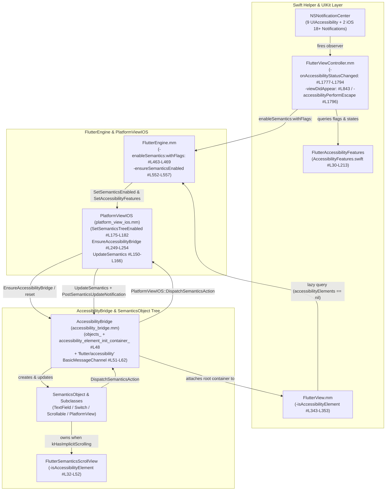

# 🥜 [Peanut #7] Accessibility, VoiceOver & Semantics Lifecycle

> [!NOTE]
> **Parent Blueprint:** [🌾 `FlutterViewController.md`](../FlutterViewController.md)
> **Primary Implementation:** [`FlutterViewController.mm`](../FlutterViewController.mm) (`#L48`, `#L367`, `#L411-L416`, `#L492-L494`, `#L839-L850`, `#L939-L950`, `#L1777-L1803`, `#L2035-L2037`), [`AccessibilityFeatures.swift`](../AccessibilityFeatures.swift) (`#L1-L214`)
> **Downstream Subsystems:** [`FlutterEngine.mm`](../FlutterEngine.mm) (`#L463-L469`, `#L552-L557`, `#L1357-L1361`), [`FlutterView.mm`](../FlutterView.mm) (`#L341-L386`), [`platform_view_ios.h`](../../../platform_view_ios.h) (`#L88`, `#L134`, `#L138-L139`, `#L163-L164`), [`platform_view_ios.mm`](../../../platform_view_ios.mm) (`#L56-L114`, `#L150-L182`, `#L237-L254`), [`accessibility_bridge.h`](../accessibility_bridge.h) (`#L37-L128`), [`accessibility_bridge.mm`](../accessibility_bridge.mm) (`#L42-L456`), [`SemanticsObject.mm`](../SemanticsObject.mm) (`#L60-L375`, `#L820-L857`, `#L936-L959`), [`FlutterSemanticsScrollView.mm`](../FlutterSemanticsScrollView.mm) (`#L32-L52`, `#L98-L141`)
> **Unit Tests:** [`AccessibilityFeaturesTests.swift`](../AccessibilityFeaturesTests.swift) (`#L1-L173`), [`FlutterViewControllerTest.mm`](../FlutterViewControllerTest.mm) (`#L1816-L1862`), [`FlutterEngineTest.mm`](../FlutterEngineTest.mm) (`#L885-L890`), [`accessibility_bridge_test.mm`](../accessibility_bridge_test.mm)

---

## 1. Overview & Responsibility Boundary

Generating and synchronizing a full semantics tree between the Dart UI isolate and iOS's `UIAccessibility` subsystem carries non-trivial CPU and memory overhead: every frame that mutates semantics serializes `flutter::SemanticsNode` and `flutter::SemanticsCustomAction` updates across threads and materializes a shadow hierarchy of Objective-C [`SemanticsObject`](../SemanticsObject.h#L95-L216) and [`SemanticsObjectContainer`](../SemanticsObject.h#L233-L242) wrappers attached to `FlutterView.accessibilityElements`.

Because of this cost, the iOS accessibility pipeline is divided cleanly across five layers:
1. **Swift State Query & Notification Catalog ([`AccessibilityFeatures.swift`](../AccessibilityFeatures.swift#L13-L213)):**
   - A Swift `@objc(FlutterAccessibilityFeatures)` helper class owned by [`FlutterViewController`](../FlutterViewController_Internal.h#L53) that encapsulates all `UIAccessibility` and iOS 18+ `Accessibility.AccessibilitySettings` queries, computes the 32-bit [`AccessibilityFeatureFlag`](../AccessibilityFeatures.swift#L13-L27) bitmask (`flags`), and vends the dynamic array of `NSNotificationCenter` notification names (`observedNotificationNames`) to observe (**9** on iOS < 18, **11** on iOS 18.0+).
2. **UIKit Gatekeeper & Lazy Trigger ([`FlutterViewController.mm`](../FlutterViewController.mm#L1777-L1803) & [`FlutterView.mm`](../FlutterView.mm#L341-L386)):**
   - Subscribes to every notification in `[self.accessibilityFeatures observedNotificationNames]` ([`FlutterViewController.mm#L411-L416`](../FlutterViewController.mm#L411-L416)) plus an initial synchronization in [`viewDidAppear:`](../FlutterViewController.mm#L839-L850), funneling them into [`onAccessibilityStatusChanged:`](../FlutterViewController.mm#L1777-L1794).
   - Decides whether semantics compilation should be enabled (`enabled = YES` on Simulator, or when VoiceOver, Switch Control, or Speak Screen is active on device) and calls [`-[FlutterEngine enableSemantics:withFlags:]`](file:///usr/local/google/home/louisehsu/.gemini/jetski/brain/f61f8251-c20d-4de6-ae1a-3274b193d650/scratch/flutter_monorepo/engine/src/flutter/shell/platform/darwin/ios/framework/Source/FlutterEngine.mm#L463-L469).
   - Provides a **lazy on-demand fallback** via [`-[FlutterView isAccessibilityElement]`](file:///usr/local/google/home/louisehsu/.gemini/jetski/brain/f61f8251-c20d-4de6-ae1a-3274b193d650/scratch/flutter_monorepo/engine/src/flutter/shell/platform/darwin/ios/framework/Source/FlutterView.mm#L343-L353) $\rightarrow$ [`-[FlutterEngine flutterViewAccessibilityDidCall]`](file:///usr/local/google/home/louisehsu/.gemini/jetski/brain/f61f8251-c20d-4de6-ae1a-3274b193d650/scratch/flutter_monorepo/engine/src/flutter/shell/platform/darwin/ios/framework/Source/FlutterEngine.mm#L1357-L1361) $\rightarrow$ [`-[FlutterEngine ensureSemanticsEnabled]`](file:///usr/local/google/home/louisehsu/.gemini/jetski/brain/f61f8251-c20d-4de6-ae1a-3274b193d650/scratch/flutter_monorepo/engine/src/flutter/shell/platform/darwin/ios/framework/Source/FlutterEngine.mm#L552-L557) for assistive technologies that query `FlutterView` without posting one of the observed notifications (such as Full Keyboard Access or Voice Control).
   - Implements [`accessibilityPerformEscape`](../FlutterViewController.mm#L1796-L1803) to translate the iOS 2-finger Z "scrub" gesture into a `navigationChannel` `"popRoute"` call.
3. **Engine & Shell Coordinator ([`FlutterEngine.mm`](../FlutterEngine.mm#L463-L557) & [`PlatformViewIOS`](../../../platform_view_ios.mm#L56-L254)):**
   - Forwards `SetSemanticsEnabled` and `SetAccessibilityFeatures` to C++ `PlatformViewIOS`, manages `std::unique_ptr<AccessibilityBridge> accessibility_bridge_`, posts [`FlutterSemanticsUpdateNotification`](../../Headers/FlutterViewController.h#L33-L35), and supports **reattaching `AccessibilityBridge` across `FlutterViewController` swaps or before `FlutterViewController.view` loads**.
4. **C++/Obj-C++ Bridge ([`AccessibilityBridge`](../accessibility_bridge.mm#L42-L456)):**
   - Diffs `SemanticsNodeUpdates` and `CustomAccessibilityActionUpdates`, maintains `NSMutableDictionary<NSNumber*, SemanticsObject*>* objects_`, caches elements in `accessibility_element_init_container_` when `viewIfLoaded == nil`, and handles the `"flutter/accessibility"` `FlutterBasicMessageChannel`.
5. **UIKit Element Hierarchy ([`SemanticsObject.mm`](../SemanticsObject.mm#L60-L1061) & [`FlutterSemanticsScrollView.mm`](../FlutterSemanticsScrollView.mm#L16-L143)):**
   - Materializes `UIAccessibilityElement` subclasses (`FlutterTextFieldSemanticsObject`, `FlutterSwitchSemanticsObject`, `FlutterScrollableSemanticsObject`, `FlutterPlatformViewSemanticsContainer`, `FlutterCustomAccessibilityActionSemanticsObject`) and `UIScrollView` proxies.



---

## 2. Swift Extraction (`AccessibilityFeatures.swift`) & Notification Listeners

In [`AccessibilityFeatures.swift`](../AccessibilityFeatures.swift#L1-L214), all iOS accessibility state queries, flag bitmask calculation, and notification name discovery were extracted out of `FlutterViewController.mm` into a Swift `@objc(FlutterAccessibilityFeatures)` class (`AccessibilityFeatures`) and a Swift `OptionSet` (`AccessibilityFeatureFlag`).

### 2.1 `FlutterViewController` Setup, Registration & Teardown

1. **Initialization ([`FlutterViewController.mm#L367`](../FlutterViewController.mm#L367)):**
   Inside `-[FlutterViewController performCommonViewControllerInitialization]`, `FlutterViewController` allocates its `FlutterAccessibilityFeatures` instance (declared in [`FlutterViewController_Internal.h#L53`](../FlutterViewController_Internal.h#L53)):
   ```objc
   _accessibilityFeatures = [[FlutterAccessibilityFeatures alloc] init];
   ```
2. **Dynamic Observer Registration ([`FlutterViewController.mm#L411-L416`](../FlutterViewController.mm#L411-L416)):**
   Inside `-[FlutterViewController setUpNotificationCenterObservers]`, instead of hardcoding individual `addObserver:` calls, `FlutterViewController` iterates over `[self.accessibilityFeatures observedNotificationNames]`:
   ```objc
   for (NSString* notification in [self.accessibilityFeatures observedNotificationNames]) {
     [center addObserver:self
                selector:@selector(onAccessibilityStatusChanged:)
                    name:notification
                  object:nil];
   }
   ```
3. **Initial Synchronization on Appearance ([`FlutterViewController.mm#L839-L850`](../FlutterViewController.mm#L839-L850)):**
   Because `NSNotificationCenter` only broadcasts *changes* to accessibility settings, an app launched while VoiceOver, Bold Text, or Reduce Motion is already enabled in iOS Settings will not receive a notification at startup. Therefore, `-[FlutterViewController viewDidAppear:]` explicitly invokes `[self onAccessibilityStatusChanged:nil]` at line 843:
   ```objc
   - (void)viewDidAppear:(BOOL)animated {
     TRACE_EVENT0("flutter", "viewDidAppear");
     if (self.engine.viewController == self) {
       [self onLocaleUpdated:nil];
       [self onUserSettingsChanged:nil];
       [self onAccessibilityStatusChanged:nil];
   ```
4. **Teardown ([`FlutterViewController.mm#L939-L950`](../FlutterViewController.mm#L939-L950)):**
   In `-[FlutterViewController deregisterNotifications]` (called from `-dealloc`), `FlutterViewController` removes each observed notification name in `[self.accessibilityFeatures observedNotificationNames]`.

### 2.2 All 11 Observed Notifications in `AccessibilityFeatures.observedNotificationNames`

[`AccessibilityFeatures.observedNotificationNames`](../AccessibilityFeatures.swift#L69-L90) returns **9** `UIAccessibility` notifications unconditionally, plus **2** `Accessibility.AccessibilitySettings` notifications on **iOS 18.0+** (verified by [`observedNotificationNamesContainsAllNotifications`](../AccessibilityFeaturesTests.swift#L142-L171)):

| # | Swift Property in `AccessibilityFeatures` | Underlying iOS Notification | Lines in [`AccessibilityFeatures.swift`](../AccessibilityFeatures.swift#L69-L202) | Availability | Effect on `enabled` (Device) | Effect on `flags` Bitmask |
| :- | :--- | :--- | :--- | :--- | :--- | :--- |
| **1** | `voiceOverStatusDidChangeNotification` | `UIAccessibility.voiceOverStatusDidChangeNotification` | [`#L71`](../AccessibilityFeatures.swift#L71), [`#L94-L96`](../AccessibilityFeatures.swift#L94-L96) | All supported iOS | `enabled = YES`, `_isVoiceOverRunning = YES` | `.accessibleNavigation` (`1 << 0`) |
| **2** | `switchControlStatusDidChangeNotification` | `UIAccessibility.switchControlStatusDidChangeNotification` | [`#L72`](../AccessibilityFeatures.swift#L72), [`#L104-L106`](../AccessibilityFeatures.swift#L104-L106) | All supported iOS | `enabled = YES` | `.accessibleNavigation` (`1 << 0`) |
| **3** | `speakScreenStatusDidChangeNotification` | `UIAccessibility.speakScreenStatusDidChangeNotification` | [`#L73`](../AccessibilityFeatures.swift#L73), [`#L114-L116`](../AccessibilityFeatures.swift#L114-L116) | All supported iOS | `enabled = YES` | **None** |
| **4** | `invertColorsStatusDidChangeNotification` | `UIAccessibility.invertColorsStatusDidChangeNotification` | [`#L74`](../AccessibilityFeatures.swift#L74), [`#L124-L126`](../AccessibilityFeatures.swift#L124-L126) | All supported iOS | None | `.invertColors` (`1 << 1`) |
| **5** | `reduceMotionStatusDidChangeNotification` | `UIAccessibility.reduceMotionStatusDidChangeNotification` | [`#L75`](../AccessibilityFeatures.swift#L75), [`#L134-L136`](../AccessibilityFeatures.swift#L134-L136) | All supported iOS | None | `.reduceMotion` (`1 << 4`) |
| **6** | `boldTextStatusDidChangeNotification` | `UIAccessibility.boldTextStatusDidChangeNotification` | [`#L76`](../AccessibilityFeatures.swift#L76), [`#L144-L146`](../AccessibilityFeatures.swift#L144-L146) | All supported iOS | None | `.boldText` (`1 << 3`) |
| **7** | `darkerSystemColorsStatusDidChangeNotification` | `UIAccessibility.darkerSystemColorsStatusDidChangeNotification` | [`#L77`](../AccessibilityFeatures.swift#L77), [`#L154-L156`](../AccessibilityFeatures.swift#L154-L156) | All supported iOS | None | `.highContrast` (`1 << 5`) |
| **8** | `onOffSwitchLabelsDidChangeNotification` | `UIAccessibility.onOffSwitchLabelsDidChangeNotification` | [`#L78`](../AccessibilityFeatures.swift#L78), [`#L164-L166`](../AccessibilityFeatures.swift#L164-L166) | All supported iOS | None | `.onOffSwitchLabels` (`1 << 6`) |
| **9** | `videosAutoPlayStatusDidChangeNotification` | `UIAccessibility.videoAutoplayStatusDidChangeNotification` | [`#L79`](../AccessibilityFeatures.swift#L79), [`#L190-L192`](../AccessibilityFeatures.swift#L190-L192) | All supported iOS | None | `.noAutoPlayVideos` (`1 << 9`, inverted) |
| **10** | `animatedImagesAutoPlayStatusDidChangeNotification` | `AccessibilitySettings.animatedImagesEnabledDidChangeNotification` | [`#L82-L84`](../AccessibilityFeatures.swift#L82-L84), [`#L174-L177`](../AccessibilityFeatures.swift#L174-L177) | `@available(iOS 18.0, *)` | None | `.noAutoPlayAnimatedImages` (`1 << 8`, inverted) |
| **11** | `deterministicCursorStatusDidChangeNotification` | `AccessibilitySettings.prefersNonBlinkingTextInsertionIndicatorDidChangeNotification` | [`#L85-L87`](../AccessibilityFeatures.swift#L85-L87), [`#L200-L203`](../AccessibilityFeatures.swift#L200-L203) | `@available(iOS 18.0, *)` | None | `.deterministicCursor` (`1 << 10`) |

---

## 3. Semantics Activation Rules (`onAccessibilityStatusChanged:`) & Lazy Trigger

### 3.1 `-[FlutterViewController onAccessibilityStatusChanged:]`

[`-[FlutterViewController onAccessibilityStatusChanged:]`](file:///usr/local/google/home/louisehsu/.gemini/jetski/brain/f61f8251-c20d-4de6-ae1a-3274b193d650/scratch/flutter_monorepo/engine/src/flutter/shell/platform/darwin/ios/framework/Source/FlutterViewController.mm#L1777-L1794) delegates flag computation to `self.accessibilityFeatures.flags` and determines `enabled`:

```objc
#pragma mark - Accessibility

- (void)onAccessibilityStatusChanged:(NSNotification*)notification {
  if (!self.engine) {
    return;
  }
  BOOL enabled = NO;
  int32_t flags = [self.accessibilityFeatures flags];
#if TARGET_OS_SIMULATOR
  // There doesn't appear to be any way to determine whether the accessibility
  // inspector is enabled on the simulator. We conservatively always turn on the
  // accessibility bridge in the simulator, but never assistive technology.
  enabled = YES;
#else
  _isVoiceOverRunning = [self.accessibilityFeatures isVoiceOverRunning];
  enabled = _isVoiceOverRunning || [self.accessibilityFeatures isSwitchControlRunning] ||
            [self.accessibilityFeatures isSpeakScreenEnabled];
#endif
  [self.engine enableSemantics:enabled withFlags:flags];
}
```

#### Simulator vs. Physical Device (`#if TARGET_OS_SIMULATOR`)
- **Simulator (`#if TARGET_OS_SIMULATOR`):** Connecting Xcode's **Accessibility Inspector** to the iOS Simulator does not cause `UIAccessibility.isVoiceOverRunning` to return `true` and does not post any notification. Therefore, `FlutterViewController` conservatively sets `enabled = YES` on the Simulator so `AccessibilityBridge` and `SemanticsObject`s are always populated for inspection. Note that in the Swift `AccessibilityFeatures.flags` implementation ([`AccessibilityFeatures.swift#L36-L38`](../AccessibilityFeatures.swift#L36-L38)), `.accessibleNavigation` is evaluated directly from `isVoiceOverRunning() || isSwitchControlRunning()` on both Simulator and device.
- **Physical Device (`#else`):** Semantics compilation is enabled when **VoiceOver**, **Switch Control**, or **Speak Screen** is enabled (`_isVoiceOverRunning || [self.accessibilityFeatures isSwitchControlRunning] || [self.accessibilityFeatures isSpeakScreenEnabled]`). As before, **Speak Screen** enables the semantics tree (`enabled = YES`) so iOS can read the screen aloud on a 2-finger swipe down, without setting `.accessibleNavigation` in `flags`.

### 3.2 On-Demand Lazy Semantics Activation (`FlutterView` $\rightarrow$ `FlutterEngine`)

Some iOS accessibility features—such as **Full Keyboard Access** (Tab navigation), **Voice Control** (*"Show names"* / *"Tap button"*), or **XCUITest**—query `FlutterView`'s `UIAccessibility` informal protocol without turning on VoiceOver, Switch Control, or Speak Screen. To support these features without keeping semantics perpetually enabled for all users:

1. [`-[FlutterView isAccessibilityElement]`](file:///usr/local/google/home/louisehsu/.gemini/jetski/brain/f61f8251-c20d-4de6-ae1a-3274b193d650/scratch/flutter_monorepo/engine/src/flutter/shell/platform/darwin/ios/framework/Source/FlutterView.mm#L343-L353) returns `NO` and calls `[self.delegate flutterViewAccessibilityDidCall]`.
2. [`-[FlutterEngine flutterViewAccessibilityDidCall]`](file:///usr/local/google/home/louisehsu/.gemini/jetski/brain/f61f8251-c20d-4de6-ae1a-3274b193d650/scratch/flutter_monorepo/engine/src/flutter/shell/platform/darwin/ios/framework/Source/FlutterEngine.mm#L1357-L1361) checks if `self.viewController.view.accessibilityElements == nil`, and if so, invokes [`-[FlutterEngine ensureSemanticsEnabled]`](file:///usr/local/google/home/louisehsu/.gemini/jetski/brain/f61f8251-c20d-4de6-ae1a-3274b193d650/scratch/flutter_monorepo/engine/src/flutter/shell/platform/darwin/ios/framework/Source/FlutterEngine.mm#L552-L557) (tested in [`testFlutterViewAccessibilityDidCall`](../FlutterEngineTest.mm#L885-L890)).
3. `-[FlutterEngine ensureSemanticsEnabled]` (also declared publicly in [`FlutterEngine.h#L314-L340`](../../Headers/FlutterEngine.h#L314-L340)) calls `self.platformView->SetSemanticsEnabled(true)`.

---

## 4. Accessibility Feature Bitmask (`AccessibilityFeatures.flags`)

[`AccessibilityFeatures.flags`](../AccessibilityFeatures.swift#L33-L65) constructs the 32-bit bitmask defined by [`AccessibilityFeatureFlag`](../AccessibilityFeatures.swift#L13-L27) and [`flutter::AccessibilityFeatureFlag`](../../../../../../../lib/ui/window/platform_configuration.h#L31-L45):

```swift
@objc var flags: Int32 {
  var flags: AccessibilityFeatureFlag = []

  if isVoiceOverRunning() || isSwitchControlRunning() {
    flags.insert(.accessibleNavigation)
  }
  if isInvertColorsEnabled() {
    flags.insert(.invertColors)
  }
  if isBoldTextEnabled() {
    flags.insert(.boldText)
  }
  if isReduceMotionEnabled() {
    flags.insert(.reduceMotion)
  }
  if isDarkerSystemColorsEnabled() {
    flags.insert(.highContrast)
  }
  if isOnOffSwitchLabelsEnabled() {
    flags.insert(.onOffSwitchLabels)
  }
  if !isAnimatedImagesAutoPlayEnabled() {
    flags.insert(.noAutoPlayAnimatedImages)
  }
  if !isVideosAutoPlayEnabled() {
    flags.insert(.noAutoPlayVideos)
  }
  if isDeterministicCursorEnabled() {
    flags.insert(.deterministicCursor)
  }

  return flags.rawValue
}
```

### Complete Mapping of all 11 `AccessibilityFeatureFlag` Bits on iOS

| Swift `AccessibilityFeatureFlag` ([`AccessibilityFeatures.swift#L13-L27`](../AccessibilityFeatures.swift#L13-L27)) | C++ Enum ([`platform_configuration.h#L31-L45`](../../../../../../../lib/ui/window/platform_configuration.h#L31-L45)) | Bit Value | iOS Query API & Location in [`AccessibilityFeatures.swift`](../AccessibilityFeatures.swift) | Dart `AccessibilityFeatures` Surface | Design & Historical Notes |
| :--- | :--- | :--- | :--- | :--- | :--- |
| `.accessibleNavigation` | `kAccessibleNavigation` | `1 << 0` | `isVoiceOverRunning() \|\| isSwitchControlRunning()` ([`#L36-L38`](../AccessibilityFeatures.swift#L36-L38), [`#L98-L110`](../AccessibilityFeatures.swift#L98-L110)) | `accessibleNavigation` | Added in `dcd2956f88` ([PR #5901](https://github.com/flutter/engine/pull/5901)). |
| `.invertColors` | `kInvertColors` | `1 << 1` | `isInvertColorsEnabled()` $\rightarrow$ `UIAccessibility.isInvertColorsEnabled` ([`#L39-L41`](../AccessibilityFeatures.swift#L39-L41), [`#L128-L130`](../AccessibilityFeatures.swift#L128-L130)) | `invertColors` | Added in `dcd2956f88` ([PR #5901](https://github.com/flutter/engine/pull/5901)). |
| `.disableAnimations` | `kDisableAnimations` | `1 << 2` | **Never set on iOS** | `disableAnimations` | Split from `kReduceMotion` in `2af72eb2cc` ([PR #6194](https://github.com/flutter/engine/pull/6194)) so iOS Reduce Motion tones down parallax/zoom transitions (`CupertinoPageRoute`) rather than freezing all animations. |
| `.boldText` | `kBoldText` | `1 << 3` | `isBoldTextEnabled()` $\rightarrow$ `UIAccessibility.isBoldTextEnabled` ([`#L42-L44`](../AccessibilityFeatures.swift#L42-L44), [`#L148-L150`](../AccessibilityFeatures.swift#L148-L150)) | `boldText` | Added in `56bad48ab2` ([PR #6072](https://github.com/flutter/engine/pull/6072)). |
| `.reduceMotion` | `kReduceMotion` | `1 << 4` | `isReduceMotionEnabled()` $\rightarrow$ `UIAccessibility.isReduceMotionEnabled` ([`#L45-L47`](../AccessibilityFeatures.swift#L45-L47), [`#L138-L140`](../AccessibilityFeatures.swift#L138-L140)) | `reduceMotion` | Added in `2af72eb2cc` ([PR #6194](https://github.com/flutter/engine/pull/6194)). |
| `.highContrast` | `kHighContrast` | `1 << 5` | `isDarkerSystemColorsEnabled()` $\rightarrow$ `UIAccessibility.isDarkerSystemColorsEnabled` ([`#L48-L50`](../AccessibilityFeatures.swift#L48-L50), [`#L158-L160`](../AccessibilityFeatures.swift#L158-L160)) | `highContrast` | Added in `d0c2418dfe` ([PR #15343](https://github.com/flutter/engine/pull/15343)). |
| `.onOffSwitchLabels` | `kOnOffSwitchLabels` | `1 << 6` | `isOnOffSwitchLabelsEnabled()` $\rightarrow$ `UIAccessibility.isOnOffSwitchLabelsEnabled` ([`#L51-L53`](../AccessibilityFeatures.swift#L51-L53), [`#L168-L170`](../AccessibilityFeatures.swift#L168-L170)) | `onOffSwitchLabels` | Relanded in `977cb0e5cc` ([PR #30764](https://github.com/flutter/engine/pull/30764)). |
| `.noAnnounce` | `kNoAnnounce` | `1 << 7` | **Never set on iOS** | `supportsAnnounce` (inverted) | Defined in `AccessibilityFeatureFlag` (`#L22`). |
| `.noAutoPlayAnimatedImages` | `kNoAutoPlayAnimatedImages` | `1 << 8` | `!isAnimatedImagesAutoPlayEnabled()` $\rightarrow$ `!AccessibilitySettings.animatedImagesEnabled` on iOS 18.0+ ([`#L54-L56`](../AccessibilityFeatures.swift#L54-L56), [`#L179-L186`](../AccessibilityFeatures.swift#L179-L186)) | `autoPlayAnimatedImages` (inverted) | Queries `Accessibility.AccessibilitySettings.animatedImagesEnabled` on iOS 18.0+; defaults to `true` (so `.noAutoPlayAnimatedImages` is not set) on earlier iOS. |
| `.noAutoPlayVideos` | `kNoAutoPlayVideos` | `1 << 9` | `!isVideosAutoPlayEnabled()` $\rightarrow$ `!UIAccessibility.isVideoAutoplayEnabled` ([`#L57-L59`](../AccessibilityFeatures.swift#L57-L59), [`#L194-L196`](../AccessibilityFeatures.swift#L194-L196)) | `autoPlayVideos` (inverted) | Maps *Settings $\rightarrow$ Accessibility $\rightarrow$ Motion $\rightarrow$ Auto-Play Video Previews*. |
| `.deterministicCursor` | `kDeterministicCursor` | `1 << 10` | `isDeterministicCursorEnabled()` $\rightarrow$ `AccessibilitySettings.prefersNonBlinkingTextInsertionIndicator` on iOS 18.0+ ([`#L60-L62`](../AccessibilityFeatures.swift#L60-L62), [`#L205-L212`](../AccessibilityFeatures.swift#L205-L212)) | `deterministicCursor` | Maps iOS 18+ *Prefer Non-Blinking Cursor* setting to disable text cursor blinking in Flutter text fields. |

---

## 5. `PlatformViewIOS`, `AccessibilityBridge` & ViewController Rebinding

### 5.1 Bridge Creation, Destruction & `FlutterSemanticsUpdateNotification`

In [`PlatformViewIOS`](../../../platform_view_ios.mm#L168-L182), `SetSemanticsEnabled(bool enabled)` notifies the Shell/Engine and delegates bridge management to [`PlatformViewIOS::SetSemanticsTreeEnabled(bool enabled)`](../../../platform_view_ios.mm#L175-L182):

```cpp
void PlatformViewIOS::SetSemanticsEnabled(bool enabled) {
  PlatformView::SetSemanticsEnabled(enabled);
  SetSemanticsTreeEnabled(enabled);
}

void PlatformViewIOS::SetSemanticsTreeEnabled(bool enabled) {
  semantics_tree_enabled_ = enabled;
  if (enabled) {
    EnsureAccessibilityBridge();
  } else {
    accessibility_bridge_.reset();
  }
}
```

where [`PlatformViewIOS::EnsureAccessibilityBridge()`](../../../platform_view_ios.mm#L249-L254) lazily constructs `accessibility_bridge_` if not already present:

```cpp
void PlatformViewIOS::EnsureAccessibilityBridge() {
  if (!accessibility_bridge_) {
    accessibility_bridge_ = std::make_unique<AccessibilityBridge>(
        owner_controller_, this, [owner_controller_.engine platformViewsController]);
  }
}
```

Whenever [`PlatformViewIOS::UpdateSemantics`](../../../platform_view_ios.mm#L150-L166) receives node updates from the Shell, it ensures the bridge exists, forwards the updates to `accessibility_bridge_->UpdateSemantics(...)`, and calls [`PostSemanticsUpdateNotification()`](../../../platform_view_ios.mm#L237-L240), which broadcasts [`FlutterSemanticsUpdateNotification`](../FlutterViewController.mm#L48) (declared in [`FlutterViewController.h#L33-L35`](../../Headers/FlutterViewController.h#L33-L35)) with `owner_controller_` as the notification object.

### 5.2 Pre-Loaded View Semantics Caching & `FlutterViewController` Rebinding

In earlier versions of the engine, `AccessibilityBridge` required `owner_controller_.view` (`FlutterView`) to already be loaded and was destroyed whenever `owner_controller_` changed in `SetOwnerViewController`. In the current architecture ([`platform_view_ios.mm#L56-L114`](../../../platform_view_ios.mm#L56-L114) and [`accessibility_bridge.mm#L42-L86`](../accessibility_bridge.mm#L42-L86), [`#L405-L448`](../accessibility_bridge.mm#L405-L448)):

1. **Initialization Container (`accessibility_element_init_container_`):**
   - [`AccessibilityBridge`](../accessibility_bridge.h#L80-L82) allocates `NSObject* accessibility_element_init_container_` in its constructor ([`accessibility_bridge.mm#L48`](../accessibility_bridge.mm#L48)).
   - If `UpdateSemantics` runs before `FlutterViewController.viewIfLoaded` exists (e.g. on a pre-warmed engine or before `loadView`), `AccessibilityBridge` parents the root `SemanticsObjectContainer` to `accessibility_element_init_container_` and stores `@[root.accessibilityContainer]` in `accessibility_element_init_container_.accessibilityElements` ([`accessibility_bridge.mm#L211-L214`](../accessibility_bridge.mm#L211-L214), [`#L428-L433`](../accessibility_bridge.mm#L428-L433)).
2. **Seamless View / ViewController Migration (`SetViewController` & `SetViewIfLoaded`):**
   - When [`PlatformViewIOS::SetOwnerViewController`](../../../platform_view_ios.mm#L56-L96) or [`PlatformViewIOS::attachView`](../../../platform_view_ios.mm#L98-L114) binds a new `FlutterViewController` or `FlutterView`, it calls `accessibility_bridge_->SetViewController(owner_controller_)`.
   - [`AccessibilityBridge::SetViewController`](../accessibility_bridge.mm#L73-L86) and [`AccessibilityBridge::SetViewIfLoaded`](../accessibility_bridge.mm#L405-L426) transfer the existing `SemanticsObjectContainer` from `accessibility_element_init_container_` (or the previous `FlutterView`) directly onto `view_controller_.viewIfLoaded.accessibilityElements` without losing the semantics tree!

---

## 6. VoiceOver Tracking (`_isVoiceOverRunning`) & `FlutterSemanticsScrollView`

### 6.1 Active Heuristic: `_isVoiceOverRunning` and Scrollable Container Focus

[`FlutterViewController`](../FlutterViewController_Internal.h#L37) exposes `@property(nonatomic, readonly) BOOL isVoiceOverRunning` (updated in `onAccessibilityStatusChanged:` at [`FlutterViewController.mm#L1789`](../FlutterViewController.mm#L1789)) to [`AccessibilityBridge::isVoiceOverRunning()`](../accessibility_bridge.h#L84):

```cpp
bool isVoiceOverRunning() const override { return view_controller_.isVoiceOverRunning; }
```

Its primary consumer is [`-[FlutterSemanticsScrollView isAccessibilityElement]`](file:///usr/local/google/home/louisehsu/.gemini/jetski/brain/f61f8251-c20d-4de6-ae1a-3274b193d650/scratch/flutter_monorepo/engine/src/flutter/shell/platform/darwin/ios/framework/Source/FlutterSemanticsScrollView.mm#L32-L52):

```objc
- (BOOL)isAccessibilityElement {
  if (![self isViewDisplayed]) {
    return NO;
  }
  flutter::AccessibilityBridgeIos* bridge = self.semanticsObject.bridge;
  if (!bridge) {
    return NO;
  }
  if (bridge->isVoiceOverRunning()) {
    return self.semanticsObject.accessibilityLabel.length > 0;
  }
  if (self.semanticsObject.isAccessibilityElement) {
    return YES;
  }
  if (self.contentSize.width > self.frame.size.width ||
      self.contentSize.height > self.frame.size.height) {
    return YES;
  }
  return NO;
}
```

**Why this distinction is critical:**
- Every scrollable Flutter widget (`ListView`, `CustomScrollView`, `SingleChildScrollView`) with `kHasImplicitScrolling` is represented by [`FlutterScrollableSemanticsObject`](../SemanticsObject.mm#L171-L266), which owns a real `UIScrollView` subclass ([`FlutterSemanticsScrollView`](../FlutterSemanticsScrollView.h#L24-L42)) as its `nativeAccessibility` object so iOS can invoke `UIScrollViewAccessibilityDelegate` scrolling (`scrollViewWillEndDragging:withVelocity:targetContentOffset:` at [`FlutterSemanticsScrollView.mm#L126-L141`](../FlutterSemanticsScrollView.mm#L126-L141)).
- When **VoiceOver** is running (`bridge->isVoiceOverRunning() == true`), if an unlabeled `UIScrollView` returns `isAccessibilityElement == YES`, VoiceOver treats the scroll view as a leaf element and **refuses to traverse into its children**. Thus, under VoiceOver, `FlutterSemanticsScrollView` returns `self.semanticsObject.accessibilityLabel.length > 0` (`NO` for normal unlabeled scroll containers so VoiceOver traverses children, `YES` only when the scroll container has an explicit semantic label).
- When **Switch Control** or **Voice Control** is running (`bridge->isVoiceOverRunning() == false`), a scrollable container (`contentSize > frame.size`) returns `YES` so the user can select the scroll container itself and trigger scroll actions.

### 6.2 Public Helper: `+[FlutterViewController isUIAccessibilityIsVoiceOverRunning]`

At [`FlutterViewController.mm#L2035-L2037`](../FlutterViewController.mm#L2035-L2037) (declared in [`FlutterViewController.h#L189-L194`](../../Headers/FlutterViewController.h#L189-L194)):
```objc
+ (BOOL)isUIAccessibilityIsVoiceOverRunning {
  return UIAccessibilityIsVoiceOverRunning();
}
```
Originally introduced in commit `bbc9bd899d` ([PR #32820](https://github.com/flutter/engine/pull/32820)) for OCMock class stubbing of `UIAccessibilityIsVoiceOverRunning()`, it remains in `FlutterViewController.h` for public API stability after `accessibilityElementsHidden` changes were reverted in `fff144c466` ([PR #34086](https://github.com/flutter/engine/pull/34086)).

---

## 7. The 2-Finger Z "Scrub" Gesture (`accessibilityPerformEscape`)

When a VoiceOver user performs the 2-finger **"Z" scrub gesture**, UIKit walks the accessibility/responder hierarchy invoking `-accessibilityPerformEscape`:

1. **Element-Level `SemanticsAction::kDismiss` ([`SemanticsObject.mm#L820-L830`](../SemanticsObject.mm#L820-L830)):**
   ```objc
   - (BOOL)accessibilityPerformEscape {
     if (![self isAccessibilityBridgeAlive]) {
       return NO;
     }
     if (_node.HasAction(flutter::SemanticsAction::kDismiss)) {
       [self bridge]->DispatchSemanticsAction(self.uid, flutter::SemanticsAction::kDismiss);
       return YES;
     }
     return [self.bridge->view_controller() accessibilityPerformEscape];
   }
   ```
   If the focused node has `SemanticsAction::kDismiss` (e.g. a `ModalBarrier` for a dialog or bottom sheet), `SemanticsObject` dispatches `kDismiss` directly. Otherwise, it delegates to `[self.bridge->view_controller() accessibilityPerformEscape]`.
2. **View Controller Route Pop ([`FlutterViewController.mm#L1796-L1803`](../FlutterViewController.mm#L1796-L1803) & [`#L492-L494`](../FlutterViewController.mm#L492-L494)):**
   ```objc
   - (BOOL)accessibilityPerformEscape {
     FlutterMethodChannel* navigationChannel = self.engine.navigationChannel;
     if (navigationChannel) {
       [self popRoute];
       return YES;
     }
     return NO;
   }
   ```
   `FlutterViewController` calls `[self popRoute]` (which invokes `"popRoute"` on `self.engine.navigationChannel`) and returns `YES`.

---

## 8. Key Verification & Unit Tests

- **[`AccessibilityFeaturesTests.swift`](../AccessibilityFeaturesTests.swift#L1-L173)**:
  - [`accessibilityFeatureFlagRawValuesAreCorrect`](../AccessibilityFeaturesTests.swift#L67-L79): Verifies all 11 bit shifts (`1 << 0` through `1 << 10`).
  - [`flagsBitmaskIsCorrect`](../AccessibilityFeaturesTests.swift#L81-L140): Uses `MockAccessibilityFeatures` (`#L13-L64`) to test individual and combined feature flags, including iOS 18+ `.noAutoPlayAnimatedImages` and `.deterministicCursor`.
  - [`observedNotificationNamesContainsAllNotifications`](../AccessibilityFeaturesTests.swift#L142-L171): Asserts 11 notifications on iOS 18+ and 9 notifications on earlier iOS versions.
- **[`FlutterViewControllerTest.mm`](../FlutterViewControllerTest.mm#L1816-L1862)**:
  - [`testOnAccessibilityStatusChangedCallsEnableSemanticsWithFlags`](../FlutterViewControllerTest.mm#L1816-L1826): Mocks `FlutterAccessibilityFeatures` (`flags = 42`) and verifies `[mockEngine enableSemantics:YES withFlags:42]`.
  - [`testHandleAccessibilityNotifications`](../FlutterViewControllerTest.mm#L1828-L1846): Posts every notification name in `[FlutterAccessibilityFeatures observedNotificationNames]` and verifies `onAccessibilityStatusChanged:` fires for each one.
  - [`testAccessibilityPerformEscapePopsRoute`](../FlutterViewControllerTest.mm#L1848-L1862): Verifies `[viewController accessibilityPerformEscape]` invokes `"popRoute"` on `navigationChannel`.
- **[`FlutterEngineTest.mm`](../FlutterEngineTest.mm#L885-L890)**:
  - [`testFlutterViewAccessibilityDidCall`](../FlutterEngineTest.mm#L885-L890): Verifies lazy on-demand semantics activation when `FlutterView` is queried by UIKit.
- **[`accessibility_bridge_test.mm`](../accessibility_bridge_test.mm#L1-L800)**:
  - Comprehensive coverage of `SemanticsObject`, `FlutterSemanticsScrollView`, `AccessibilityBridge` node diffing, route focus changes, custom actions, and pre-loaded view / reattached `FlutterViewController` semantics retention.
