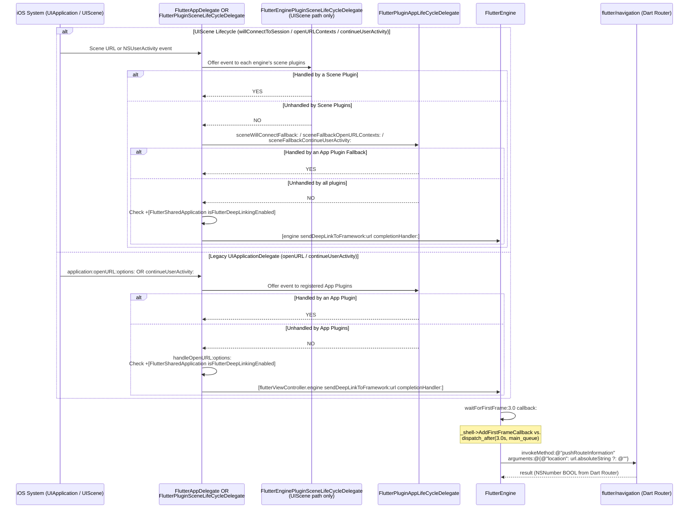
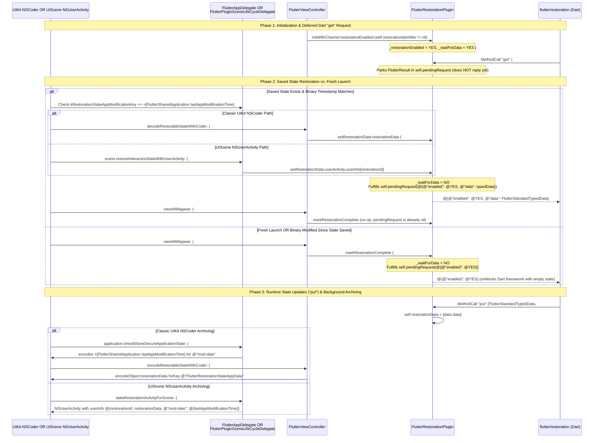

# 🥜 [Peanut #8] Navigation, Deep Linking & UIKit State Restoration

> [!NOTE]
> **Parent Blueprint:** [🌾 `FlutterViewController.md`](../FlutterViewController.md)
> **Scope of this Peanut:** How [`FlutterViewController`](../FlutterViewController.mm), [`FlutterEngine`](../FlutterEngine.mm), [`FlutterAppDelegate`](../FlutterAppDelegate.mm), and [`FlutterPluginSceneLifeCycleDelegate`](../FlutterSceneLifeCycle.mm) coordinate initial route setup, runtime route pushing/popping, custom-scheme and Universal Link deep linking (`-[FlutterEngine sendDeepLinkToFramework:completionHandler:]`), and both UIKit `NSCoder` and `UIScene` `NSUserActivity` State Restoration with [`FlutterRestorationPlugin`](../FlutterRestorationPlugin.mm).
> **Files Covered:**
> - [`FlutterViewController.mm`](../FlutterViewController.mm) (`#L46`, `#L233-L245`, `#L268-L342`, `#L488-L498`, `#L817-L837`, `#L1796-L1803`, `#L2281-L2301`)
> - [`FlutterViewController.h`](../../Headers/FlutterViewController.h) (`#L105-L108`, `#L148-L183`) & [`FlutterViewController_Internal.h`](../FlutterViewController_Internal.h) (`#L66`)
> - [`FlutterEngine.mm`](../FlutterEngine.mm) (`#L664-L691`, `#L748-L750`, `#L930-L964`, `#L1051-L1089`, `#L1599-L1723`) & [`FlutterEngine_Internal.h`](../FlutterEngine_Internal.h) (`#L95`, `#L132`)
> - [`FlutterAppDelegate.mm`](../FlutterAppDelegate.mm) (`#L60-L69`, `#L145-L177`, `#L210-L221`, `#L325-L348`) & [`FlutterSharedApplication.mm`](../FlutterSharedApplication.mm) (`#L12`, `#L50-L67`)
> - [`FlutterSceneLifeCycle.mm`](../FlutterSceneLifeCycle.mm) (`#L212-L241`, `#L289-L405`, `#L432-L468`) & [`FlutterPluginAppLifeCycleDelegate.mm`](../FlutterPluginAppLifeCycleDelegate.mm) (`#L156-L173`, `#L492-L525`, `#L662-L700`)
> - [`FlutterRestorationPlugin.h`](../FlutterRestorationPlugin.h) (`#L1-L34`) & [`FlutterRestorationPlugin.mm`](../FlutterRestorationPlugin.mm) (`#L1-L137`) & [`platform_view_ios.mm`](../../../platform_view_ios.mm) (`#L190-L200`)
> - **Unit Tests:** [`FlutterViewControllerTest.mm`](../FlutterViewControllerTest.mm) (`#L1848-L1862`, `#L2231-L2341`), [`FlutterEngineTest.mm`](../FlutterEngineTest.mm) (`#L334-L384`), [`FlutterAppDelegateTest.mm`](../FlutterAppDelegateTest.mm) (`#L70-L246`), [`FlutterSceneLifeCycleTest.mm`](../FlutterSceneLifeCycleTest.mm) (`#L488-L579`, `#L727-L1176`), [`FlutterRestorationPluginTest.mm`](../FlutterRestorationPluginTest.mm) (`#L41-L220`)

---

## 1. Initial Route & Navigation Channel Methods (`setInitialRoute:`, `pushRoute:`, `popRoute`)

**Where:** [`FlutterViewController.mm#L233-L245`](../FlutterViewController.mm#L233-L245), [`#L268-L342`](../FlutterViewController.mm#L268-L342), [`#L488-L498`](../FlutterViewController.mm#L488-L498), [`#L1796-L1803`](../FlutterViewController.mm#L1796-L1803), [`FlutterEngine.mm#L664-L691`](../FlutterEngine.mm#L664-L691), [`#L930-L964`](../FlutterEngine.mm#L930-L964)

All route communication between UIKit and the Dart framework flows through `self.engine.navigationChannel` (`"flutter/navigation"`, encoded with `FlutterJSONMethodCodec`).

### 1.1 How `initialRoute` Is Delivered Before vs. After Engine Launch
In Commit `0c504da039` (PR `#20468`), initial route delivery was unified around the `flutter/navigation` channel's pre-launch message buffer rather than passing the initial route through C++ `PlatformConfiguration` startup globals:

1. **Implicit Engine Creation (`initWithProject:initialRoute:nibName:bundle:`, [`FlutterViewController.mm#L233-L245`](../FlutterViewController.mm#L233-L245)):**
   - Calls `-[FlutterViewController sharedSetupWithProject:initialRoute:]` ([`#L268-L342`](../FlutterViewController.mm#L268-L342)), which allocates a `FlutterEngine` and calls `[_engine createShell:nil libraryURI:nil initialRoute:initialRoute]` ([`#L306`](../FlutterViewController.mm#L306)) while deferring `launchEngine:` until `viewDidLoad` (`_engineNeedsLaunch = YES`).
   - Inside `-[FlutterEngine createShell:libraryURI:initialRoute:]` ([`FlutterEngine.mm#L930-L964`](../FlutterEngine.mm#L930-L964)), `self.initialRoute` is populated from the explicit `initialRoute` argument, or falls back to `settings.route` (`FLTDefaultSettingsForBundle()`).
   - At the end of `createShell:`, `-[FlutterEngine setUpShell:withVMServicePublication:]` calls `-[FlutterEngine setUpChannels]` ([`FlutterEngine.mm#L664-L691`](../FlutterEngine.mm#L664-L691)). If `[_initialRoute length] > 0` ([`#L683-L685`](../FlutterEngine.mm#L683-L685)), it immediately invokes:
     ```objc
     [self.navigationChannel invokeMethod:@"setInitialRoute" arguments:_initialRoute];
     _initialRoute = nil;
     ```
   - **Why this works before the Dart isolate runs:** Even though the Dart isolate has not launched yet (`_engineNeedsLaunch == YES`), the C++ `Shell`'s `ChannelBuffers` caches the `"setInitialRoute"` message on `"flutter/navigation"` and drains it to `WidgetsBinding` as soon as the framework initializes.
2. **Pre-Warming or Spawning an Engine (`initWithEngine:nibName:bundle:`, [`FlutterViewController.mm#L186-L218`](../FlutterViewController.mm#L186-L218)):**
   - When using an explicit `FlutterEngine`, the caller passes `initialRoute` when starting the engine via `-[FlutterEngine runWithEntrypoint:initialRoute:]` ([`FlutterEngine.mm#L1065-L1070`](../FlutterEngine.mm#L1065-L1070)), `-[FlutterEngine runWithEntrypoint:libraryURI:initialRoute:entrypointArgs:]` ([`#L1079-L1089`](../FlutterEngine.mm#L1079-L1089)), or `-[FlutterEngine spawnWithEntrypoint:libraryURI:initialRoute:entrypointArgs:]` ([`#L1634-L1686`](../FlutterEngine.mm#L1634-L1686)).

### 1.2 Why `setInitialRoute:` Is Deprecated and How `pushRoute:` / `popRoute` Work

| Method | Lines in [`FlutterViewController.mm`](../FlutterViewController.mm#L488-L498) | Channel Call | Design Intent & Commit Context |
| :--- | :--- | :--- | :--- |
| `-setInitialRoute:` | [`#L488-L490`](../FlutterViewController.mm#L488-L490) | `[navigationChannel invokeMethod:@"setInitialRoute" arguments:route]` | **Added in `f44bc00abd` (PR `#3754`); Deprecated in `0c504da039` (PR `#20468`):** Sending `"setInitialRoute"` only has an effect *before* the Dart isolate starts `WidgetsBinding`. Calling `-setInitialRoute:` after `viewDidLoad` launches the engine—or on a `FlutterViewController` created via `initWithEngine:` with an already-running engine—is silently ignored by the framework. |
| `-popRoute` | [`#L492-L494`](../FlutterViewController.mm#L492-L494) | `[navigationChannel invokeMethod:@"popRoute" arguments:nil]` | **Exposed in `c589b312a9` (PR `#6347`):** Convenience wrapper over `self.engine.navigationChannel` instructing the Flutter `Navigator` to pop the current route. Also invoked by `-[FlutterViewController accessibilityPerformEscape]` ([`#L1796-L1803`](../FlutterViewController.mm#L1796-L1803)) when a VoiceOver user performs the 2-finger Z "escape" gesture. |
| `-pushRoute:` | [`#L496-L498`](../FlutterViewController.mm#L496-L498) | `[navigationChannel invokeMethod:@"pushRoute" arguments:route]` | **Exposed in `c589b312a9` (PR `#6347`):** Convenience wrapper over `self.engine.navigationChannel` for imperative `Navigator` route pushing after the engine is running (deprecated in favor of `Router` / `"pushRouteInformation"`). |

---

## 2. Deep Linking Pipeline (`-[FlutterEngine sendDeepLinkToFramework:completionHandler:]`)

**Where:** [`FlutterEngine.mm#L1599-L1632`](../FlutterEngine.mm#L1599-L1632), [`#L1696-L1723`](../FlutterEngine.mm#L1696-L1723), [`FlutterAppDelegate.mm#L145-L177`](../FlutterAppDelegate.mm#L145-L177), [`#L210-L221`](../FlutterAppDelegate.mm#L210-L221), [`FlutterSceneLifeCycle.mm#L212-L241`](../FlutterSceneLifeCycle.mm#L212-L241), [`#L289-L349`](../FlutterSceneLifeCycle.mm#L289-L349), [`#L432-L468`](../FlutterSceneLifeCycle.mm#L432-L468), [`FlutterSharedApplication.mm#L60-L67`](../FlutterSharedApplication.mm#L60-L67)

### 2.1 Architectural Shift: Moving Deep Linking to `FlutterEngine` & Adding `UIScene` Support

In the current `flutter/flutter:master` codebase, deep linking underwent three major architectural upgrades:
1. **`sendDeepLinkToFramework:completionHandler:` Moved from `FlutterViewController` to `FlutterEngine` ([`FlutterEngine_Internal.h#L132`](../FlutterEngine_Internal.h#L132), [`FlutterEngine.mm#L1696-L1723`](../FlutterEngine.mm#L1696-L1723)):**
   - With `UIScene` lifecycle adoption ([`FlutterSceneLifeCycle.mm`](../FlutterSceneLifeCycle.mm)), a scene manages one or more `FlutterEngine` instances (`flutterManagedEngines` and `manuallyRegisteredEngines`), and connection URLs/Universal Links can arrive during `scene:willConnectToSession:options:` or be broadcast across multiple engines in a scene. Hosting `sendDeepLinkToFramework:completionHandler:` directly on `FlutterEngine` unifies both `FlutterAppDelegate` (`[flutterViewController.engine sendDeepLinkToFramework:...]`) and `FlutterPluginSceneLifeCycleDelegate` (`[engine sendDeepLinkToFramework:...]`).
2. **`isFlutterDeepLinkingEnabled` Moved to `FlutterSharedApplication` ([`FlutterSharedApplication.mm#L60-L67`](../FlutterSharedApplication.mm#L60-L67)):**
   - Both `FlutterAppDelegate` and `FlutterPluginSceneLifeCycleDelegate` query `+[FlutterSharedApplication isFlutterDeepLinkingEnabled]`, which reads `"FlutterDeepLinkingEnabled"` from `[NSBundle mainBundle]` and defaults to `YES` when unset.
3. **Non-Blocking Main-Queue `waitForFirstFrame:callback:` ([`FlutterEngine.mm#L1599-L1632`](../FlutterEngine.mm#L1599-L1632)):**
   - Instead of dispatching to a `QOS_CLASS_BACKGROUND` queue and blocking a worker thread on `shell.WaitForFirstFrame()`, `waitForFirstFrame:callback:` now registers `_shell->AddFirstFrameCallback(...)` on the platform thread and races it against a main-queue `dispatch_after` timer (`kWaitForFirstFrameTimeoutInSeconds = 3.0`), invoking `"pushRouteInformation"` with `@{@"location": url.absoluteString ?: @""}` even if the 3.0s timeout elapses.

```objc
- (void)waitForFirstFrame:(NSTimeInterval)timeout callback:(void (^)(BOOL didTimeout))callback {
  if (!_shell) {
    FML_LOG(ERROR) << "waitForFirstFrame called on an engine with no shell.";
    callback(NO);
    return;
  }
  fml::WeakPtr<flutter::Shell> weakShell = _shell->GetWeakPtr();
  __block BOOL completed = NO;
  void (^complete)(BOOL) = ^(BOOL didTimeout) {
    if (completed) {
      return;
    }
    completed = YES;
    if (didTimeout && weakShell) {
      weakShell->RemoveFirstFrameCallback();
    }
    callback(didTimeout);
  };

  _shell->AddFirstFrameCallback([complete]() { complete(NO); });

  dispatch_after(dispatch_time(DISPATCH_TIME_NOW, (int64_t)(timeout * NSEC_PER_SEC)),
                 dispatch_get_main_queue(), ^{
                   complete(YES);
                 });
}
```

### 2.2 End-to-End Deep Link Routing (`FlutterAppDelegate` & `FlutterPluginSceneLifeCycleDelegate`)



### 2.3 Removal of `relayToSystemIfUnhandled:` for Universal Links

In [`-[FlutterAppDelegate handleOpenURL:options:]`](file:///usr/local/google/home/louisehsu/.gemini/jetski/brain/f61f8251-c20d-4de6-ae1a-3274b193d650/scratch/flutter_monorepo/engine/src/flutter/shell/platform/darwin/ios/framework/Source/FlutterAppDelegate.mm#L156-L177) and [`-[FlutterPluginSceneLifeCycleDelegate handleDeeplink:flutterEngine:]`](file:///usr/local/google/home/louisehsu/.gemini/jetski/brain/f61f8251-c20d-4de6-ae1a-3274b193d650/scratch/flutter_monorepo/engine/src/flutter/shell/platform/darwin/ios/framework/Source/FlutterSceneLifeCycle.mm#L454-L468), the completion handler passed to `sendDeepLinkToFramework:completionHandler:` is a no-op (`^(BOOL success) { // no-op. }`).
- Previously, when a Universal Link returned `false` from Dart's `Router`, `FlutterAppDelegate` attempted to call `[UIApplication.sharedApplication openURL:url]` to open the link in Safari. However, re-opening a Universal Link registered to the same app caused iOS to re-deliver the link or bounce unexpectedly, so the relay behavior was removed (verified by [`testUniversalLinkDoesNotRelayToSystemWhenUnhandled`](../FlutterAppDelegateTest.mm#L195-L219)).

---

## 3. State Restoration: UIKit `NSCoder`, `UIScene` `NSUserActivity` & `FlutterRestorationPlugin`

**Where:** [`FlutterViewController.mm#L46`](../FlutterViewController.mm#L46), [`#L295`](../FlutterViewController.mm#L295), [`#L833`](../FlutterViewController.mm#L833), [`#L2281-L2301`](../FlutterViewController.mm#L2281-L2301), [`FlutterRestorationPlugin.mm#L1-L137`](../FlutterRestorationPlugin.mm#L1-L137), [`FlutterAppDelegate.mm#L325-L348`](../FlutterAppDelegate.mm#L325-L348), [`FlutterSceneLifeCycle.mm#L351-L405`](../FlutterSceneLifeCycle.mm#L351-L405), [`FlutterSharedApplication.mm#L50-L58`](../FlutterSharedApplication.mm#L50-L58)

### 3.1 The Race Between Dart Startup and iOS State Restoration

When a `FlutterViewController` with a non-nil `restorationIdentifier` initializes, [`sharedSetupWithProject:initialRoute:`](../FlutterViewController.mm#L295) creates `FlutterEngine` with `restorationEnabled:[self restorationIdentifier] != nil`. The Dart isolate starts in `viewDidLoad` and immediately invokes `"get"` on `"flutter/restoration"`. However, iOS does **not** deliver restored state (`decodeRestorableStateWithCoder:` or `scene:restoreInteractionStateWithUserActivity:`) until *after* `viewDidLoad`—and on a fresh launch, iOS **never** calls the restoration callback at all!

[`FlutterRestorationPlugin`](../FlutterRestorationPlugin.mm#L26-L137) resolves this race using `_waitForData` and `self.pendingRequest`:



### 3.2 Key Design Invariants

1. **Classic UIKit `NSCoder` Encoding & Decoding ([`FlutterViewController.mm#L46`](../FlutterViewController.mm#L46), [`#L2283-L2297`](../FlutterViewController.mm#L2283-L2297)):**
   - Uses keyed secure coding (`encodeObject:forKey:kFlutterRestorationStateAppData` and `decodeObjectOfClass:[NSData class] forKey:kFlutterRestorationStateAppData`) where `kFlutterRestorationStateAppData = @"FlutterRestorationStateAppData"`:
     ```objc
     - (void)encodeRestorableStateWithCoder:(NSCoder*)coder {
       NSData* restorationData = _engine.restorationPlugin.restorationData;
       if (restorationData) {
         [coder encodeObject:restorationData forKey:kFlutterRestorationStateAppData];
       }
       [super encodeRestorableStateWithCoder:coder];
     }

     - (void)decodeRestorableStateWithCoder:(NSCoder*)coder {
       NSData* restorationData = [coder decodeObjectOfClass:[NSData class]
                                                     forKey:kFlutterRestorationStateAppData];
       if (restorationData) {
         [_engine.restorationPlugin setRestorationData:restorationData];
       }
       [super decodeRestorableStateWithCoder:coder];
     }
     ```
2. **`UIScene` `NSUserActivity` State Restoration ([`FlutterSceneLifeCycle.mm#L351-L405`](../FlutterSceneLifeCycle.mm#L351-L405)):**
   - [`-stateRestorationActivityForScene:`](../FlutterSceneLifeCycle.mm#L353-L377) iterates through `[self allEngines]` in the scene, collects each engine whose `viewController.restorationIdentifier` and `restorationPlugin.restorationData` are non-nil, and stores `@{restorationId: restorationData, kRestorationStateAppModificationKey: @([FlutterSharedApplication lastAppModificationTime])}` in the `NSUserActivity.userInfo`.
   - [`-scene:restoreInteractionStateWithUserActivity:`](../FlutterSceneLifeCycle.mm#L379-L405) verifies that `stateRestorationActivity.userInfo[kRestorationStateAppModificationKey]` matches `+[FlutterSharedApplication lastAppModificationTime]` before calling `[engine.restorationPlugin setRestorationData:restorationData]` for each engine in `[self allEngines]`.
3. **Shared Binary Modification Timestamp Check ([`FlutterSharedApplication.mm#L12`](../FlutterSharedApplication.mm#L12), [`#L50-L58`](../FlutterSharedApplication.mm#L50-L58)):**
   - `+[FlutterSharedApplication lastAppModificationTime]` inspects `[[NSBundle mainBundle] executableURL]` for `NSURLContentModificationDateKey` so both `FlutterAppDelegate` ([`#L325-L348`](../FlutterAppDelegate.mm#L325-L348)) and `FlutterPluginSceneLifeCycleDelegate` ([`#L381-L392`](../FlutterSceneLifeCycle.mm#L381-L392)) discard stale restoration state whenever the app binary is recompiled or updated.
4. **Hot Restart Reset ([`platform_view_ios.mm#L190-L200`](../../../platform_view_ios.mm#L190-L200)):**
   - `PlatformViewIOS::OnPreEngineRestart()` calls `[[owner_controller_.engine restorationPlugin] reset]` (`#L198`), clearing `pendingRequest` and `restorationData` (`FlutterRestorationPlugin.mm#L129-L135`).

---

## 4. Test Coverage Matrix

When modifying any code in this subsystem, run `ios_debug_sim_unittests` and check these unit tests:

| Test File & Method | Lines | Invariant Verified |
| :--- | :--- | :--- |
| **`FlutterViewControllerTest.mm`** | | |
| `testAccessibilityPerformEscapePopsRoute` | [`#L1848-L1862`](../FlutterViewControllerTest.mm#L1848-L1862) | `-[FlutterViewController accessibilityPerformEscape]` invokes `-[FlutterViewController popRoute]`, sending `"popRoute"` with `nil` arguments on `self.engine.navigationChannel`. |
| `testStateRestoration` | [`#L2231-L2277`](../FlutterViewControllerTest.mm#L2231-L2277) | Verifies `restorationIdentifier`, `encodeRestorableStateWithCoder:`, `decodeRestorableStateWithCoder:`, and `viewWillAppear:` calling `markRestorationComplete`. |
| `testwaitForFirstFrameTimeout` | [`#L2279-L2302`](../FlutterViewControllerTest.mm#L2279-L2302) | `-[FlutterEngine waitForFirstFrame:callback:]` invokes callback with `didTimeout == YES` when no frame renders within the timeout. |
| `testSendDeepLinkToFramework` | [`#L2304-L2341`](../FlutterViewControllerTest.mm#L2304-L2341) | `-[FlutterEngine sendDeepLinkToFramework:completionHandler:]` waits for the first frame and invokes `"pushRouteInformation"` with `@{@"location": @"http://example.com/foo/bar"}`. |
| **`FlutterEngineTest.mm`** | | |
| `testRunningInitialRouteSendsNavigationMessage` | [`#L334-L351`](../FlutterEngineTest.mm#L334-L351) | `runWithEntrypoint:initialRoute:` caches `"setInitialRoute"` on `"flutter/navigation"` during channel setup. |
| `testInitialRouteSettingsSendsNavigationMessage` | [`#L353-L371`](../FlutterEngineTest.mm#L353-L371) | `settings.route` on `FlutterDartProject` falls back to sending `"setInitialRoute"` on `"flutter/navigation"` when `initialRoute` argument is `nil`. |
| `testWaitForFirstFrameTimeout` | [`#L373-L384`](../FlutterEngineTest.mm#L373-L384) | `-[FlutterEngine waitForFirstFrame:callback:]` invokes completion callback on timeout when no frame is rendered. |
| **`FlutterAppDelegateTest.mm`** | | |
| `testLaunchUrl` & `testLaunchUrlWithPresetViewController` | [`#L70-L115`](../FlutterAppDelegateTest.mm#L70-L115) | Custom scheme URL with `FlutterDeepLinkingEnabled = YES` calls `[engine sendDeepLinkToFramework:url completionHandler:]` and returns `YES`. |
| `testLaunchUrlWithQueryParameter` & `testNoLaunchUrl` | [`#L117-L165`](../FlutterAppDelegateTest.mm#L117-L165) | Preserves full URL query parameters/fragments and respects `FlutterDeepLinkingEnabled = NO`. |
| `testUniversalLink`, `testUniversalLinkDoesNotRelayToSystemWhenUnhandled`, & `testNoUniversalLink` | [`#L167-L246`](../FlutterAppDelegateTest.mm#L167-L246) | `application:continueUserActivity:restorationHandler:` forwards `userActivity.webpageURL` to `engine` and never re-opens unhandled Universal Links via `UIApplication`. |
| **`FlutterSceneLifeCycleTest.mm`** | | |
| `testSceneWillConnectToSessionOptionsHandledByUniversalLinks` & `...ByDeepLinks` | [`#L488-L548`](../FlutterSceneLifeCycleTest.mm#L488-L548) | Cold-launch `UISceneConnectionOptions` (`userActivities` and `URLContexts`) route to `[mockEngine sendDeepLinkToFramework:url completionHandler:]` when unhandled by plugins. |
| `testSceneOpenURLContextsHandledByDeeplink` & Multi-Engine Variants | [`#L775-L950`](../FlutterSceneLifeCycleTest.mm#L775-L950) | Warm `scene:openURLContexts:` cascades through scene plugins $\rightarrow$ app fallback plugins $\rightarrow$ per-engine `sendDeepLinkToFramework:`. |
| `testSceneContinueUserActivityHandledByUniversalLinks` | [`#L1000-L1027`](../FlutterSceneLifeCycleTest.mm#L1000-L1027) | Warm `scene:continueUserActivity:` cascades through scene plugins $\rightarrow$ app fallback plugins $\rightarrow$ `sendDeepLinkToFramework:`. |
| `testStateRestorationActivityForScene`, `testSceneRestoreInteractionStateWithUserActivity`, & `testSceneDoesNotRestoreInteractionStateWithUserActivity` | [`#L1029-L1147`](../FlutterSceneLifeCycleTest.mm#L1029-L1147) | `UIScene` state saving into `NSUserActivity.userInfo`, restoration into `FlutterRestorationPlugin`, and rejection when `"mod-date"` differs from `lastAppModificationTime`. |
| **`FlutterRestorationPluginTest.mm`** | | |
| `testRestoratonViewControllerEncodeAndDecode` | [`#L41-L65`](../FlutterRestorationPluginTest.mm#L41-L65) | `FlutterViewController` round-trips `restorationData` through `NSKeyedArchiver` (`requiringSecureCoding:YES`) and `NSKeyedUnarchiver`. |
| `testRestorationEnabledWaitsForData` through `testResetClearsData` | [`#L67-L220`](../FlutterRestorationPluginTest.mm#L67-L220) | Verifies `"get"` queuing before `setRestorationData:` / `markRestorationComplete`, immediate response when disabled or already complete, `"put"` updates, and `reset` cleanup. |
